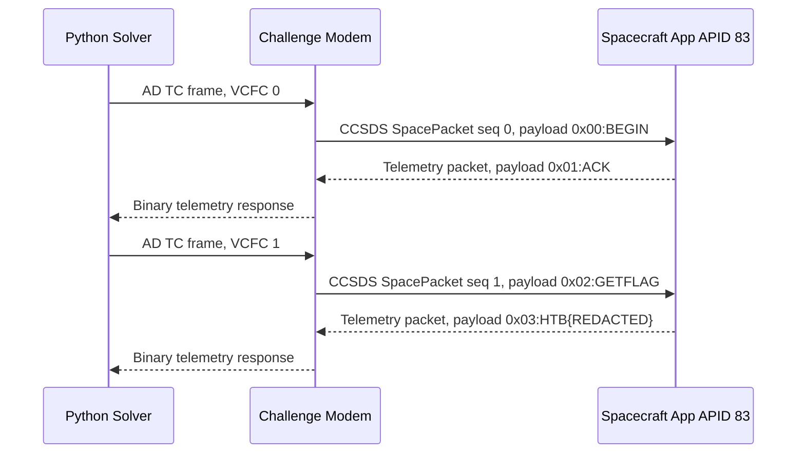
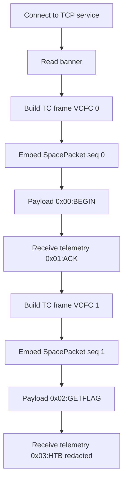

# 🛰️ Echoes in Orbit

> **Challenge type:** Space packet crafting, CCSDS, telecommand frames, CRC, stateful command counters  
> **Target used during solve:** `154.57.164.79:30749`  
> **Final result:** Solved, flag retrieved but intentionally redacted for write-up quality

---

## 1. Challenge Summary

The challenge gives us a spacecraft communication service. The service is not a normal web API or shell. It expects **binary spacecraft communication frames**.

The scenario says:

```text
A secondary onboard service has been discovered on spacecraft ID 12,
running on APID 83 over virtual channel 4.

The service accepts CCSDS space packets with payload format:
0x00:BEGIN

where 0x00 is a packet counter starting at zero.
The spacecraft replies with the incremented counter and an ACK.

After synchronization, the command GETFLAG can be issued using the expected counter.

Communication is done via AD-type telecommand frames with CRC,
and responses must be parsed from CCSDS telemetry frames.
```

So the task is not simply sending `GETFLAG` over TCP. We must build a valid binary packet stack:

```text
TCP socket
└── AD-type Telecommand Frame
    ├── TC frame header
    ├── CCSDS Space Packet
    │   ├── CCSDS primary header
    │   └── Application payload
    └── CRC/FECF
```

---

## 2. Given Information

| Field | Value | Meaning |
|---|---:|---|
| Spacecraft ID | `12` | The spacecraft identifier, also called `SCID` |
| Virtual Channel | `4` | The telecommand virtual channel, also called `VCID` |
| APID | `83` | Application Process ID, used inside the CCSDS space packet |
| First app payload | `0x00:BEGIN` | Synchronization command |
| Response after BEGIN | `0x01:ACK` | Spacecraft ACK with incremented application counter |
| Final command | `GETFLAG` | Command to retrieve the flag |
| Transport | TCP | The challenge socket receives raw frame bytes |
| Frame type | AD telecommand frame | Needs correct VCFC and CRC |

---

## 3. Why the Starter Client Was Not Enough

The supplied file was only a skeleton. It had placeholder functions and demo values:

```python
space_packet = generate_space_packet(apid=42, packet_count=0, payload=b"TEST_PAYLOAD")
frame = generate_tc_frame(spacecraft_id=12, virtual_channel_id=3, tc_packet_count=0, payload=space_packet)
```

Problems:

| Problem | Why it matters |
|---|---|
| `generate_space_packet()` was unfinished | The CCSDS packet was never actually built |
| `generate_tc_frame()` was unfinished | The TC frame and CRC were missing |
| APID was `42` | Challenge requires APID `83` |
| VCID was `3` | Challenge requires VCID `4` |
| Payload was `TEST_PAYLOAD` | Challenge requires `0x00:BEGIN` first |
| It sent `frame + space_packet` | The space packet should already be inside the frame |

> [!NOTE]
> In protocol challenges, a starter file often shows function names and structure, not the final correct values. Treat sample constants as suspicious until confirmed by the challenge text or server output.

---

## 4. Knowledge Gap 1, What Is CCSDS?

**CCSDS** stands for **Consultative Committee for Space Data Systems**. In simple terms, it defines packet formats used in space communication.

For this challenge, the important idea is:

```text
Ground station sends a telecommand frame
Spacecraft replies with a telemetry frame
```

Two words matter here:

| Term | Simple meaning |
|---|---|
| Telecommand | Command sent from ground to spacecraft |
| Telemetry | Data sent from spacecraft back to ground |

This challenge asks us to send **telecommand frames**, then parse **telemetry responses**.

---

## 5. Knowledge Gap 2, What Is an APID?

`APID` means **Application Process Identifier**.

Think of it like a service number inside the spacecraft packet layer.

```text
APID 83 = send this packet to onboard service 83
```

This is similar to a port number in normal networking, but it exists inside the CCSDS packet header, not inside TCP or UDP.

---

## 6. Knowledge Gap 3, What Is VCID and VCFC?

### VCID

`VCID` means **Virtual Channel ID**.

The challenge says the service runs over:

```text
Virtual Channel 4
```

So our TC frame must contain:

```text
VCID = 4
```

### VCFC

`VCFC` means **Virtual Channel Frame Count**.

It is a frame-level counter.

For this challenge:

```text
First TC frame  -> VCFC = 0
Second TC frame -> VCFC = 1
```

If this value is wrong, the server tells us directly:

```text
Expected TC frame with VCFC 1 but got 0.
Expected TC frame with VCFC 1 but got 2.
```

That error was useful because it proved the second TC frame must use:

```text
VCFC = 1
```

---

## 7. Knowledge Gap 4, What Is a Space Packet Sequence Count?

Inside the CCSDS space packet there is another counter called the **sequence count**.

This is separate from VCFC.

For this challenge:

```text
First CCSDS space packet  -> sequence count = 0
Second CCSDS space packet -> sequence count = 1
```

When this value was wrong, the server told us:

```text
Expected SpacePacket with sequence count 1 but got 0.
Expected SpacePacket with sequence count 1 but got 2.
```

That proved the second space packet must use:

```text
SpacePacket sequence count = 1
```

---

## 8. The Main Trap, Three Different Counters

This was the real challenge.

There are **three counters**, and they are not the same thing.

| Counter | Layer | First packet | Second packet | Purpose |
|---|---|---:|---:|---|
| Application counter | Payload text | `0x00` | `0x02` | Tracks app-level command state |
| SpacePacket sequence count | CCSDS packet header | `0` | `1` | Tracks CCSDS packet ordering |
| VCFC | TC frame header | `0` | `1` | Tracks telecommand frame ordering |

The misleading part was the ACK:

```text
We send:       0x00:BEGIN
Spacecraft:    0x01:ACK
Then we send:  0x02:GETFLAG
```

At first, it looks like `0x01:GETFLAG` should be correct because the ACK contains `0x01`.

But in this service, the ACK itself advances the application state. After the spacecraft replies with `0x01:ACK`, the next expected application counter becomes:

```text
0x02
```

That is why the final working command is:

```text
0x02:GETFLAG
```

not:

```text
0x01:GETFLAG
```

---

## 9. Overall Exploitation Flow



---

## 10. Valid BEGIN Frame Breakdown

The known-good BEGIN frame was:

```text
000c1016001053c0000009307830303a424547494ea471
```

Break it into parts:

```text
00 0c | 10 16 | 00 | 10 53 c0 00 00 09 30 78 30 30 3a 42 45 47 49 4e | a4 71
```

| Bytes | Meaning |
|---|---|
| `00 0c` | Spacecraft ID, `SCID = 12` |
| `10 16` | VCID and frame length field |
| `00` | VCFC, first telecommand frame count |
| `10 53` | CCSDS first header word, packet type TC and APID 83 |
| `c0 00` | Sequence flags `3`, sequence count `0` |
| `00 09` | Payload length minus 1 |
| `30 78 30 30 3a 42 45 47 49 4e` | ASCII `0x00:BEGIN` |
| `a4 71` | CRC-16/CCITT-FALSE |

Payload decoding:

```text
30 78 30 30 3a 42 45 47 49 4e
   ↓
0x00:BEGIN
```

---

## 11. Valid Final GETFLAG Frame Breakdown

The final successful command frame used:

```text
000c1018011053c001000b307830323a474554464c4147ac22
```

Breakdown:

```text
00 0c | 10 18 | 01 | 10 53 c0 01 00 0b 30 78 30 32 3a 47 45 54 46 4c 41 47 | ac 22
```

| Bytes | Meaning |
|---|---|
| `00 0c` | Spacecraft ID, `SCID = 12` |
| `10 18` | VCID and frame length field |
| `01` | VCFC, second telecommand frame count |
| `10 53` | CCSDS first header word, packet type TC and APID 83 |
| `c0 01` | Sequence flags `3`, sequence count `1` |
| `00 0b` | Payload length minus 1 |
| `30 78 30 32 3a 47 45 54 46 4c 41 47` | ASCII `0x02:GETFLAG` |
| `ac 22` | CRC-16/CCITT-FALSE |

Payload decoding:

```text
30 78 30 32 3a 47 45 54 46 4c 41 47
   ↓
0x02:GETFLAG
```

---

## 12. Why Earlier Attempts Failed

### Failed assumption 1, raw binary counter

We first assumed the payload meant a raw byte:

```python
b"\x00:BEGIN"
```

But the service expected the ASCII string:

```python
b"0x00:BEGIN"
```

### Failed assumption 2, wrong second application counter

We then assumed:

```python
b"0x01:GETFLAG"
```

The server accepted the frame and CCSDS packet, but rejected the application state:

```text
APPLICATION: invalid payload or sequence state.
```

That meant the transport layer was correct, but the payload state was wrong.

### Failed assumption 3, brute-forcing the wrong layer

The server already told us the required transport counters:

```text
Expected TC frame with VCFC 1 but got 0.
Expected TC frame with VCFC 1 but got 2.
Expected SpacePacket with sequence count 1 but got 0.
Expected SpacePacket with sequence count 1 but got 2.
```

So there was no need to keep brute-forcing `VCFC` and `SpacePacket sequence count`.

The only remaining unknown was the application payload counter.

---

## 13. Final Correct Values

```text
SCID  = 12
VCID  = 4
APID  = 83
CRC   = CRC-16/CCITT-FALSE
```

### First command

```text
TC VCFC             = 0
SpacePacket seq     = 0
Application payload  = 0x00:BEGIN
```

### Response

```text
Application payload  = 0x01:ACK
```

### Second command

```text
TC VCFC             = 1
SpacePacket seq     = 1
Application payload  = 0x02:GETFLAG
```

### Final response

```text
Application payload  = 0x03:HTB{REDACTED}
```

> [!IMPORTANT]
> The final flag is intentionally redacted in this write-up. For public CTF notes, explain the method, not the exact flag value.

---

## 14. Final Solver

Save as:

```text
solve_echoes_in_orbit_final.py
```

```python
#!/usr/bin/env python3
from pwn import remote, context, log
import argparse
import re
import socket
import struct
import time

context.log_level = "info"

SCID = 12
VCID = 4
APID = 83


def crc16_ccitt_false(data: bytes, init: int = 0xFFFF) -> int:
    """CRC-16/CCITT-FALSE, polynomial 0x1021, init 0xFFFF."""
    crc = init
    for b in data:
        crc ^= b << 8
        for _ in range(8):
            if crc & 0x8000:
                crc = ((crc << 1) ^ 0x1021) & 0xFFFF
            else:
                crc = (crc << 1) & 0xFFFF
    return crc & 0xFFFF


def build_space_packet(payload: bytes, seq_count: int, apid: int = APID) -> bytes:
    """
    Build a CCSDS primary-header-only space packet.

    Header fields:
    - version = 0
    - packet type = 1, telecommand
    - secondary header flag = 0
    - APID = 83
    - sequence flags = 3, unsegmented
    - sequence count = seq_count
    - packet data length = len(payload) - 1
    """
    first_word = (0 << 13) | (1 << 12) | (0 << 11) | (apid & 0x07FF)
    second_word = (3 << 14) | (seq_count & 0x3FFF)
    length_word = len(payload) - 1

    return struct.pack(">HHH", first_word, second_word, length_word) + payload


def build_tc_ad_frame(space_packet: bytes, vcfc: int, scid: int = SCID, vcid: int = VCID) -> bytes:
    """
    Build the minimal AD-type TC frame accepted by the challenge.

    Frame layout:
    - 2 bytes: spacecraft ID field
    - 2 bytes: virtual channel ID plus frame length
    - 1 byte : VCFC
    - N bytes: CCSDS space packet
    - 2 bytes: CRC/FECF
    """
    total_len = 5 + len(space_packet) + 2

    word0 = scid & 0x03FF
    word1 = ((vcid & 0x3F) << 10) | ((total_len - 1) & 0x03FF)

    body = struct.pack(">HHB", word0, word1, vcfc & 0xFF) + space_packet
    crc = crc16_ccitt_false(body)

    return body + struct.pack(">H", crc)


def make_frame(app_payload: bytes, sp_seq: int, vcfc: int) -> bytes:
    space_packet = build_space_packet(app_payload, sp_seq)
    return build_tc_ad_frame(space_packet, vcfc)


def printable(data: bytes) -> str:
    return "".join(chr(b) if 32 <= b <= 126 else "." for b in data)


def recv_collect(r, want=None, total_timeout=5.0, idle_timeout=0.5) -> bytes:
    """Collect socket data until a target appears, EOF happens, or the socket becomes idle."""
    end = time.time() + total_timeout
    buf = b""
    last_data = time.time()

    while time.time() < end:
        try:
            chunk = r.recv(timeout=0.2)
        except EOFError:
            break
        except (socket.timeout, TimeoutError):
            chunk = b""

        if chunk:
            buf += chunk
            last_data = time.time()
            if want and want(buf):
                break
        elif buf and time.time() - last_data >= idle_timeout:
            break

    return buf


def extract_ack_counter(resp: bytes):
    m = re.search(rb"0x([0-9a-fA-F]{1,2}):ACK", resp)
    if not m:
        return None
    return int(m.group(1), 16)


def extract_flag(resp: bytes):
    m = re.search(rb"HTB\{[^}\r\n]*\}", resp)
    if not m:
        return None
    return m.group(0).decode(errors="replace")


def solve(host: str, port: int):
    r = remote(host, port)

    prompt = recv_collect(
        r,
        want=lambda b: b"Awaiting telecommand frame" in b,
        total_timeout=5.0,
    )
    log.info(f"Prompt: {printable(prompt)}")

    # Stage 1, synchronize with the application.
    begin_payload = b"0x00:BEGIN"
    begin_frame = make_frame(begin_payload, sp_seq=0, vcfc=0)
    log.info(f"BEGIN TX: {begin_frame.hex()}")
    r.send(begin_frame)

    ack_rx = recv_collect(
        r,
        want=lambda b: b":ACK" in b or b"invalid" in b.lower(),
        total_timeout=5.0,
    )
    log.info(f"BEGIN RX txt: {printable(ack_rx)}")
    log.info(f"BEGIN RX hex: {ack_rx.hex()}")

    ack_counter = extract_ack_counter(ack_rx)
    if ack_counter is None:
        r.close()
        raise RuntimeError("No ACK counter found in telemetry response")

    # Important challenge-specific insight:
    # We sent 0x00:BEGIN, spacecraft replied 0x01:ACK,
    # so the next application command must use 0x02.
    next_app_counter = ack_counter + 1

    # Stage 2, retrieve the flag.
    get_payload = f"0x{next_app_counter:02x}:GETFLAG".encode()
    get_frame = make_frame(get_payload, sp_seq=1, vcfc=1)
    log.info(f"GETFLAG payload: {get_payload!r}")
    log.info(f"GETFLAG TX: {get_frame.hex()}")
    r.send(get_frame)

    flag_rx = recv_collect(
        r,
        want=lambda b: b"HTB{" in b or b"invalid" in b.lower(),
        total_timeout=6.0,
        idle_timeout=0.7,
    )
    r.close()

    log.info(f"GETFLAG RX txt: {printable(flag_rx)}")
    log.info(f"GETFLAG RX hex: {flag_rx.hex()}")

    flag = extract_flag(flag_rx)
    if not flag:
        raise RuntimeError("No flag found in telemetry response")

    log.success(f"FLAG: {flag}")


def main():
    parser = argparse.ArgumentParser(description="Echoes in Orbit final solver")
    parser.add_argument("host")
    parser.add_argument("port", type=int)
    args = parser.parse_args()

    solve(args.host, args.port)


if __name__ == "__main__":
    main()
```

---

## 15. How to Run

Install pwntools if needed:

```bash
python3 -m pip install --user pwntools
```

Run:

```bash
python3 solve_echoes_in_orbit_final.py 154.57.164.79 30749
```

Expected style of output:

```text
[+] Opening connection to 154.57.164.79 on port 30749: Done
[*] Prompt: SPACECRAFT LINK ESTABLISHED.SCID=12 VCID=4 APID=83.Awaiting telecommand frame....
[*] BEGIN TX: 000c1016001053c0000009307830303a424547494ea471
[*] BEGIN RX txt: .......S....0x01:ACK..
[*] GETFLAG payload: b'0x02:GETFLAG'
[*] GETFLAG RX txt: .......S....0x03:HTB{REDACTED}..
[+] FLAG: HTB{REDACTED}
```

---

## 16. Debugging Methodology

### Step 1, verify the banner

The server confirmed the required identifiers:

```text
SCID=12 VCID=4 APID=83
```

That removes guesswork.

### Step 2, build the outer TC frame

If the CRC or outer frame is wrong, the modem complains before the application sees anything:

```text
MODEM: No valid TC frame found, CRC check failed.
```

That means:

```text
Problem is in TC frame or CRC
```

### Step 3, build the inner SpacePacket

If APID or packet type is wrong:

```text
Received packet with wrong APID or not a TC packet
```

That means:

```text
Problem is in CCSDS packet header
```

### Step 4, check application payload

If the error is:

```text
APPLICATION: invalid payload or sequence state.
```

That means:

```text
TC frame worked
CRC worked
SCID worked
VCID worked
APID worked
SpacePacket structure worked
Only app state or app payload is wrong
```

This error was the key clue.

---

## 17. Clean Mental Model

Use this model to avoid confusion:

```text
Frame counter  !=  SpacePacket counter  !=  Application counter
```

Expanded:

```text
VCFC
  belongs to TC frame
  values: 0, 1

SpacePacket sequence count
  belongs to CCSDS packet header
  values: 0, 1

Application counter
  belongs to payload string
  values: 0x00, 0x01, 0x02, 0x03
```

Visual:



---

## 18. Knowledge Gaps to Review

### 18.1 Binary protocols

Most web challenges use text protocols like HTTP. This challenge uses binary frames. That means you must care about:

- exact byte order
- bit fields
- packet length fields
- CRC values
- counters
- raw socket reads

### 18.2 Big-endian packing

The solver uses:

```python
struct.pack(">HHH", first_word, second_word, length_word)
```

`>` means **big-endian**.

Big-endian means the most significant byte comes first.

Example:

```text
0x1053 -> 10 53
```

not:

```text
0x1053 -> 53 10
```

### 18.3 Packet length minus one

CCSDS packet data length is usually:

```text
payload length - 1
```

For `0x00:BEGIN`:

```text
payload length = 10 bytes
length field   = 9
hex            = 0009
```

For `0x02:GETFLAG`:

```text
payload length = 12 bytes
length field   = 11
hex            = 000b
```

### 18.4 CRC-16/CCITT-FALSE

CRC is a checksum. It protects the frame from accidental corruption.

For this challenge, the CRC settings were:

```text
Algorithm  = CRC-16/CCITT-FALSE
Polynomial = 0x1021
Initial    = 0xffff
Output     = 2 bytes, big-endian
```

If the CRC is wrong, the server rejects the frame before the application receives it.

### 18.5 Telemetry parsing

The response is not clean text. It is binary telemetry with readable text embedded inside.

Example:

```text
00 c8 00 00 18 00 00 53 c0 00 00 07 30 78 30 31 3a 41 43 4b 55 f3
```

Printable version:

```text
.......S....0x01:ACKU.
```

So instead of doing only:

```python
response.decode()
```

use regex over raw bytes:

```python
re.search(rb"0x([0-9a-fA-F]{1,2}):ACK", response)
re.search(rb"HTB\{[^}\r\n]*\}", response)
```

---

## 19. Common Mistakes

| Mistake | Result |
|---|---|
| Sending plain `GETFLAG` | Server never reaches correct app state |
| Sending raw `\x00:BEGIN` | Application rejects payload |
| Using APID `42` from starter | Wrong APID error |
| Using VCID `3` from starter | Wrong channel/frame rejection |
| Forgetting CRC | Modem rejects frame |
| Using `0x01:GETFLAG` | Application state error |
| Keeping VCFC at `0` for second frame | `Expected TC frame with VCFC 1 but got 0` |
| Keeping SpacePacket seq at `0` for second packet | `Expected SpacePacket with sequence count 1 but got 0` |
| Decoding telemetry as pure ASCII | Binary bytes hide useful payload |

---

## 20. Final Takeaway

The challenge is solved by understanding the protocol layers and separating their state counters.

Final clean logic:

```text
1. Connect to the modem.
2. Send AD TC frame with:
   VCFC = 0
   SpacePacket seq = 0
   Payload = 0x00:BEGIN

3. Receive telemetry:
   Payload = 0x01:ACK

4. Send AD TC frame with:
   VCFC = 1
   SpacePacket seq = 1
   Payload = 0x02:GETFLAG

5. Parse telemetry response and extract HTB{...}.
```

The hard part was not writing Python. The hard part was recognizing that **the ACK response consumes the next application counter**, so `GETFLAG` needs `0x02`, not `0x01`.

---

## 21. Quick Revision Card

```text
Challenge: Echoes in Orbit
Protocol: CCSDS inside AD-type TC frame
SCID: 12
VCID: 4
APID: 83
CRC: CRC-16/CCITT-FALSE

BEGIN:
  VCFC 0
  SP seq 0
  payload 0x00:BEGIN

ACK:
  payload 0x01:ACK

GETFLAG:
  VCFC 1
  SP seq 1
  payload 0x02:GETFLAG

Trap:
  Do not confuse application counter, SpacePacket sequence count, and VCFC.
```
