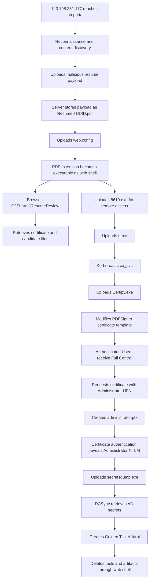

# 🧾 JobApplicant — HTB Sherlock Write-up

> **Category:** Digital Forensics / Incident Response  
> **Platform:** Hack The Box Sherlocks  
> **Scenario:** Compromised job-application portal → web shell → Kerberoasting → AD CS abuse → DCSync → Golden Ticket  
> **Evidence archive:** `JobApplicant.zip`  
> **Archive password:** `hacktheblue`  
> **Time standard used throughout:** **UTC**

---

## Table of Contents

1. [Scenario Summary](#scenario-summary)
2. [Final Answers](#final-answers)
3. [Attack Chain](#attack-chain)
4. [Evidence Handling and Preparation](#evidence-handling-and-preparation)
5. [Recommended Tooling](#recommended-tooling)
6. [Evidence Inventory](#evidence-inventory)
7. [Investigation Methodology](#investigation-methodology)
8. [Task-by-Task Analysis](#task-by-task-analysis)
9. [Consolidated Intrusion Timeline](#consolidated-intrusion-timeline)
10. [MITRE ATT&CK Mapping](#mitre-attck-mapping)
11. [Indicators of Compromise](#indicators-of-compromise)
12. [Detection and Hardening Recommendations](#detection-and-hardening-recommendations)
13. [Important Answer-Formatting Notes](#important-answer-formatting-notes)

---

# Scenario Summary

Wowza Grand College deployed an IIS-based job application portal that accepted resume uploads. An external threat actor discovered the site, abused its upload functionality, and converted a file stored with a `.pdf` extension into an executable web shell by uploading a malicious `web.config` file.

The web shell was then used to:

- Browse the server filesystem.
- Read files from the resume-review share.
- Upload additional attack tooling.
- Target a service account through Kerberoasting activity.
- Abuse an Active Directory Certificate Services certificate template.
- Request a certificate for the domain `Administrator` identity.
- Authenticate with that certificate and recover the Administrator NTLM hash.
- Perform DCSync against the domain controller.
- Generate a Golden Ticket.
- Delete the tools and output files through the web shell.

The most important investigative lesson is that no single artifact contains the entire story. The solution requires correlating:

- **IIS W3C logs** for remote web activity.
- **NTFS `$MFT`** for file paths, creation times, and resident file content.
- **NTFS USN Journal `$Extend\$J`** for precise file lifecycle events.
- **Windows Security events** for Kerberos, certificate enrollment, AD CS configuration, and DCSync activity.
- **Windows shortcut files** for confirmation of accessed share paths.

---

# Final Answers

| Task | Correct answer |
|---:|---|
| **1** | `2025-07-27 19:27:35` |
| **2** | `143.198.231.177` |
| **3** | `Resume9_eba15ba0-81ca-4d0f-9fad-3fc1fc92c181.pdf` |
| **4** | `web.config` |
| **5** | `C:\inetpub\wwwroot\resumes\8619.exe` |
| **6** | `C:\Shares\ResumeReview\Certificate_for_sign.cer` |
| **7** | `warlocksmurf` |
| **8** | `r.exe` |
| **9** | `WOWZA.EDU\ca_svc` |
| **10** | `2025-07-27 19:52:03` |
| **11** | `2025-07-27 19:56:38` |
| **12** | `PDFSigner` — version `100.4` |
| **13** | `NT AUTHORITY\Authenticated Users` |
| **14** | `2025-07-27 19:57:55` |
| **15** | `1D00000008A6E7524F029E603A000000000008` |
| **16** | `T1003.006` |
| **17** | `2025-07-27 20:05:14` |
| **18** | `shinyboi_wowza_edu_2025_07_27_20_06_33_Administratorr_to_krbtgt@WOWZA.EDU.kirbi` |
| **19** | `2025-07-27 20:11:13` |

> [!IMPORTANT]
> Task 9 expects the FQDN-style domain prefix and a **backslash**: `WOWZA.EDU\ca_svc`.  
> Task 10 expects the time at which the file write was completed and closed, not the earlier allocation time.

---

# Attack Chain



---

# Evidence Handling and Preparation

## 1. Preserve and hash the archive

Create a working directory and calculate a hash before analysis:

```bash
mkdir -p ~/Cases/JobApplicant/{original,evidence,output,notes}
cp ~/Downloads/JobApplicant.zip ~/Cases/JobApplicant/original/
cd ~/Cases/JobApplicant
sha256sum original/JobApplicant.zip | tee notes/archive-sha256.txt
```

Hash observed during this investigation:

```text
92ead0d5aa49e65b3beabb554b7f4c88894fcb50f7475b4bd81bd8b93a162546
```

## 2. Extract the password-protected archive

Using `unzip`:

```bash
unzip -P hacktheblue original/JobApplicant.zip -d evidence/
```

Using 7-Zip:

```bash
7z x -phacktheblue original/JobApplicant.zip -oevidence/
```

## 3. Record the artifact layout

```bash
find evidence -type f | sort | tee notes/evidence-file-list.txt
find evidence -type f | wc -l
```

The archive contains a Windows triage collection rooted under `C/`, including approximately:

- 480 collected files.
- 162 Windows Event Log files.
- IIS logs.
- `$MFT`.
- `$Extend/$J`.
- Registry hives.
- Recent shortcut files.

## 4. Work from copies

Do not alter the original extraction. Copy artifacts needed by parsing tools into a dedicated output directory:

```bash
mkdir -p output/{iis,evtx,mft,usn,lnk,timeline}
```

---

# Recommended Tooling

## Cross-platform and Linux tools

| Tool | Purpose |
|---|---|
| `7z` / `unzip` | Extract the evidence archive |
| `ripgrep` (`rg`) | Rapidly search IIS logs and exported event data |
| `python-evtx` / `evtx_dump` | Export `.evtx` records to XML on Linux |
| `jq` | Query JSON exports |
| `strings` | Triage binary artifacts for keywords |
| Python | URL decoding and custom timeline processing |
| Autopsy | GUI analysis of NTFS metadata and resident file data |

Example Fedora setup:

```bash
sudo dnf install -y p7zip p7zip-plugins ripgrep jq python3-pip
python3 -m venv ~/venvs/jobapplicant
source ~/venvs/jobapplicant/bin/activate
pip install python-evtx
```

## Eric Zimmerman tools

A Windows analysis VM is convenient for the following:

| Tool | Artifact |
|---|---|
| `EvtxECmd.exe` | Windows `.evtx` logs |
| `MFTECmd.exe` | `$MFT` and `$J` |
| `LECmd.exe` | Windows `.lnk` files |
| Timeline Explorer | Filter and correlate CSV timelines |

Example commands from PowerShell:

```powershell
mkdir .\output\evtx, .\output\mft, .\output\usn, .\output\lnk

EvtxECmd.exe -d ".\evidence\C\Windows\System32\winevt\logs" `
  --csv ".\output\evtx" --csvf "evtx.csv"

MFTECmd.exe -f ".\evidence\C\$MFT" `
  --csv ".\output\mft" --csvf "mft.csv"

MFTECmd.exe -f ".\evidence\C\$Extend\$J" `
  --csv ".\output\usn" --csvf "usn.csv"

LECmd.exe -d ".\evidence\C\Users\Administrator\AppData\Roaming\Microsoft\Windows\Recent" `
  --csv ".\output\lnk"
```

> [!NOTE]
> In PowerShell, `$MFT` and `$J` must be placed inside single-quoted strings or the dollar signs escaped; otherwise PowerShell may treat them as variables.

Safer PowerShell forms:

```powershell
MFTECmd.exe -f '.\evidence\C\$MFT' --csv '.\output\mft' --csvf 'mft.csv'
MFTECmd.exe -f '.\evidence\C\$Extend\$J' --csv '.\output\usn' --csvf 'usn.csv'
```

---

# Evidence Inventory

| Artifact | Location | Investigative value |
|---|---|---|
| IIS W3C log | `C\inetpub\logs\LogFiles\W3SVC1\u_ex250727.log` | Initial access, source IP, uploads, web-shell activity, downloads, deletion commands |
| NTFS MFT | `C\$MFT` | File paths, names, timestamps, resident data |
| USN Journal | `C\$Extend\$J` | File-create, write, close, rename, and deletion times |
| Security log | `C\Windows\System32\winevt\logs\Security.evtx` | Kerberoasting, AD CS events, certificate authentication, DCSync |
| Other event logs | `C\Windows\System32\winevt\logs\*.evtx` | Supporting host and service activity |
| Recent LNKs | `C\Users\Administrator\AppData\Roaming\Microsoft\Windows\Recent\` | Confirms share file paths and UNC locations |
| Registry hives | `C\Windows\System32\config\*` | System/domain context and supporting configuration |

---

# Investigation Methodology

The fastest reliable workflow is:

1. Establish the external attack window using IIS logs.
2. Identify suspicious HTTP requests and URL-decode their parameters.
3. Correlate POST times with `$MFT` and USN Journal file creation.
4. Recover small resident text files from the MFT.
5. Export and search Security events around the tool-staging timestamps.
6. Correlate certificate-template, certificate-issuance, authentication, and directory-replication events.
7. Verify cleanup using both IIS deletion requests and USN `FILE_DELETE` records.

## Build a narrow time window

The first malicious request is at `19:27:35`, and cleanup starts at `20:11:13`. Therefore, focus initially on:

```text
2025-07-27 19:27:00 UTC — 2025-07-27 20:12:00 UTC
```

This reduces noise significantly.

## Export Security events on Linux

```bash
EVTX='evidence/C/Windows/System32/winevt/logs/Security.evtx'
evtx_dump "$EVTX" > output/evtx/Security.xml
```

Search high-value terms:

```bash
rg -n -i \
  'ca_svc|PDFSigner|Administrator|CertificateTemplate|Authenticated Users|krbtgt|1131f6aa|1131f6ad' \
  output/evtx/Security.xml
```

Useful event categories include:

- Kerberos service-ticket requests.
- Certificate template changes.
- Certificate requests and issuance.
- Certificate-based Kerberos authentication.
- Directory Service object access with replication-control GUIDs.

## Search the IIS log

```bash
IIS='evidence/C/inetpub/logs/LogFiles/W3SVC1/u_ex250727.log'
rg -n '143\.198\.231\.177' "$IIS" > output/iis/attacker-requests.txt
```

Search specifically for the web shell’s command parameters:

```bash
rg -n 'Resume9_|fdir=|get=|del=' "$IIS"
```

## URL-decode suspicious parameters

```bash
python3 - <<'PY'
from urllib.parse import unquote_plus
value = 'C%3a%2fShares%2fResumeReview%2f%2fCertificate_for_sign.cer'
print(unquote_plus(value))
PY
```

Output:

```text
C:/Shares/ResumeReview//Certificate_for_sign.cer
```

Normalize it to the Windows path expected by HTB:

```text
C:\Shares\ResumeReview\Certificate_for_sign.cer
```

---

# Task-by-Task Analysis

## Task 1 — First interaction with the College infrastructure

**Question:** When did the threat actor first interact with the College's IT Infrastructure?

### Evidence source

```text
C\inetpub\logs\LogFiles\W3SVC1\u_ex250727.log
```

### Method

Inspect the beginning of the IIS log and identify the first request associated with the later confirmed malicious IP:

```bash
IIS='evidence/C/inetpub/logs/LogFiles/W3SVC1/u_ex250727.log'
head -40 "$IIS"
rg -n '143\.198\.231\.177' "$IIS" | head
```

The first relevant request is a `GET` request for `/index.aspx` at:

```text
2025-07-27 19:27:35
```

The same source later conducts automated discovery, uploads files, operates the web shell, and performs cleanup. This establishes it as the start of the intrusion rather than a benign isolated request.

### Answer

```text
2025-07-27 19:27:35
```

---

## Task 2 — Malicious reconnaissance IP address

**Question:** What is the malicious IP address used for initial reconnaissance and discovery?

### Method

Group IIS requests by `c-ip`, then inspect sources generating large numbers of requests or suspicious user agents:

```bash
awk '!/^#/ {print $9}' "$IIS" | sort | uniq -c | sort -nr
```

Depending on the exact IIS field order, first read the `#Fields:` header before selecting an `awk` column:

```bash
rg '^#Fields:' "$IIS"
```

The source responsible for the initial request, automated discovery, malicious uploads, web-shell access, and deletion activity is:

```text
143.198.231.177
```

### Answer

```text
143.198.231.177
```

---

## Task 3 — Server-side filename of the first uploaded resume

**Question:** Under what name did the server store the uploaded resume file?

### Evidence correlation

At `19:28:29`, the IIS log records a successful POST to the upload endpoint:

```text
2025-07-27 19:28:29 ... POST /default.aspx ... 143.198.231.177 ... 200
```

The MFT and USN Journal show a file created at the same time under the resume directory:

```text
C:\inetpub\wwwroot\resumes\Resume9_eba15ba0-81ca-4d0f-9fad-3fc1fc92c181.pdf
```

Subsequent requests from the attacker invoke this exact path as the web shell, which independently confirms the mapping between the upload and the stored filename.

### Filtering the MFT/USN exports

```powershell
Import-Csv .\output\mft\mft.csv |
  Where-Object { $_.FileName -like 'Resume9_*' } |
  Format-Table -AutoSize

Import-Csv .\output\usn\usn.csv |
  Where-Object { $_.FileName -like 'Resume9_*' } |
  Sort-Object UpdateTimestamp |
  Format-Table -AutoSize
```

Linux CSV search:

```bash
rg -n 'Resume9_eba15ba0' output/mft output/usn
```

### Answer

```text
Resume9_eba15ba0-81ca-4d0f-9fad-3fc1fc92c181.pdf
```

---

## Task 4 — File that changed website behavior

**Question:** What was the name of the second uploaded file that allowed the first file to function as a web shell?

### Evidence correlation

At `19:32:28`, IIS records another POST to `/default.aspx`:

```text
2025-07-27 19:32:28 ... POST /default.aspx ... 143.198.231.177 ... 200
```

At the same timestamp, NTFS metadata records truncation and new data being written to:

```text
C:\inetpub\wwwroot\web.config
```

USN reasons include:

```text
DATA_TRUNCATION
DATA_EXTEND | DATA_TRUNCATION
DATA_EXTEND | DATA_TRUNCATION | CLOSE
```

Immediately afterward, at `19:33`, HTTP requests to the stored `.pdf` include parameters such as `fdir`, `get`, and later `del`, and the server returns HTTP 200 responses. This behavior demonstrates that the configuration change caused the nominal PDF file to be processed as executable server-side content.

### Answer

```text
web.config
```

---

## Task 5 — Initial remote-access file path

**Question:** Using the web shell, the threat actor uploaded a file on the endpoint to facilitate initial remote access. Identify its full path.

### Evidence correlation

The IIS log records a POST to the web shell at `19:35:58`:

```text
2025-07-27 19:35:58 ... POST /resumes/Resume9_...pdf ... 200
```

At precisely the same time, the USN Journal records the creation and completion of:

```text
C:\inetpub\wwwroot\resumes\8619.exe
```

Relevant USN sequence:

```text
2025-07-27 19:35:58.859972  FILE_CREATE
2025-07-27 19:35:58.859972  DATA_EXTEND | FILE_CREATE | CLOSE
```

The later cleanup request explicitly deletes the same full path, giving a third point of confirmation.

### Answer

```text
C:\inetpub\wwwroot\resumes\8619.exe
```

---

## Task 6 — First file retrieved from the resume-review share

**Question:** What is the full path of the first file retrieved from the shared folder?

### Method

Filter the IIS log for `get=` parameters and sort chronologically:

```bash
rg -n ' get=' "$IIS"
```

The first retrieval request is:

```text
2025-07-27 19:34:23
GET /resumes/Resume9_...pdf
get=C%3a%2fShares%2fResumeReview%2f%2fCertificate_for_sign.cer
```

After URL decoding and Windows path normalization:

```text
C:\Shares\ResumeReview\Certificate_for_sign.cer
```

### Answer

```text
C:\Shares\ResumeReview\Certificate_for_sign.cer
```

---

## Task 7 — First ideal candidate

**Question:** Who was the first ideal candidate the company was seeking?

### Evidence source

```text
C:\Shares\ResumeReview\ideal candidates.txt
```

The original file was not present as a normal extracted file, but its content was stored resident within its NTFS MFT record. Small files may be stored directly in the MFT’s `$DATA` attribute rather than in external filesystem clusters.

### Recovery options

- Open `$MFT` in Autopsy and inspect the file’s resident data.
- Parse `$MFT` with a tool that exports resident `$DATA`.
- Locate the relevant MFT record and extract the resident attribute.

Recovered content:

```text
Looking for someone like them
- warlocksmurf
- tmechen
- lukasLUZSC
```

The first listed candidate is `warlocksmurf`.

### Answer

```text
warlocksmurf
```

---

## Task 8 — Kerberoasting-related file

**Question:** What is the name of the file dropped to perform a potential Kerberoasting attack?

### Evidence correlation

The USN Journal records the creation of the following executable shortly before the suspicious service-ticket request:

```text
r.exe
```

Timeline:

```text
2025-07-27 19:40:14.484450  FILE_CREATE
2025-07-27 19:40:14.897244  DATA_EXTEND | FILE_CREATE
2025-07-27 19:40:15.000068  DATA_EXTEND | FILE_CREATE | CLOSE
```

A suspicious Kerberos service-ticket event follows seconds later. The short filename is consistent with renamed attack tooling, but attribution to a specific product is unnecessary for the answer.

### Answer

```text
r.exe
```

---

## Task 9 — Targeted service account

**Question:** Which service account was targeted by this Active Directory attack?

### Event analysis

Search Security events for `ca_svc`, or filter Kerberos service-ticket events around `19:40`:

```bash
rg -n -i 'ca_svc|iis_svc' output/evtx/Security.xml
```

The relevant event fields contain:

```text
TargetUserName:   iis_svc@WOWZA.EDU
TargetDomainName: WOWZA.EDU
ServiceName:      ca_svc
ClientAddress:    ::1
```

This shows that `iis_svc` requested a ticket for the service account `ca_svc`, making `ca_svc` the Kerberoasting target.

### HTB answer-format issue

HTB’s masked answer has the pattern:

```text
*****.***\**_***
```

Therefore, the required format is the domain FQDN, followed by a **backslash**, followed by the account name:

```text
WOWZA.EDU\ca_svc
```

The following variants do not match the expected flag format:

```text
ca_svc
WOWZA\ca_svc
WOWZA.EDU/ca_svc
ca_svc@WOWZA.EDU
```

### Answer

```text
WOWZA.EDU\ca_svc
```

---

## Task 10 — Successful creation time of the AD CS exploitation tool

**Question:** When was the second tool successfully created on the endpoint?

### Identify the tool

The relevant tool is:

```text
Certipy.exe
```

### Interpret the USN lifecycle correctly

The USN Journal contains three important events:

```text
2025-07-27 19:51:32.860094  FILE_CREATE
2025-07-27 19:51:43.843552  DATA_EXTEND | FILE_CREATE
2025-07-27 19:52:03.015636  DATA_EXTEND | FILE_CREATE | CLOSE
```

`19:51:32` represents initial file allocation or creation. However, the question asks when the tool was **successfully created**. The last event includes `CLOSE`, which indicates the writer finished populating the file and closed the handle. HTB therefore expects the completion timestamp, truncated to seconds.

### Answer

```text
2025-07-27 19:52:03
```

> [!CAUTION]
> `2025-07-27 19:51:32` is a plausible but incorrect answer because it only marks the initial `FILE_CREATE` event.

---

## Task 11 — Successful AD CS exploitation time

**Question:** When was AD CS exploited successfully on the domain controller?

### Method

Search the Security log for the certificate-template name and inspect the earliest event that records the dangerous template state:

```bash
rg -n -i 'PDFSigner|TemplateInternalName|SecurityDescriptor|ENROLLEE_SUPPLIES_SUBJECT' \
  output/evtx/Security.xml
```

At `19:56:38.188534`, an event records the `PDFSigner` template with:

- Enrollee-supplied subject enabled.
- Client Authentication EKU.
- Exportable keys.
- A security descriptor granting broad control to Authenticated Users.

This is the point at which the vulnerable template configuration was successfully applied and observable on the domain controller.

HTB requires second-level precision:

### Answer

```text
2025-07-27 19:56:38
```

---

## Task 12 — Vulnerable certificate-template name and version

**Question:** Identify the name and version of the vulnerable certificate template.

### Evidence fields

The certificate-template event contains:

```text
TemplateInternalName: PDFSigner
TemplateVersion:      100.4
TemplateSchemaVersion: 2
revision:             100
msPKI-Template-Minor-Revision: 4
```

The displayed version is derived from revision `100` and minor revision `4`, producing `100.4`.

The same event also records:

```text
msPKI-Certificate-Name-Flag = 0x1
CT_FLAG_ENROLLEE_SUPPLIES_SUBJECT
pKIExtendedKeyUsage = Client Authentication
```

These properties are critical because they allow a requester to supply another identity in the certificate request and then use the resulting certificate for authentication.

### Answer

```text
PDFSigner 100.4
```

If the platform provides separate fields, enter:

```text
PDFSigner
100.4
```

---

## Task 13 — Group granted Full Control over the template

**Question:** What group received Full Control through the new security descriptor?

### Evidence

The same certificate-template event contains this security descriptor and decoded access-control entry:

```text
O:LAG:S-1-5-21-2525499130-77348690-3507557611-519D:PAI
(A;;CCDCLCSWRPWPDTLOCRSDRCWDWO;;;AU)

Allow(0x000f01ff)
NT AUTHORITY\Authenticated Users
Full Control
```

The SID alias `AU` represents Authenticated Users. Because the ACE grants `0x000f01ff`, the event decoder reports Full Control.

### Answer

```text
NT AUTHORITY\Authenticated Users
```

---

## Task 14 — Certificate issuance time for the privileged identity

**Question:** When was the certificate issued for a high-privilege user?

### Event correlation

The certificate request records show:

```text
Requester: WOWZA\ca_svc
CertificateTemplate: PDFSigner
SAN: upn=Administrator
```

At `19:57:55.676312`, the successful certificate issuance event records the request and its issued-certificate details. NTFS metadata then shows `administrator.pfx` created at `19:57:55.698560`, only milliseconds later.

This close correlation confirms that the event represents successful issuance and the PFX is the resulting certificate material.

### Answer

```text
2025-07-27 19:57:55
```

---

## Task 15 — Serial number of the certificate used for privilege escalation

**Question:** What was the certificate serial number used to retrieve the high-privilege user’s NTLM hash?

### Method

Search Security events after `administrator.pfx` creation for:

```text
Administrator
wowza-MAIN-DC-CA
CertificateSerialNumber
```

A certificate-based Kerberos authentication event at `19:59:15.187294` contains:

```text
TargetUserName: Administrator
TargetDomainName: WOWZA.EDU
ServiceName: krbtgt
CertificateIssuerName: wowza-MAIN-DC-CA
CertificateSerialNumber: 1D00000008A6E7524F029E603A000000000008
CertificateThumbprint: 15F5FE778E03BB9278B655827572EB2AA1AAFA9F
```

Do not confuse the certificate serial number with the SHA-1 thumbprint. The question specifically asks for the serial number.

### Answer

```text
1D00000008A6E7524F029E603A000000000008
```

---

## Task 16 — MITRE ATT&CK technique for obtaining AD secrets

**Question:** What MITRE ATT&CK ID represents the AD misconfiguration abuse used to access secrets on the domain controller?

### Analysis

The later Security events contain the extended-right GUIDs:

```text
1131f6aa-9c07-11d1-f79f-00c04fc2dcd2
1131f6ad-9c07-11d1-f79f-00c04fc2dcd2
```

These correspond to directory replication rights used by DCSync:

- `DS-Replication-Get-Changes`
- `DS-Replication-Get-Changes-All`

DCSync is mapped to:

```text
T1003.006 — OS Credential Dumping: DCSync
```

### Answer

```text
T1003.006
```

---

## Task 17 — Successful DCSync time

**Question:** When was the DCSync attack successfully carried out?

### Method

Filter Security events for object-access events containing replication-control GUIDs:

```bash
rg -n -i '1131f6aa|1131f6ad' output/evtx/Security.xml
```

The first conclusive DCSync event occurs at:

```text
2025-07-27 20:05:14.687160
```

The event subject is `Administrator`, and the requested directory rights include the two replication GUIDs. Several closely grouped records follow, showing repeated replication access during the secrets-dumping operation.

Use second-level precision for HTB.

### Answer

```text
2025-07-27 20:05:14
```

---

## Task 18 — Golden Ticket filename

**Question:** What was the filename of the Golden Ticket?

### Evidence correlation

After the DCSync operation, the USN Journal records creation of a Kerberos ticket file at `20:06:33.604956`:

```text
shinyboi_wowza_edu_2025_07_27_20_06_33_Administratorr_to_krbtgt@WOWZA.EDU.kirbi
```

The filename itself describes the operation:

- Domain: `wowza.edu`
- Timestamp: `2025_07_27_20_06_33`
- Impersonated identity: `Administratorr`
- Target service account: `krbtgt`
- Realm: `WOWZA.EDU`
- Kerberos ticket extension: `.kirbi`

### Answer

```text
shinyboi_wowza_edu_2025_07_27_20_06_33_Administratorr_to_krbtgt@WOWZA.EDU.kirbi
```

> [!IMPORTANT]
> Preserve the filename exactly. It contains `Administratorr` with **two trailing `r` characters** before `_to_krbtgt`.

---

## Task 19 — Beginning of the deletion routine

**Question:** When did deletion of the operation’s files begin?

### IIS evidence

The first deletion request is:

```text
2025-07-27 20:11:13
GET /resumes/Resume9_...pdf
fdir=C%3a%2finetpub%2fwwwroot%2fresumes%2f
&del=C%3a%2finetpub%2fwwwroot%2fresumes%2f%2f8619.exe
```

The USN Journal independently confirms deletion of `8619.exe` at:

```text
2025-07-27 20:11:13.980332  FILE_DELETE | CLOSE
```

Subsequent deletion requests remove:

```text
administrator.ccache
administrator.pfx
Certipy.exe
PDFSigner.json
r.exe
secretsdump.exe
shinyboi_wowza_edu_2025_07_27_20_06_33_Administratorr_to_krbtgt@WOWZA.EDU.kirbi
```

### Answer

```text
2025-07-27 20:11:13
```

---

# Consolidated Intrusion Timeline

| UTC timestamp | Artifact | Activity |
|---|---|---|
| `19:27:35` | IIS | First attacker interaction with `/index.aspx` |
| `19:28:18` | IIS | Initial POST to resume-upload endpoint |
| `19:28:29` | IIS + MFT + USN | Malicious resume uploaded and stored as `Resume9_...pdf` |
| `19:28:57` onward | IIS | Automated reconnaissance/content discovery |
| `19:32:28` | IIS + USN | `web.config` uploaded/overwritten |
| `19:33:17` | IIS | `.pdf` payload used as web shell; filesystem enumeration begins |
| `19:34:23` | IIS | `Certificate_for_sign.cer` retrieved from resume-review share |
| `19:34:35` | IIS | `ideal candidates.txt` retrieved |
| `19:35:58` | IIS + USN | `8619.exe` uploaded for remote access |
| `19:40:14`–`19:40:15` | USN | `r.exe` created and write completed |
| approximately `19:40` | Security | `iis_svc` requests service ticket for `ca_svc` |
| `19:51:32` | USN | Initial `Certipy.exe` file allocation |
| `19:52:03` | USN | `Certipy.exe` write completed and file closed |
| `19:55:03` | USN | `PDFSigner.json` created |
| `19:56:38` | Security | Vulnerable `PDFSigner` template configuration recorded |
| `19:56:49` onward | Security | Certificate requests submitted with `SAN:upn=Administrator` |
| `19:57:55` | Security + MFT | Administrator certificate issued; `administrator.pfx` created |
| `19:59:15` | Security + MFT | Certificate-based authentication as Administrator; `administrator.ccache` created |
| `20:03:51`–`20:04:00` | USN | `secretsdump.exe` created and completed |
| `20:05:14` | Security | DCSync replication access succeeds |
| `20:06:33` | USN | Golden Ticket `.kirbi` file created |
| `20:11:13` | IIS + USN | Cleanup begins with deletion of `8619.exe` |
| `20:11:41` | IIS + USN | Golden Ticket file deleted |

---

# MITRE ATT&CK Mapping

| Attack activity | MITRE technique |
|---|---|
| Web application reconnaissance | `T1595` — Active Scanning |
| Malicious file upload / web shell | `T1505.003` — Server Software Component: Web Shell |
| File and directory enumeration | `T1083` — File and Directory Discovery |
| Data from shared directory | `T1039` — Data from Network Shared Drive |
| Tool transfer through web shell | `T1105` — Ingress Tool Transfer |
| Kerberoasting | `T1558.003` — Steal or Forge Kerberos Tickets: Kerberoasting |
| AD CS certificate-template abuse | Commonly tracked under certificate-based credential abuse and account manipulation, depending on detection taxonomy |
| Certificate-based authentication as Administrator | `T1649` — Steal or Forge Authentication Certificates |
| DCSync | `T1003.006` — OS Credential Dumping: DCSync |
| Golden Ticket creation | `T1558.001` — Steal or Forge Kerberos Tickets: Golden Ticket |
| File deletion and cleanup | `T1070.004` — Indicator Removal: File Deletion |

---

# Indicators of Compromise

## Network IOC

| Type | Value |
|---|---|
| Attacker IP | `143.198.231.177` |
| Target hostname | `resumeupload.wowza.edu` |
| Internal web-server address in IIS log | `192.168.189.150` |

## File IOCs

```text
C:\inetpub\wwwroot\resumes\Resume9_eba15ba0-81ca-4d0f-9fad-3fc1fc92c181.pdf
C:\inetpub\wwwroot\web.config
C:\inetpub\wwwroot\resumes\8619.exe
C:\inetpub\wwwroot\resumes\r.exe
C:\inetpub\wwwroot\resumes\Certipy.exe
C:\inetpub\wwwroot\resumes\PDFSigner.json
C:\inetpub\wwwroot\resumes\administrator.pfx
C:\inetpub\wwwroot\resumes\administrator.ccache
C:\inetpub\wwwroot\resumes\secretsdump.exe
C:\inetpub\wwwroot\resumes\shinyboi_wowza_edu_2025_07_27_20_06_33_Administratorr_to_krbtgt@WOWZA.EDU.kirbi
```

## Account and directory IOCs

```text
WOWZA.EDU\ca_svc
WOWZA\ca_svc
WOWZA.EDU\iis_svc
Administrator
krbtgt
PDFSigner
NT AUTHORITY\Authenticated Users
```

## Certificate IOC

```text
Issuer: wowza-MAIN-DC-CA
Serial: 1D00000008A6E7524F029E603A000000000008
Thumbprint: 15F5FE778E03BB9278B655827572EB2AA1AAFA9F
Template: PDFSigner
Requested SAN UPN: Administrator
```

## DCSync control-access GUIDs

```text
1131f6aa-9c07-11d1-f79f-00c04fc2dcd2
1131f6ad-9c07-11d1-f79f-00c04fc2dcd2
```

---

# Detection and Hardening Recommendations

## Web application and IIS

- Store uploaded files outside the web root.
- Generate server-side filenames, but do not rely on filename randomization as a security control.
- Validate file type using content inspection rather than extension alone.
- Prevent users from uploading configuration files such as `web.config`.
- Disable script execution in upload directories.
- Alert on executable extensions, double extensions, and server configuration changes under the web root.
- Detect query parameters resembling filesystem functions, such as `fdir`, `get`, and `del`.
- Correlate upload POSTs with new executable files in IIS directories.

## Endpoint monitoring

Alert on creation of the following beneath IIS content directories:

```text
*.exe
*.pfx
*.ccache
*.kirbi
web.config
```

Monitor USN and EDR telemetry for rapid sequences of:

```text
FILE_CREATE → DATA_EXTEND → CLOSE → execution → FILE_DELETE
```

## Active Directory and Kerberos

- Use strong, long, randomly generated passwords for service accounts.
- Prefer group Managed Service Accounts where possible.
- Alert on RC4 service-ticket requests where AES should be available.
- Detect abnormal service-ticket volume or service-ticket requests from unusual processes and hosts.
- Monitor for tools or command lines associated with Kerberoasting.

## AD CS

- Remove broad enrollment and object-control permissions from certificate templates.
- Do not grant `Authenticated Users` Full Control over templates.
- Disable enrollee-supplied subject unless strictly required.
- Remove Client Authentication EKU from templates that do not require authentication.
- Require manager approval or authorized signatures for sensitive templates.
- Monitor template changes, template security descriptors, certificate requests containing privileged SAN/UPN values, and issuance to unusual requesters.

## Domain controller

- Restrict directory replication rights to legitimate domain controllers and approved identity-management services.
- Alert on directory replication GUID access by normal user or service accounts.
- Monitor certificate authentication for high-privilege identities.
- Alert on `.kirbi`, `.ccache`, and credential-dumping tooling appearing on domain controllers.

---

# Important Answer-Formatting Notes

## Timestamp format

HTB expects:

```text
YYYY-MM-DD HH:MM:SS
```

Do not include:

- `T` between date and time.
- A trailing `Z`.
- Fractional seconds.
- Local timezone conversion.

Correct:

```text
2025-07-27 19:52:03
```

Incorrect examples:

```text
2025-07-27T19:52:03Z
2025-07-27 19:52:03.015636
2025-07-28 00:52:03
```

## Windows account format

Task 9 requires:

```text
WOWZA.EDU\ca_svc
```

Pay attention to:

- FQDN: `WOWZA.EDU`, not only `WOWZA`.
- Backslash: `\`, not `/`.
- Account suffix: `ca_svc`.

## File-completion semantics

For Task 10, distinguish:

```text
FILE_CREATE                         -> file object allocated
DATA_EXTEND | FILE_CREATE          -> data still being written
DATA_EXTEND | FILE_CREATE | CLOSE  -> completed write and closed handle
```

The wording “successfully created” points to the final close event.

## Exact filename preservation

Task 18 must retain:

```text
Administratorr
```

The doubled `r` is part of the actual filename and should not be corrected.

---

# Conclusion

The JobApplicant intrusion began as a web application compromise but quickly escalated into a full Active Directory takeover. The actor converted an uploaded resume into a web shell through an IIS configuration change, staged tools through the web shell, harvested a Kerberos service ticket, weaponized a certificate template, impersonated the domain Administrator through a forged certificate request, obtained directory secrets using DCSync, and created a Golden Ticket.

The evidence demonstrates why DFIR investigations must correlate network-facing logs with endpoint filesystem metadata and identity-control-plane events. IIS establishes the actor and web commands, NTFS metadata reconstructs deleted tooling, and Security events prove the Kerberos, AD CS, and DCSync stages.

---

## Compact Submission Block

```text
Task 1:  2025-07-27 19:27:35
Task 2:  143.198.231.177
Task 3:  Resume9_eba15ba0-81ca-4d0f-9fad-3fc1fc92c181.pdf
Task 4:  web.config
Task 5:  C:\inetpub\wwwroot\resumes\8619.exe
Task 6:  C:\Shares\ResumeReview\Certificate_for_sign.cer
Task 7:  warlocksmurf
Task 8:  r.exe
Task 9:  WOWZA.EDU\ca_svc
Task 10: 2025-07-27 19:52:03
Task 11: 2025-07-27 19:56:38
Task 12: PDFSigner 100.4
Task 13: NT AUTHORITY\Authenticated Users
Task 14: 2025-07-27 19:57:55
Task 15: 1D00000008A6E7524F029E603A000000000008
Task 16: T1003.006
Task 17: 2025-07-27 20:05:14
Task 18: shinyboi_wowza_edu_2025_07_27_20_06_33_Administratorr_to_krbtgt@WOWZA.EDU.kirbi
Task 19: 2025-07-27 20:11:13
```
