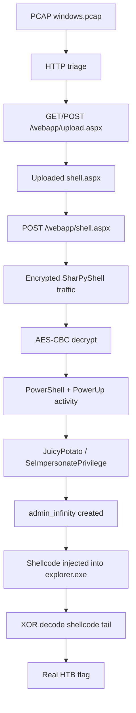
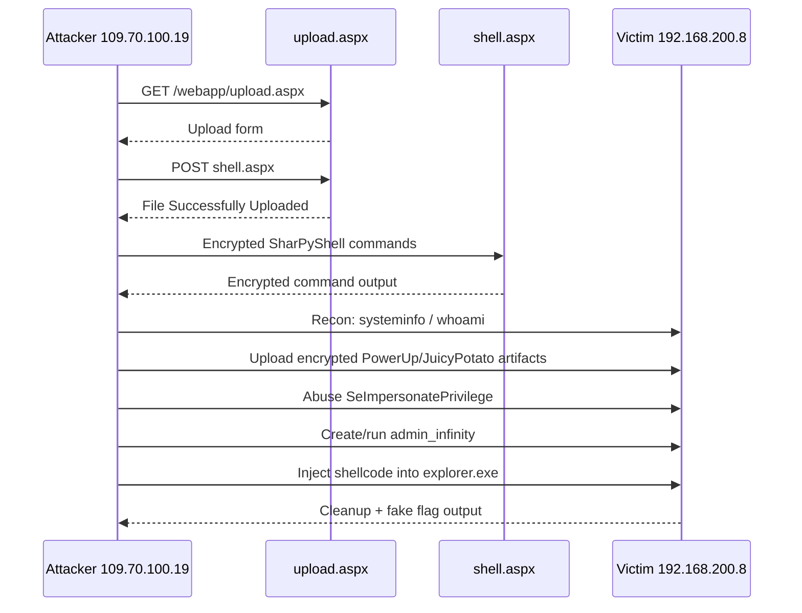

<!--
  HTB Write-up: Window's Infinity Edge
  Best viewed in Obsidian Reading View, VS Code Markdown Preview, Typora, or any Markdown renderer with Mermaid support.
  CSS animations are optional visual polish. If your renderer strips <style>, the technical content still remains fully readable.
-->

<style>
:root {
  --bg: #0b1020;
  --panel: #111827;
  --panel2: #172033;
  --text: #e5e7eb;
  --muted: #9ca3af;
  --cyan: #38bdf8;
  --green: #22c55e;
  --yellow: #facc15;
  --orange: #fb923c;
  --red: #ef4444;
  --purple: #a78bfa;
}

.hero {
  border: 1px solid rgba(56, 189, 248, 0.25);
  border-radius: 18px;
  padding: 24px;
  margin: 18px 0;
  background:
    radial-gradient(circle at top left, rgba(56, 189, 248, 0.20), transparent 35%),
    radial-gradient(circle at bottom right, rgba(167, 139, 250, 0.18), transparent 40%),
    linear-gradient(135deg, #0b1020, #111827);
  color: var(--text);
  box-shadow: 0 0 35px rgba(56, 189, 248, 0.12);
  position: relative;
  overflow: hidden;
}

.hero::after {
  content: "";
  position: absolute;
  top: 0;
  left: -75%;
  width: 45%;
  height: 100%;
  background: linear-gradient(90deg, transparent, rgba(255,255,255,0.12), transparent);
  animation: scan 5s infinite;
}

@keyframes scan {
  0% { left: -75%; }
  45% { left: 120%; }
  100% { left: 120%; }
}

.badge {
  display: inline-block;
  padding: 4px 10px;
  border-radius: 999px;
  margin: 3px 5px 3px 0;
  font-size: 0.85em;
  background: rgba(56, 189, 248, 0.12);
  border: 1px solid rgba(56, 189, 248, 0.30);
  color: #bae6fd;
}

.flagbox {
  border: 1px solid rgba(34, 197, 94, 0.35);
  background: rgba(34, 197, 94, 0.08);
  border-radius: 14px;
  padding: 16px;
  margin: 16px 0;
  box-shadow: 0 0 26px rgba(34, 197, 94, 0.08);
  animation: pulse 2.4s infinite;
}

@keyframes pulse {
  0%, 100% { box-shadow: 0 0 18px rgba(34, 197, 94, 0.07); }
  50% { box-shadow: 0 0 32px rgba(34, 197, 94, 0.22); }
}

.warnbox {
  border-left: 4px solid var(--orange);
  background: rgba(251, 146, 60, 0.08);
  padding: 12px 14px;
  border-radius: 10px;
  margin: 14px 0;
}

.step {
  border-left: 3px solid var(--cyan);
  background: rgba(56, 189, 248, 0.06);
  padding: 12px 14px;
  margin: 12px 0;
  border-radius: 8px;
}

.kpi-grid {
  display: grid;
  grid-template-columns: repeat(auto-fit, minmax(180px, 1fr));
  gap: 10px;
  margin: 14px 0;
}

.kpi {
  border: 1px solid rgba(255,255,255,0.08);
  border-radius: 12px;
  padding: 12px;
  background: rgba(17, 24, 39, 0.85);
}

.kpi strong {
  color: var(--cyan);
}

kbd {
  background: #111827;
  border: 1px solid rgba(255,255,255,0.18);
  border-radius: 5px;
  padding: 1px 6px;
}
</style>

<div class="hero">

# 🪟 Window's Infinity Edge — Hack The Box Write-up

**Category:** Forensics / Malware Traffic Analysis  
**Artifact:** `windows.pcap` inside password-protected ZIP  
**Password:** `hackthebox`  
**Core idea:** The host looked clean because the remaining attacker activity was hidden inside an uploaded ASPX webshell and an encrypted SharPyShell command channel.

<span class="badge">PCAP Analysis</span>
<span class="badge">ASPX Webshell</span>
<span class="badge">SharPyShell</span>
<span class="badge">AES-CBC</span>
<span class="badge">Shellcode</span>
<span class="badge">XOR Decode</span>

</div>

<div class="flagbox">

## ✅ Final Flag

```text
HTB{F1n4lly_y0u_cr0ss3d_th3_edg3!}
```

</div>

<div class="warnbox">

## ⚠️ Fake Flag Trap

The challenge contains at least one fake/troll flag:

```text
HTB{TH1s_1s_N0t_4_TRo11}
```

This is not the real flag. It appears in decrypted attacker commands and is intentionally placed to make basic `strings | grep HTB` analysis fail.

</div>

---

# 1. Initial Extraction

The supplied archive was password-protected. The password was given as `hackthebox`.

```bash
unzip 'windows hard.zip'
# password: hackthebox
```

The extracted capture was:

```text
2019-11-12_21:00:30-EXT07.pcap
```

For convenience, I renamed or referenced it as:

```text
windows.pcap
```

---

# 2. PCAP Baseline Triage

First, I checked basic PCAP metadata.

```bash
capinfos windows.pcap
```

Important output:

```text
File type:           Wireshark/tcpdump/... - pcap
Encapsulation:       Ethernet
Number of packets:   4,403
File size:           4,912 kB
Capture duration:    164.573019 seconds
Earliest packet time: 2019-11-13 00:57:25.951900
Latest packet time:   2019-11-13 01:00:10.524919
```

<div class="kpi-grid">
  <div class="kpi"><strong>Packets</strong><br>4,403</div>
  <div class="kpi"><strong>Duration</strong><br>~164 seconds</div>
  <div class="kpi"><strong>Size</strong><br>~4.9 MB</div>
  <div class="kpi"><strong>Traffic Type</strong><br>HTTP webshell channel</div>
</div>

The PCAP is small, so the correct strategy is not broad hunting. The correct strategy is to reconstruct the few HTTP streams and inspect the uploaded content.

---

# 3. Endpoint and Conversation Review

The interesting traffic was between:

```text
Attacker / C2: 109.70.100.19
Victim IIS:    192.168.200.8:80
```

Useful triage commands:

```bash
tshark -r windows.pcap -q -z conv,ip

tshark -r windows.pcap -q -z conv,tcp

tshark -r windows.pcap -Y "http.request" -T fields \
  -e frame.number \
  -e ip.src \
  -e ip.dst \
  -e http.host \
  -e http.request.method \
  -e http.request.uri \
  -e http.user_agent
```

The important HTTP paths were:

```text
GET  /webapp/upload.aspx
POST /webapp/upload.aspx
POST /webapp/shell.aspx
```

The capture showed two stages:

| Stage | Path | Meaning |
|---|---|---|
| 1 | `/webapp/upload.aspx` | Attacker accessed the upload page and uploaded a file. |
| 2 | `/webapp/shell.aspx` | Attacker used the uploaded ASPX webshell as a command channel. |

---

# 4. Attack Flow Overview



---

# 5. Recovering the Uploaded Webshell

HTTP object extraction is the fastest way to find the uploaded ASPX payload.

```bash
mkdir -p exported

tshark -r windows.pcap --export-objects http,exported

find exported -type f -maxdepth 1 -exec file {} \;
```

The upload request contained an ASPX webshell named:

```text
shell.aspx
```

The server response confirmed the upload succeeded:

```text
File Successfully Uploaded
```

Inside `shell.aspx`, this line immediately stood out:

```csharp
string p = "4d65bdbad183f00203b1e80cf96fba549663dabeab12fab153a921b346975cdd";
string r = Request.Form["data"];
```

This tells us two important things:

1. The webshell expects a POST form field called `data`.
2. The long hex string is a crypto key or password used by the shell runtime.

The file also dynamically loads a class named `SharPy`:

```csharp
object o = aS.CreateInstance("SharPy");
```

That identifies the command channel as **SharPyShell-style encrypted ASPX traffic**.

---

# 6. Why Basic String Search Misleads You

A direct flag search finds troll content:

```bash
strings -a windows.pcap | grep -i 'HTB'
```

One of the visible/decrypted results is:

```text
HTB{TH1s_1s_N0t_4_TRo11}
```

Later decrypted PowerShell also writes another fake flag:

```powershell
Write-Output "HTB{0K_TH1s_1s_4_TR011!}" | Out-File C:\windows\temp\flag.txt
```

These are not the solution. The real flag is hidden deeper, inside shellcode used later in the intrusion chain.

---

# 7. Understanding the SharPyShell Encryption

The shell channel was AES-CBC encrypted.

Recovered values:

```text
AES key = 4d65bdbad183f00203b1e80cf96fba549663dabeab12fab153a921b346975cdd
AES IV  = infinity_edgehtb
```

The key comes from the ASPX webshell. The IV appears in the compiled SharPy runtime logic and is visible from the recovered runtime strings.

Useful confirmation:

```bash
strings -a SharPy.dll | grep -i infinity
```

Output:

```text
infinity_edgehtb
```

So every meaningful `POST /webapp/shell.aspx` body needs to be:

```text
multipart form-data
→ data=<base64 ciphertext>
→ AES-CBC decrypt
→ C# / PowerShell / command output
```

---

# 8. Decrypting the Webshell Channel

The decryption logic is straightforward:

```python
from Crypto.Cipher import AES
from Crypto.Util.Padding import unpad
import base64

key = bytes.fromhex("4d65bdbad183f00203b1e80cf96fba549663dabeab12fab153a921b346975cdd")
iv = b"infinity_edgehtb"

ciphertext = base64.b64decode(data_field)
plaintext = AES.new(key, AES.MODE_CBC, iv).decrypt(ciphertext)
plaintext = unpad(plaintext, 16)
```

In the final solver, I parsed the PCAP, reconstructed TCP streams, extracted HTTP messages, pulled each `data` field, base64-decoded it, and decrypted it.

The decrypted material revealed normal attacker operations:

```text
GetTempDirectory()
GetEnvDirectory("x1fvogijp5pyzn7")
dir C:\Windows\Temp
systeminfo
whoami /all
mkdir infinity_edge
PowerUp privilege checks
JuicyPotato execution
RunAs admin_infinity
explorer.exe shellcode injection
cleanup / timestomping
```

---

# 9. Decrypted Activity Timeline



---

# 10. Key Decrypted Evidence

## 10.1 System information

The host was Windows Server 2012 R2:

```text
OS Name:    Microsoft Windows Server 2012 R2 Standard
OS Version: 6.3.9600 N/A Build 9600
System:     x64-based PC
IP:         192.168.200.8
```

## 10.2 Webshell execution context

The shell was running as the IIS application pool identity:

```text
User Name: iis apppool\defaultapppool
```

The privilege that matters:

```text
SeImpersonatePrivilege        Enabled
```

This is a classic path to token impersonation abuse on older Windows/IIS setups.

## 10.3 PowerUp confirms the privilege path

The decrypted PowerUp output showed:

```text
[*] Checking for Process Token Privileges...
Privilege   : SeImpersonatePrivilege
Attributes  : SE_PRIVILEGE_ENABLED_BY_DEFAULT, SE_PRIVILEGE_ENABLED
```

## 10.4 JuicyPotato-style SYSTEM execution

One decrypted response showed COM token abuse:

```text
Testing: {4991d34b-80a1-4291-83b6-3328366b9097} - 48278
startCOMListener bindresult: 0
[+] authResult: 0
{4991d34b-80a1-4291-83b6-3328366b9097}: NT AUTHORITY\SYSTEM
[+] CreateProcessWithTokenW OK
```

That explains the privilege escalation from IIS context to SYSTEM-assisted account creation/execution.

## 10.5 Admin user created

The decrypted command chain later used:

```text
admin_infinity : Password2!
```

And `whoami /all` confirmed administrator context:

```text
win-nqb1dmlmhve\admin_infinity
BUILTIN\Administrators
SeDebugPrivilege Enabled
SeImpersonatePrivilege Enabled
```

---

# 11. The Fake Flag Placement

Later in the chain, the attacker executed:

```csharp
ExecCmd(@"echo HTB{TH1s_1s_N0t_4_TRo11}", @"C:\inetpub\wwwroot\webapp")
```

The decrypted response printed:

```text
HTB{TH1s_1s_N0t_4_TRo11}
```

This is why simply following the command output is wrong. The challenge specifically wants the analyst to keep digging.

---

# 12. Important Turning Point: Shellcode Injection

The real flag was not in the normal decrypted command output. It was inside the shellcode injected into `explorer.exe`.

The decrypted traffic showed:

```text
name        : explorer.exe
commandline : "C:\Windows\Explorer.EXE" /LOADSAVEDWINDOWS
processid   : 136
```

Then:

```text
Trying to open running process with pid 136
Correctly opened a handle on process explorer.exe with pid 136
Allocated memory RWX for code of 1024 bytes
Code written into remote process. Bytes written: 1024
Using CreateRemoteThread...
Remote Thread started!
Code executed left in background as an async thread in the process 'explorer.exe' with pid 136
```

That tells us the final payload is in a small shellcode blob, not in the visible command transcript.

---

# 13. Extracting the Shellcode Blob

The decrypted SharPyShell C# contained variables like:

```csharp
string shellcodeBase64 = "H4sIACYPy10C//...";
byte[] shellcodeCompressed = Convert.FromBase64String(shellcodeBase64);
byte[] shellcodeByteArr = Decompress(shellcodeCompressed);
```

So the extraction process was:

```text
shellcodeBase64 string
→ base64 decode
→ gzip decompress
→ raw shellcode bytes
```

A compact extractor:

```python
import base64
import gzip
import re
from pathlib import Path

for file in Path("decrypted").glob("*req.bin"):
    data = file.read_bytes()
    for m in re.finditer(br'string\s+shellcodeBase64\s*=\s*"([A-Za-z0-9+/=]+)";', data):
        raw = base64.b64decode(m.group(1))
        try:
            shellcode = gzip.decompress(raw)
        except Exception:
            shellcode = raw
        out = Path("shellcodes") / f"{file.stem}_shellcode.bin"
        out.parent.mkdir(exist_ok=True)
        out.write_bytes(shellcode)
        print(out, len(shellcode))
```

Recovered shellcode blobs included:

```text
msg18_shellcodeBase64.bin             348672 bytes
msg18_threadParametersBase64.bin         527 bytes
msg22_shellcodeBase64.bin                501 bytes
```

The interesting one is the small `msg22_shellcodeBase64.bin`, because this was the payload injected into `explorer.exe`.

---

# 14. Recovering the XOR Key

The decrypted command chain revealed this line:

```text
echo xGk89_Ew > C:\xor.k
```

That gives the XOR key:

```text
xGk89_Ew
```

The small shellcode blob had an obfuscated tail. Decoding the bytes from offset `380` using this key revealed the final command.

---

# 15. XOR Decoding the Shellcode Tail

Command used:

```bash
python3 - << 'PY'
from pathlib import Path
import re

key = b"xGk89_Ew"
blob = Path("shellcodes/msg22_shellcodeBase64.bin").read_bytes()

# The meaningful obfuscated command starts at offset 380.
decoded = bytes(blob[380 + i] ^ key[i % len(key)] for i in range(len(blob) - 380))

print(decoded.decode("latin1", errors="replace"))

for flag in re.findall(rb"HTB\{[^}]+\}", decoded):
    print(flag.decode())
PY
```

Decoded shellcode tail:

```text
cmd.exe /c echo HTB{F1n4lly_y0u_cr0ss3d_th3_edg3!} > C:\windows\temp\infinity_edge\flag.txt
```

Therefore, the real flag is:

```text
HTB{F1n4lly_y0u_cr0ss3d_th3_edg3!}
```

---

# 16. Full Decryption + Flag Solver

This is the logic used by the final solver:

```mermaid
graph LR
    A[ZIP / PCAP] --> B[Extract PCAP]
    B --> C[Parse Ethernet/IP/TCP]
    C --> D[Reassemble TCP streams]
    D --> E[Parse HTTP messages]
    E --> F[Extract multipart data field]
    F --> G[Base64 decode]
    G --> H[AES-CBC decrypt]
    H --> I[Find shellcodeBase64]
    I --> J[Base64 + GZip decompress]
    J --> K[Find XOR key]
    K --> L[XOR shellcode offset 380]
    L --> M[Filter fake flags]
    M --> N[Print real flag]
```



Run the provided solver:

```bash
python3 -m pip install cryptography
python3 window_infinity_edge_solve.py "windows hard.zip"
```

Expected output:

```text
HTB{F1n4lly_y0u_cr0ss3d_th3_edg3!}
```

---

# 17. Manual Reproduction Commands

## 17.1 Extract archive

```bash
unzip 'windows hard.zip'
# password: hackthebox
```

## 17.2 Check capture metadata

```bash
capinfos windows.pcap
```

## 17.3 List HTTP requests

```bash
tshark -r windows.pcap -Y "http.request" -T fields \
  -e frame.number \
  -e ip.src \
  -e ip.dst \
  -e http.host \
  -e http.request.method \
  -e http.request.uri \
  -e http.user_agent | column -t
```

## 17.4 Export HTTP objects

```bash
mkdir -p exported

tshark -r windows.pcap --export-objects http,exported

find exported -type f -maxdepth 1 -exec file {} \;
```

## 17.5 Search for suspicious ASPX / SharPyShell strings

```bash
grep -RaniE 'shell\.aspx|SharPy|Request.Form|AES|HTB|data' exported/
```

## 17.6 Extract encryption material

```bash
strings -a shell.aspx | grep -E '4d65|Request.Form|SharPy'
strings -a SharPy.dll | grep -i infinity
```

Expected values:

```text
key = 4d65bdbad183f00203b1e80cf96fba549663dabeab12fab153a921b346975cdd
iv  = infinity_edgehtb
```

## 17.7 Decrypt SharPyShell messages

Use AES-CBC with the recovered key and IV.

```python
from Crypto.Cipher import AES
from Crypto.Util.Padding import unpad
import base64

key = bytes.fromhex("4d65bdbad183f00203b1e80cf96fba549663dabeab12fab153a921b346975cdd")
iv = b"infinity_edgehtb"

pt = AES.new(key, AES.MODE_CBC, iv).decrypt(base64.b64decode(data))
pt = unpad(pt, 16)
print(pt.decode(errors="ignore"))
```

## 17.8 Extract and decode final shellcode

```bash
python3 - << 'PY'
from pathlib import Path
import re

key = b"xGk89_Ew"
blob = Path("shellcodes/msg22_shellcodeBase64.bin").read_bytes()

decoded = bytes(blob[380 + i] ^ key[i % len(key)] for i in range(len(blob) - 380))
print(decoded.decode("latin1", errors="replace"))

for flag in re.findall(rb"HTB\{[^}]+\}", decoded):
    print(flag.decode())
PY
```

---

# 18. Why AntiVirus Missed It

The scenario said the implants were remediated, but one server still produced suspicious traffic. The missed component was not just a normal executable implant. The activity lived in web/application-layer artifacts:

| Missed Artifact | Why It Matters |
|---|---|
| `shell.aspx` | Persistent webshell uploaded into the IIS web root. |
| Encrypted `data` parameter | Command traffic did not appear as plaintext commands in the PCAP. |
| SharPyShell runtime | Dynamic C# execution hid attacker intent until decryption. |
| PowerShell + uploaded modules | Attacker staged tooling under `C:\Windows\Temp`. |
| Explorer shellcode injection | Final payload was executed in a legitimate GUI process. |
| Timestomping | The attacker modified `shell.aspx` timestamps to match `upload.aspx`. |

The key defensive lesson: cleaning known binaries is not enough. You also need web root integrity checks, IIS log review, upload handler auditing, suspicious ASPX detection, encrypted form-field anomaly detection, and memory/process injection telemetry.

---

# 19. Detection Notes

Good detection points from this challenge:

```text
POST /webapp/upload.aspx uploading .aspx file
Repeated POST /webapp/shell.aspx with multipart data field
Large base64-looking form-data values
IIS worker identity executing systeminfo/whoami/PowerShell
SeImpersonatePrivilege abuse from IIS context
JuicyPotato-style COM activity
New local admin: admin_infinity
RWX memory allocation into explorer.exe
CreateRemoteThread against explorer.exe
Timestomping shell.aspx to match upload.aspx
```

Potential Sigma-style logic:

```text
IIS process w3wp.exe spawning cmd.exe or powershell.exe
ASPX file written into web root
PowerShell accessing C:\Windows\Temp staging directories
CreateRemoteThread into explorer.exe
Local user creation followed by Administrators group usage
```

---

# 20. Final Answer

```text
HTB{F1n4lly_y0u_cr0ss3d_th3_edg3!}
```

---

# Appendix A — Minimal Final Solver Logic

```python
#!/usr/bin/env python3
import base64
import gzip
import re
from pathlib import Path
from Crypto.Cipher import AES
from Crypto.Util.Padding import unpad

KEY = bytes.fromhex("4d65bdbad183f00203b1e80cf96fba549663dabeab12fab153a921b346975cdd")
IV = b"infinity_edgehtb"
XOR_KEY = b"xGk89_Ew"
FAKE = b"HTB{TH1s_1s_N0t_4_TRo11}"

# 1. Reassemble HTTP from PCAP.
# 2. Extract multipart data=<base64 ciphertext> from POST /webapp/shell.aspx.
# 3. AES-CBC decrypt every message.
# 4. Find shellcodeBase64 strings.
# 5. base64 decode + gzip decompress shellcode.
# 6. XOR decode shellcode from offset 380.
# 7. Print HTB flags that are not the fake one.
```

---

# Appendix B — Analyst Summary

The suspicious server still had a malicious ASPX webshell in the IIS web root. The attacker communicated with it using SharPyShell, where commands and outputs were encrypted with AES-CBC and sent through a `data` form field. After decrypting the traffic, the visible command history showed recon, PowerUp checks, SeImpersonatePrivilege abuse, JuicyPotato-style privilege escalation, and an administrator account named `admin_infinity`. The obvious HTB-looking strings were fake. The real flag was hidden in the final shellcode injected into `explorer.exe`; decoding the shellcode tail with XOR key `xGk89_Ew` exposed the command writing the real flag to `C:\windows\temp\infinity_edge\flag.txt`.

